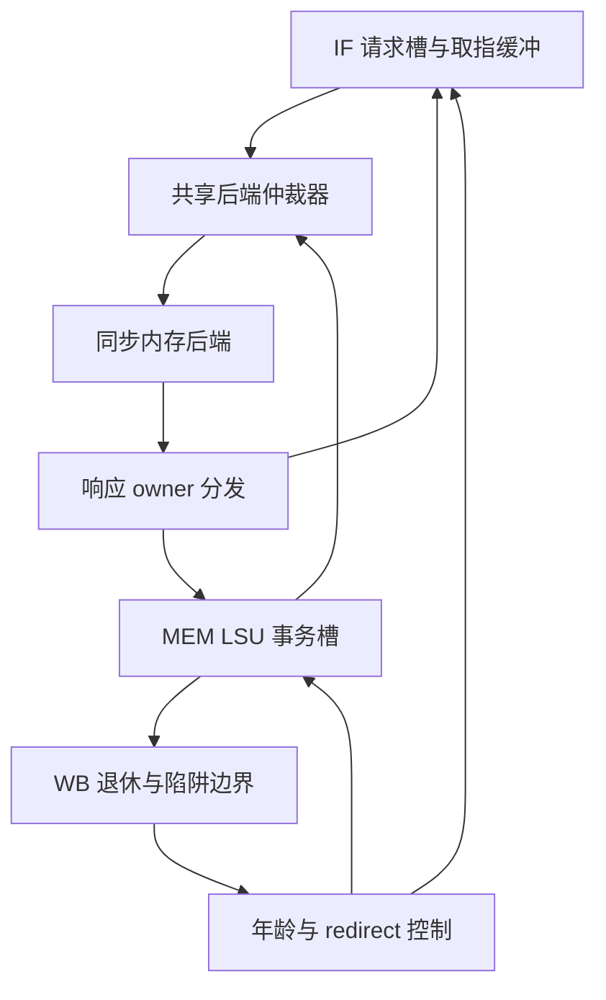
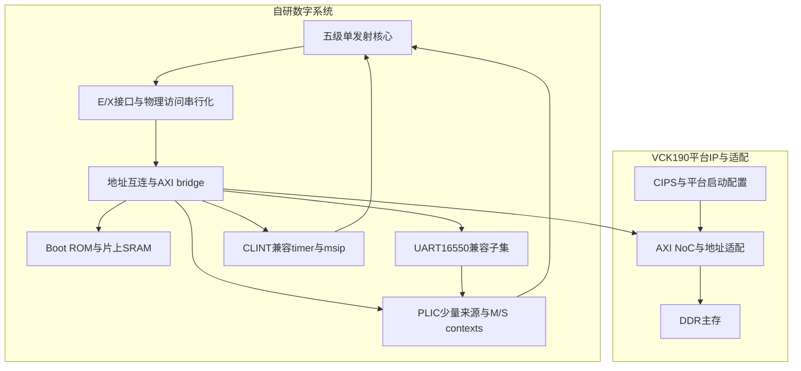

# 自研 RISC-V CPU：从阶段 E 到 Linux 与顺序双发射的完整设计路线

> 文档版本：v0.1，设计基线草案；编制日期：2026-10-12。  
> 起点：现有 D5 为历史基线；2026-10-18 E 首版已实现，范围与证据见 [E 验收记录](../cpu-fuzzing/e-acceptance.md)。  
> 终点：两次 VCK190 系统验收——先单发射 Linux SoC，再带三级分支预测的顺序双发射 Linux SoC。  
> 本文沿用原文的 E / F / G / H / I / J 名称；把精确异常独立记为 X，把 Linux 能力记为 L，把两次板级验收记为 P1 / P2。编号表达依赖关系，不按字母排序。

## 0 阅读方式、范围与状态含义

### 0.1 本文要交付什么

本文从当前已形成的固定时延五级核出发，给出完整的设计目标、模块责任、跨模块合同、分步实施顺序、验证场景、故障负例、阶段产物和退出条件。它既是后续架构文档的主干，也是每个阶段建立实施计划和验收记录时的共同依据。

项目分为两个有明确交接点的大阶段：

1. **大阶段一：自研五级单发射 CPU 与 Linux 最小 SoC。** 先使流水线正确应对可变访存延迟，再完成精确异常、AXI、RTL 外设、缓存、M/S/U、Sv32 和原子操作。在 VCK190 的 PL 中运行自研 RISC-V CPU，由它执行 OpenSBI、Linux 与用户态程序，完成第一次板级验收。
2. **大阶段二：自研三级预测前端与顺序双发射 CPU。** 在第一阶段已验收版本上先加入单发射预测，再参考固定版本 Nanhu 的三级预测机制，扩大指令供给、译码和执行宽度，保持顺序发射与精确提交，最后在同一板卡完成第二次验收。

完成标准覆盖架构正确性、协议正确性、设备副作用、系统功能、可综合性、板级运行和可重复的性能测量。运行到某个启动打印只构成一个里程碑。

### 0.2 本文使用的三种状态

| 标记 | 含义 | 可据此做出的判断 |
| --- | --- | --- |
| 现状／已有记录 | 来自用户提供的 `cpu.md`；保留原记录的版本和场景边界 | 可以决定从哪里继续，不能替代当前 RTL 复验 |
| 建议基线 | 本文为使路线可实施而提出的配置或策略 | 后续可经设计评审修改；修改时必须更新受影响的合同和验证 |
| 待实现／待验收 | 后续需要完成的 RTL、工具、测试或工程产物 | 不表示对应模块已存在，也不表示测试已通过 |

本文没有取得当前完整 RTL 仓库、原文全部链接文档、仿真产物或板卡工程。本次完成的是架构与实施路线设计、来源核对、交叉审阅和文档检查，没有运行新的 CPU 仿真或 FPGA 实验。[S01]

原文提到的流片、乱序、Tomasulo、寄存器重命名、ROB、向量、多核与一致性协议，保留为后续研究主题，不进入本次两个大阶段的完成条件。当前也不把原文的全部虚拟外设搬到 RTL：第一版 Linux 平台优先实现 UART、timer、软件中断和外部中断控制。

### 0.3 “核心自研”的工程边界

| 层次 | 本项目的实现责任 | 可以使用的参考或平台能力 |
| --- | --- | --- |
| CPU | 自研流水线、数据冒险、CSR、异常、中断、LSU、提交接口 | RISC-V 规范；CVA6 的模块划分、接口与验证思路 |
| 存储系统 | 自研 cache、TLB、PTW、维护协议、原子序列化 | CVA6 的责任分解；仿真存储模型和参考模型 |
| SoC 数字逻辑 | 自研内部互连、地址译码、bridge、Boot ROM 内容、基本外设 RTL | 通用 AXI 规范；公开兼容的 UART/CLINT/PLIC 软件接口 |
| 第二阶段前端 | 自研预测表、流水、历史、FTQ、恢复、训练和双发射适配 | 固定 Nanhu 版本的预测机制；不直接把完整 Nanhu 核作为成品替换 |
| FPGA 平台 | 自建工程、约束、复位、启动和测量闭环 | AMD CIPS、NoC、DDR 控制器、时钟／复位／调试等平台 IP |
| 软件与验证 | 自己完成平台适配、配置冻结、驱动验证与自动化验收 | OpenSBI、Linux、BusyBox、NEMU／Spike、编译工具链 |

需要区分两条启动链。Versal 的 PMC/PLM 完成器件与 DDR 等平台初始化；其后，自研 PL RISC-V CPU 从自己的 Boot ROM 进入 OpenSBI、Linux。AMD 文档要求 Versal 设计包含 CIPS；使用这些硬平台能力与自研 CPU 的目标并不冲突。[S09][S10]

“参考 CVA6 最新架构”的操作定义是：**在文档形成时核对官方仓库当前实现，选定 commit，记录参考内容，再独立设计。** 以后追踪上游更新应单独评审，不让正在验收的工程随 master 自动变化。

### 0.4 文档导航

| 章节 | 内容 | 阅读目的 |
| --- | --- | --- |
| 1 | 当前进展和继承边界 | 避免重做已完成部分，也避免扩大历史 PASS 的范围 |
| 2 | 版本参考、总体路线和两张架构图 | 先看清两个大阶段的目标结构 |
| 3 | ISA、地址图、时序、事务、异常与观测合同 | 冻结跨模块共同规则 |
| 4–7 | E、X、F、G | 从固定延迟仿真核走到可综合最小 SoC |
| 8–10 | H、L、P1 | 缓存、Linux 支持和第一次上板 |
| 11–15 | J1、J2、J3、J4、P2 | 预测、双发射、双提交和第二次上板 |
| 16 | 贯穿全程的 I：验证与 fuzzing | 建立统一证据、随机验证和失败定位方法 |
| 17 | 阶段交付、配置管理与风险 | 决定何时允许进入下一关口 |
| 18 | 从现在开始的实施顺序与待决项 | 把 E 阶段拆成可执行工作包 |
| 19 | 参考资料 | 固定参考身份，追溯事实依据 |

## 1 当前设计进展与 E 阶段起点

### 1.1 当前有效微结构

根据原文 2026-10-07 状态核对及 2026-10-11 D5 更新，当前核心是 RV32、单发射、IF/ID/EX/MEM/WB 五级流水线，已有四组带 valid 的级间寄存器。当前功能覆盖 RV32I/M 基础指令和 M 模式 CSR 子集；完整 S/U、MMU、可综合总线和 Linux 平台还未形成。[S01]

| 路径 | 当前有效逻辑 | E 及后续的继承要求 |
| --- | --- | --- |
| GPR | ID 读，WB 写；EX/MEM→EX、MEM/WB→EX、WB→ID | stall 后保存已解析操作数；不能依赖转发源一直留在原级 |
| EX 结果 | ALU、PC+4、CSR 旧值可供合法转发 | load 的有效地址不能当作 load 结果转发 |
| Store | 地址与写数据在 EX 获得转发 | 请求一旦呈现，地址、数据、掩码和属性必须稳定 |
| load-use | 固定内存模型下已有一拍处理 | 可变延迟下改为依赖结果可用性，不能固定数一拍 |
| 控制转移 | JAL 在 ID；Branch/JALR 在 EX；ECALL/MRET 在 WB | 允许保持位置，但所有 redirect 必须带有效性、年龄和一次性授权 |
| CSR | EX 读／计算，WB 更新；已有 CSR 数据与状态 RAW 处理 | 扩展后维护特权合法性、别名、WARL 及串行化 |
| 存储端口 | 独立 mem_port、MEM 优先、固定时延；组合读、边沿写 | E 用明确的请求接受与响应完成替换隐含完成 |
| 事件／REF | 提交级事件、MMIO 标记、实际 IRQ 接受事件 | 等待不推进 REF；新增同步 trap、可变延迟及双提交合同 |

原文末尾的 B/C 历史推导不覆盖更新后的有效结构。后续不把“所有分支都在 ID”当作当前前提，也不把已完成的 CSR 旧值转发再次列为待实现。[S01]

### 1.2 已有成果的证据边界

| 能力／程序 | 当前可继承的结论 | 进入新阶段时的处理 |
| --- | --- | --- |
| D2 / D3 / D4 | 指定数据、控制及 CSR 场景已有验收 | 原场景继续作为回归；等待与新异常组合需新增用例 |
| D5 | 固定时延共享端口、MMIO 消费、kill/恢复及控制碰撞指定场景闭环 | 复用刺激和独立计数思路；重新定义 req/resp 采样点 |
| CoreMark 1000 | 有历史验收记录；部分原始产物目录在原文核对时不可得 | 保留历史结论，必要时重新归档当前版本完整运行 |
| RT-Thread 启动、delay、抢占 | 指定配置有程序和 Difftest 证据；部分产物可核对 | 后续迁移到 RTL timer 与外设后建立独立系统验收 |
| cpu-tests 35/35、MicroBench | 用户反馈通过，待版本绑定归档／复验 | 不写“未运行”，也不写成已独立复验 |
| 调试与日志 | 提交触发路径已有，日志失配负例已有 | 接口变更后重新检查 DPI／probe 资格和日志完整性 |
| SoC、cache、Linux、预测、双发射 | 未实现或未形成闭环 | 全部采用“待实现／待验收”状态 |

本次文档依据的附件 SHA-256 为：

~~~text
eae6c7a9c5bd7b9d911214bbaf9b3cc5719f99621792cd6f6c85675e4f94a5ed
~~~

该摘要只标识本次读取的文档，不是 RTL 仓库、REF、软件镜像或全部验收证据的摘要。

### 1.3 为什么从 E 开始

当前固定时延模型把“想访问”“被允许访问”“已拿到数据”“可提交”压在很短的路径内。进入 AXI、DDR 和 cache miss 后，这些事件会相隔多个甚至大量周期。E 的核心任务是把这些时间边界显式化，并让流水线在等待期间保持正确状态。

E 之后立刻加入 X，是因为总线接受的写入和具有读副作用的设备访问无法通过清空流水线 valid 撤回。若精确异常与不可撤销许可没有形成合同，后续接上真实 UART、PLIC 或 DDR 只会放大问题。

从现在开始的顺序因此是：先锁定基线证据和接口，再实现 E；在 E 的请求状态中预留并接入 X；完成 E+X 后推进 F/G，随后 H/L，最终 P1。第二大阶段的 RTL 主线从 P1 已验收版本分出。

## 2 参考架构、两大阶段与总体结构

### 2.1 CVA6 参考版本及采用方式

本次核对的 CVA6 官方仓库为 `openhwfoundation/cva6`，参考 commit：

~~~text
81245a47fad8fe1a5d562d953ef2662e099def76
~~~

这是本次检索时官方 master 的已读取快照，提交日期为 2026-09-15；不把它称为经过本项目验证的“稳定发行版”。官方总体描述为可配置六级核。其模块边界和当前配置实现值得借鉴，但本项目保留五级主流水，不因参考 CVA6 而强制改成相同级数。[S02]

| 参考点 | 对本项目的具体用途 | 适配边界 |
| --- | --- | --- |
| PC／fetch、decode、issue、execute、commit 的责任分解 | 明确“供给、许可、执行完成、架构提交”是不同事件 | 本项目先映射到五个主级和局部多周期状态机 |
| issue／scoreboard／commit | 学习依赖、长延迟结果与顺序提交的合同 | 保守五级和受限双发射不以 ROB、重命名为前提 |
| RV32 IMA Sv32 FPGA 配置 | 证明官方代码中存在与本路线接近的 RV32/S/U/MMU 组合 | 参数和平台不直接照搬；本项目自行验证 |
| LSU、cache、MMU、PTW | 借鉴独立请求、错误、维护、地址翻译责任 | 选择更小的 blocking、write-through 结构 |
| 可配置 superscalar 路径 | 区分发射宽度、提交宽度和取指宽度 | 以 build_config 后的有效参数为准，不能只看原始配置字段 |

固定版本的 `cv32a6_ima_sv32_fpga_config_pkg.sv` 配置包含 RV32、A、S/U、Sv32/MMU，关闭 C/F/D，采用单发射与 write-through 路径。另一方面，启用 Superscalar 的配置及 `build_config_pkg.sv` 会改变有效发射／提交／取指等宽度；不能把某一个双发射配置的 ISA/特权开关直接解释成 Linux 目标配置。[S03][S04]

### 2.2 Nanhu 参考版本及采用方式

第二阶段参考 XiangShan Nanhu 固定 commit：

~~~text
997cd5b35cfbd26586674aa553d0f04b27914cb2
~~~

这个固定版本的参数文件实际实例化的是 **FauFTB** 作为快一级预测器，组合 FTB、TAGE/SC、ITTAGE 和 RAS。旧 Nanhu 文档中的 uBTB 叫法与此处代码命名／结构存在差异，后续设计以固定代码和明确记录的适配为准。[S11][S12][S17]

本项目采用其“快速初猜、后级覆盖、携带预测元数据、可恢复历史、提交训练”的机制，再为小型顺序核设计容量、流水、接口和队列。三级预测不等于三级后端，也不等于一次发射三条指令。Nanhu 原核的乱序执行资源不属于本项目第二阶段必需结构。[S12][S13]

### 2.3 路线总表与硬关口

下表中的退出条件是后续验收要求，全部尚待实施。阶段可以提前做规范阅读、测试模型和模块草图，但不能以并行准备代替前置关口。

| 阶段 | 主要新增能力 | 必须带入的前置能力 | 主要退出证据 |
| --- | --- | --- | --- |
| E | 同步 req/resp、可变延迟、hold/backpressure、响应身份 | D5 固定时延基线 | 协议、一次性事件、旧响应丢弃、等待／碰撞与 Difftest |
| X | 精确异常、Store/MMIO 不可撤销许可、IRQ 安全边界 | E 事务状态和动态指令身份 | 最老故障正确、年轻无副作用、排空与恢复 PC、错误负例 |
| F | AXI4 bridge，先单拍、单 outstanding | E+X | 五通道独立背压、错误映射、无重复／丢失、进度界 |
| G | Boot ROM、SRAM、UART、RTL timer/IRQ、译码 | F 与精确提交 | 可综合顶层、裸机／RT、外设行为、复位启动 |
| H | blocking I/D cache、MMIO bypass、维护、统计 | G 稳定请求和物理地址属性 | refill／错误／冲突／fence.i／写穿透一致性 |
| L | M/S/U、A、Sv32、TLB/PTW、SBI、Linux | X/H 与平台地址图 | ISA/特权/MMU/原子测试；仿真 OpenSBI→Linux→用户态 |
| P1 | VCK190 单发射 SoC 验收 | G/H/L 全部关口 | 可复建工程、约束／时序、DDR、Linux、压力与恢复 |
| J1 | 单发射动态预测和执行纠错 | P1 冻结版本 | 预测身份、训练、错误恢复、性能计数及系统回归 |
| J2 | FauFTB→FTB/TAGE/RAS→SC/ITTAGE 三级预测 | J1 稳定前端合同 | s2/s3 覆盖、历史恢复、FTQ 生命周期、长等待与回绕 |
| J3 | 双指令供给、双译码、受限顺序双发射 | J2+足够供给 | 配对矩阵、4R2W、阻塞、顺序完成和正确提交 |
| J4 | 双提交验证闭环、特权与 Linux 系统回归 | J3 正确提交实现 | 逐条 REF、前缀退休、trap/IRQ、用户态和长程序 |
| P2 | VCK190 预测双发射验收 | J4 | 二次板级稳定性，公平性能／资源／时序对照 |
| I | 定向、随机、覆盖、最小化与证据归档 | 从 E 即启动 | 每阶段独立检查器和可重放失败；持续实施 |

G 完成后可以进行一次 BRAM/UART 的板级冒烟实验，帮助提早发现封装、复位、串口和时钟问题。该实验是 P1 的准备活动；P1 完整通过仍要求自研核真正运行 Linux 用户态。

### 2.4 大阶段一架构图：五级单发射 Linux SoC

下图表示 P1 目标状态，并非当前 RTL。实线表示主要数据／请求方向；虚线表示控制、维护、异常和观测。ITLB、DTLB 和 cache 的实际 ready/valid 返回路径在模块合同中双向定义，图中不逐根展开。

~~~mermaid
flowchart TB
  subgraph C1["自研 CPU：五级主流水"]
    direction LR
    IF1["IF 取指"] --> ID1["ID 译码 / 读寄存器"]
    ID1 --> EX1["EX ALU / 分支 / M"]
    EX1 --> MEM1["MEM 访存等待"]
    MEM1 --> WB1["WB 顺序提交"]
  end
  CTRL1["年龄仲裁 / stall / flush / 精确异常"] -.-> IF1
  CTRL1 -.-> EX1
  WB1 -.-> CTRL1
  CSR1["M/S/U CSR / trap / IRQ"] <--> WB1
  WB1 -.-> TRACE1["retire / trap / IRQ / 事务 trace"]
  IF1 --> IT1["ITLB / PIPT I-cache"]
  MEM1 --> LS1["LSU / DTLB / PIPT D-cache"]
  IT1 --> PTW1["共享 Sv32 PTW"]
  LS1 --> PTW1
  IT1 --> SEQ1["物理访存序列化 / 原子 / 维护"]
  LS1 --> SEQ1
  PTW1 --> SEQ1
  SEQ1 -.-> LS1
  SEQ1 --> AXI1["自研 AXI4 bridge"]
  AXI1 --> SOC1["自研互连 / PMA / 地址译码"]
  SOC1 --> ROM1["Boot ROM / 调试 SRAM"]
  SOC1 --> DEV1["UART / CLINT / PLIC"]
  DEV1 -.-> CSR1
  SOC1 --> DDR1["AMD NoC / DDR"]
  PLAT1["AMD CIPS / PMC / 时钟复位"] -.-> DDR1
~~~

### 2.5 大阶段二架构图：三级预测与顺序双发射

下图表示 P2 目标结构。第二阶段复用第一阶段已经验收的 ISA、特权、MMU、cache、总线、外设与软件合同；具体容量变化应通过参数变更记录重新验收。

~~~mermaid
flowchart TB
  subgraph BP2["自研 Nanhu 风格三级预测"]
    direction LR
    S12["s1 FauFTB"] --> S22["s2 FTB / TAGE / RAS"]
    S22 --> S32["s3 SC / ITTAGE"]
  end
  FTQ2["FTQ / epoch / 分支位置 / 历史快照"]
  S12 --> FTQ2
  S22 -.-> FTQ2
  S32 -.-> FTQ2
  FTQ2 --> FETCH2["ITLB / I-cache 64-bit / 跨边界组装"]
  FETCH2 --> IQ2["指令队列 / s3 finalized 后交付"]
  IQ2 --> ID2["双译码 / 4R2W GPR / 配对检查"]
  ID2 --> EX02["slot0 完整 EX"]
  ID2 --> EX12["slot1 简单 ALU"]
  EX02 --> MEM2["单 LSU / MEM 等待"]
  EX12 --> HOLD2["slot1 结果暂存 / 等待组完成"]
  MEM2 --> WB2["按年龄前缀提交 / 每拍最多 2 条"]
  HOLD2 --> WB2
  EX02 -.-> REC2["执行纠错 / trap / IRQ 恢复"]
  WB2 -.-> REC2
  REC2 -.-> FTQ2
  REC2 -.-> BP2
  CSR2["复用 M/S/U CSR / trap / IRQ"] <--> WB2
  CSR2 -.-> REC2
  WB2 -.-> TRAIN2["提交训练 / FTQ 回收"]
  TRAIN2 -.-> BP2
  WB2 -.-> OBS2["双提交 trace / 逐条 Difftest"]
  MEM2 --> SYS2["复用 DTLB / D-cache / PTW / 原子"]
  FETCH2 --> SYS2
  SYS2 --> SOC2["复用 AXI / SoC / UART / timer / PLIC"]
  SOC2 --> FPGA2["VCK190 NoC / DDR / 平台初始化"]
  SOC2 -.-> CSR2
~~~

### 2.6 两张架构图的关键合同

**图 1 的关键阅读点：**

- 主流水仍是 IF/ID/EX/MEM/WB；cache miss、PTW、乘除和总线等待使相应阶段多周期停留，不要求每条指令恰好五拍。
- 提交点决定架构状态和精确异常；外部不可撤销访问的许可必须提前满足更老指令已无故障的条件。许可不等于退休。
- ITLB/DTLB 共享单 PTW；先完成地址翻译和权限检查，再按物理地址访问 PIPT cache 或设备。
- 普通访存、PTW 隐式访问、AMO/LRSC 经过统一的物理访存序列化规则。旁路写页表或原子写必须和 D-cache 失效、在途 refill 协调。
- SoC 上运行的 Linux 来自自研 RISC-V 核的启动链；AMD 平台资源负责器件初始化与外部存储接入。

**图 2 的关键阅读点：**

- s1/s2/s3 是可覆盖的预测流水，最终结果和历史快照属于同一动态预测块。s2/s3 覆盖与执行阶段的真实误预测分别记录。
- 首版允许 s1 提前发起取指，但对应块必须到达 s3 finalized 才向后端交付。这是本项目为简化恢复而提出的设计选择，需要容量和吞吐验证。
- slot0 能执行完整指令集合；slot1 初版只接受简单整数 ALU。一个周期可以发射零、一或两条，不保证任意相邻两条都能配对。
- 初版只有一个 LSU；分支、CSR、系统、fence 和原子等采取独占／串行规则。乘除及等待中的 slot0 不能被 slot1 或更年轻指令绕过。
- 最多双退休与双发射分别验收。所有结果按年龄前缀提交，故障指令不计普通退休，双提交观测必须保留两条指令之间的架构状态。

### 2.7 学习、实现、验证三条工作线如何协作

每个小阶段建立三个配套产物。设计说明解释规则和取舍；实现差异记录哪些模块、接口和状态新增或改变；验收记录给出可重放的输入、命令、观测点和结果。

阅读 CVA6 或 Nanhu 时，不以“读完整仓库”作为开工条件。围绕本阶段的问题建立参考映射，例如 E 阅读流水停顿和请求完成合同，X 阅读提交／控制器，H 阅读缓存维护，L 阅读 MMU/PTW，J 阅读预测元数据与历史恢复。每次阅读回答“这个机制解决什么不变量、我们的实现在哪里承担同一责任”。

允许提前搭建 L 的软件构建环境、P1 的板卡工程骨架以及 J 的离线预测模型，但正式通过阶段仍以表中的依赖为准。不得把尚未验证的多项新结构一次性合入唯一可运行基线后再统一定位。

## 3 全局设计合同与建议默认参数

### 3.1 第一版硬件与软件配置

以下参数是本文提出的基线，尚未实现或测量。采用这些数值是为了给接口、测试与软件构建一个明确起点；规模和频率调整需要记录。

| 维度 | 建议默认值 | 必须说明的边界 |
| --- | --- | --- |
| XLEN / hart / 字节序 | RV32、1 hart、小端 | 不把 RV64 当作 Linux 前置要求 |
| 硬件 ISA 能力 | RV32IMA + Zicsr + Zifencei + Zicntr | 以完整能力表、CSR 和软件探测一致性为准 |
| 编译基线 | `-march=rv32ima_zicsr_zifencei -mabi=ilp32` | 是允许编译器生成的子集；不否认实现的 Zicntr |
| 暂不实现 | C、F、D、V、H 及未声明扩展 | 使用软浮点软件；32 位指令、IALIGN=32 |
| 特权 / MMU | M/S/U、Bare + Sv32 | 实现 WARL、权限、trap 委派和返回规则 |
| 物理地址 | 内部 PADDR_W=34 | Sv32 可能生成 34 位 PA；高位不能悄悄截断 |
| ITLB / DTLB | 各 8 项、全相联，单 PTW | 4 KiB 和 4 MiB 页；ASIDLEN=0 可以作为首版选择 |
| cache | I/D 各 4 KiB、直接映射、32 B line、PIPT | blocking；先功能闭环，再增大规模 |
| D-cache 写策略 | write-through、no-write-allocate、无 write buffer | 普通写等外部响应；没有脏行不等于无需维护 |
| 总线 | AXI4、先单拍固定 ID、单 outstanding | 后续 cache refill 加 burst；五通道始终独立 |
| 原子 | RV32 A，LR.W/SC.W 与 AMO.W | 单 hart 仍需原子性、reservation、aq/rl 和 PTW 协调 |
| A/D 更新 | 硬件进行受序列化的原子 PTE 更新 | 不据此声称实现 Svadu 可配置扩展 |
| PMP | 首版固定 PMP_NUM=0 | M态标准PMP CSR字段恒零；PMA/总线区域约束仍实现 |
| trap 向量 | mtvec/stvec 仅 Direct 模式 | BASE 4B对齐，MODE按WARL回读 |
| UART | TX/RX各16-byte FIFO，reg-shift=0，reg-io-width=1 | 首次软件8N1；寄存器兼容、FIFO及中断仍需验收 |
| 计数器 | 64 位 cycle/time/instret 及 RV32 高低半部 | counteren 与只读别名正确，minstret 不计 trap 指令 |
| 系统软件 | OpenSBI + 自编译 Linux + BusyBox initramfs | 固定 tag/commit/config/ABI；不用 master/latest 作验收输入 |
| 板卡 | VCK190 | 本文将对话中的 VCK19 按 VCK190 路线整理 |
| 目标时钟 | 首次 bring-up 候选 50 MHz | 不是已实现或保证值；以实际约束和 post-route 为准 |

现代 Linux 的 RV32 配置、压缩指令与 FPU 选项必须按选定内核版本核对。OpenSBI 对平台有自己的 M/S、原子、CSR、timer 等要求；本项目以固定软件组合做兼容性试编和运行，不能把某个发行版镜像默认选项直接当作硬件要求。[S07][S08][S14]

首版 PMP CSR 采用可探测的恒零窗口：RV32 的 `pmpcfg0…15`（0x3A0–0x3AF）和 `pmpaddr0…63`（0x3B0–0x3EF）允许 M 态合法访问，标准 MRW CSR 中的 WARL 字段固定为零；M 态写入忽略，S/U 访问产生非法指令异常。这些 CSR 的解码不代表存在参与匹配的 PMP 条目，不能启用“实现了条目但全部 OFF”时的 S/U 默认拒绝逻辑。PMA、地址窗和页表权限继续独立检查。[S05]

已核对的 OpenSBI 探测代码只有在写入 pmpaddr0 后读回非零时才继续探测数量，恒零方案与该探测路径相容；实际软件基线冻结后仍须复查和运行无 PMP 的 S 态启动测试。[S21]

### 3.2 建议地址图与配置一致性

以下为 RISC-V 侧逻辑物理地址。VCK190 NoC 实际地址窗口可以不同，但必须由明确的地址映射层转换，并在 RTL、链接脚本、DTS、OpenSBI 平台配置和加载工具中保持一致。

| 区域 | RISC-V 物理地址范围 | 大小 | 属性与实现要求 |
| --- | --- | --- | --- |
| Boot ROM | 0x00010000–0x0001ffff | 64 KiB | 可取指、只读；写入报错；复位入口拟定 0x00010000 |
| CLINT 兼容块 | 0x02000000–0x0200ffff | 64 KiB | 单 hart 的 msip、mtimecmp、mtime；未实现地址返回明确错误 |
| PLIC 窗口 | 0x0c000000–0x0fffffff | 64 MiB 窗口 | 实际只实现所需源与 M/S context 寄存器；保留地址不分配存储器 |
| UART | 0x10000000–0x10000fff | 4 KiB | 16550 兼容接口的已实现子集与 DTS 参数必须匹配 |
| SRAM 调试配置 | 0x80000000 起 | 按仿真／BRAM 配置冻结 | 与下方 DDR 配置互斥，不能把两个从设备同时译码到同一范围 |
| DDR Linux 配置 | 0x80000000–0x87ffffff | 128 MiB | 普通内存、cacheable；可执行权限仍受页表控制 |
| 其余地址 | 未定义 | — | 按请求类型生成 access fault；不返回虚假的零数据成功 |

设计评审必须核对 region 不重叠、边界不溢出、字节访问属性、异常返回、软件保留区和 NoC 地址转换。PADDR_W=34 接入更宽的 AXI/NoC 地址时进行受控零扩展或映射；接入更窄／受限从设备时先检查高位，不允许截断后访问错误位置。

128 MiB 是建议向 Linux 声明的初始窗口，不代表板卡只有这些存储资源。DTS 的 memory、reserved-memory、chosen、stdout-path、timebase-frequency、interrupt-parent、reg 和中断号均以实现和实际连接为依据。

### 3.3 流水槽、动态指令与事务身份

每个有效流水槽至少保存：PC、指令、控制包、源／目的寄存器信息、已经解析的操作数、当前特权上下文、异常载荷和动态身份。可以把部分字段由可证明稳定的共享寄存器提供，但必须写出在 stall、flush 和配置切换时仍成立的条件。

以下身份域不混用：

| 身份 | 生命周期 | 主要用途 |
| --- | --- | --- |
| 指令 seq / age | 指令进入可追踪流水后，直到退休或被 kill | 最老异常／redirect 仲裁、提交顺序、LSU 归属 |
| fetch epoch | 控制流重定向前后的取指上下文 | 识别已过时的 IF 响应，防止旧路径进入 ID |
| request token | 一次事务，直到对应最终响应／排空 | 响应匹配、refill 或 PTW 生命周期 |
| FTQ index + allocation generation | 一次队列槽分配，直到提交回收或取消后安全释放 | 区分同一槽位的不同分配；同次分配内覆盖另用 revision |

epoch 更新只作废重定向边界之后的工作，不应杀死边界之前仍有效的老指令。有限位宽计数器会回绕。不得仅靠“epoch 不相等”假设永远成立；必须选择足够的代际位与受控复用，或者在可能重用前排空相关旧事务。队列用槽号时应附加分配代际，不能在旧响应仍可到达时让新请求获得相同有效身份。

允许 E 的硬件用单 outstanding 与本地状态减少显式 tag 位宽，但验证日志仍应记录可重建的动态身份。J 的预测块身份和指令身份需要映射，不能直接把块的序号当作每条指令的退休序号。

### 3.4 五级停顿与完成规则

~~~text
valid      ：该槽持有一条动态指令
local_done ：本级完成了这条指令需要的工作
allowin    ：本级能接纳上游的新指令
stage_fire ：该槽本拍真正向下一级移交
retire_fire：指令本拍普通退休
trap_event ：故障指令本拍进入同步异常
irq_event  ：本拍在合法指令边界接受中断
~~~

典型一级的 allowin 可以由“空槽，或本槽已完成且下游可接收”计算，但具体 flush、kill、异常和独占操作优先级必须显式设计。上述名字是行为定义，后续 RTL 可使用其他命名。

在 EX 被 MEM 反压时，转发选择得到的真实操作数必须锁存。生产者离开 WB 后不能重新从旧 ID/EX 读数覆盖已解析值。乘除的启动、LSU 请求的启动、分支的首次 redirect、CSR 更新和 WB 事件都以一次性条件驱动。

各个模块的 `valid` 不等于副作用许可。特别是 WB 若被调试、事件接口或退休仲裁 hold，GPR、CSR、minstret 和仿真出口只能在实际事件发生时更新一次。

### 3.5 req/resp 合同与不可撤销访问

接口至少区分请求类型、地址、写数据、字节掩码、访问尺寸、物理属性、错误和归属。E 保证每个逻辑 IF/D 通道最多一个未完成事务；后端可以把它们串行化为一个物理端口。后续 PTW/cache 的内部事务数在各自模块中另行约束。

**本设计采用保持型 ready/valid：** 一旦首次呈现 req_valid，即使 req_ready 为零，也必须保持 valid 与载荷直到握手。resp_valid 同理，直到 resp_ready 接受。flush 不能把一个已经呈现但尚未握手的请求直接消失。允许投机的读可以标为过时并排空；已授权的 Store/MMIO 必须保留指令 owner，直到退休或完成对应异常处理，不能当作可丢弃的年轻事务。E 首版后端响应至少经过一个时钟沿，暂不提供组合“请求与响应同拍完成”的快速路径。

| 事件 | 定义 | 不代表什么 |
| --- | --- | --- |
| 首次呈现 VALID | 模块开始承担不可撤回的协议义务 | 不代表从设备已接受 |
| req_fire | valid 与 ready 在采样边沿同时成立 | 不代表访问成功或指令退休 |
| resp_fire | 对应完成／错误响应被接收 | 不一定可立即退休，仍受更老指令约束 |
| retire_fire | 当前指令无同步故障并在顺序边界提交 | 不等同于每一次外部读写 |
| trap_event / irq_event | 精确异常或中断的架构进入事件 | 不应被当作普通指令退休增加 minstret |

对于普通可重复读取的内存，错误路径请求可以在排空后丢弃结果；对于 Store、UART 发送、PLIC claim 和其他有读写副作用的 MMIO，**不可撤销授权必须早于第一次呈现 VALID**。授权要求更老同步故障已明确排除，未解决的更老控制转移不会使该指令失效，并且退休控制已承诺保留或完成它。

X 的首版实现采用更保守的许可条件：WB 已空、MEM 中该指令成为最老未完成指令且检查通过，才首次呈现不可撤销请求 VALID。一旦授权不可撤销事务，后到 IRQ 必须等待它结束并建立精确边界。不能产生外部效果后再把该指令 kill，并从同一 PC 重执行。若外设返回错误时可能已经产生部分效果，硬件无法普遍回滚；必须约定从设备的错误语义，记录是否可能部分完成，并禁止盲目自动重发。

### 3.6 异常、重定向、IRQ 与优先级

优先级首先比较动态年龄，其次比较同一指令内部的架构规则。不能把“所有 EX redirect 永远高于所有 MEM 错误”写成固定优先级，因为较老的 MEM 故障应消灭较年轻的 EX 路径。

- 同步异常附着到故障指令，携带 PC、cause、tval 和来源，沿流水到统一的精确异常处理边界。
- 最老故障只允许更老合法指令已经或继续完成；故障指令及更年轻指令不产生普通架构写回。
- IRQ 在可接受边界进入，保存真正的下一条未执行指令 PC；不能机械使用 IF PC，也不能跨越已授权的不可撤销事务。
- 分支纠错和后级预测覆盖只删除其之后的年轻工作；已经退休的结果不受恢复影响。
- satp、SFENCE.VMA、FENCE.I、trap、xRET 及改变执行权限的 CSR 操作，按各自合同建立旧请求的排空归属，并更新／失效相关状态。trap 可以先进入而作废 IF 响应随后排空；fence/原子需要等待的访问集合单独规定。普通 mscratch 等 CSR 写不因此无条件清空前端或 MMU。

无 C 的基线 IALIGN=32。跳转目标错对齐由对应控制转移指令产生同步异常；JALR 仍按 ISA 处理最低位，不能因此漏掉 bit1 对齐检查。普通 load/store 和原子访问的未对齐策略在 X/L 中分别固定；首版采用异常而不是暗中拆分具有副作用的 MMIO。[S05][S06]

### 3.7 物理存储序列化、维护与原子性

首版每次只服务有限数量的普通 CPU 访问和一个 PTW。仍需明确这些访问与 cache、原子操作和平台其他主设备的关系，不能用“只有一个 hart”代替完整规则。

统一物理访存序列化器至少承担：

1. 对 CPU D 访问、I/D refill、PTW 读／A/D 写、AMO/LRSC 和维护操作进行有界仲裁。
2. 对原子读改写锁定必要的事务序列；受保护期间不插入会破坏原子性的其他访问。
3. 对 PTW A/D 写和旁路 AMO/SC 写，通知 D-cache 使匹配物理行失效，并阻止旧在途 refill 在失效后重新装入旧值。
4. 在写响应和缓存失效确认都完成后，才报告该维护／原子操作完成。
5. 明确 reservation 的建立、失效和 SC 成败；trap、上下文切换、冲突写及平台加载器行为采用可验证策略。

write-through 只说明普通 CPU 写会到达下层，不能保证 PTW 旁路更新后的 PTE 缓存副本自动变新。SFENCE.VMA 的页表可见性和 TLB 失效也必须包含这一协调，不能只清 TLB valid。

首版运行时不允许未经协调的 PS／DMA／调试加载器持续写入 CPU 的共享 RAM。镜像加载完成后必须交接访问权并启动 CPU；若以后需要并行 DMA，则单独设计 cache maintenance、reservation 干预和系统一致性，不沿用隔离配置的原子性结论。

### 3.8 复位、错误和进度合同

复位不是向单个模块随意清零。冷启动允许在 CPU 未运行、平台明确丢弃旧事务的条件下建立干净状态；运行中的软复位要么先 drain，要么采用整个事务域共同复位的约定。AXI 从设备仍可能返回旧响应时，不能仅清 CPU 的 outstanding 状态后接受新请求。

测试环境应为合法请求提供明确最大等待界，或声明响应最终到达的公平性。硬件不能在任意从设备永久不响应的情况下保证退休。仿真 watchdog 报告无进展时，应分开标识 CPU 死锁、协议违规、外设超时、软件有意等待和测试前提未满足。

未经完整设计的 AXI 超时不能伪装成总线已经取消。若平台需要错误恢复超时，必须同时说明迟到响应隔离、事务身份和复位域处理；首版先实现环境约束与清晰诊断。

### 3.9 统一观测与参考模型边界

建议提交／trap 记录包含 seq、PC、inst、特权、next_pc、GPR 写入、CSR 更新、异常 cause/tval、访存身份与实际 irq_accept。第二阶段将其扩展为两个按年龄排列的槽，并保留两槽之间的状态。

REF 只按真实架构事件推进，不跟随 DUT 等待周期。MMIO load 的返回值可以按既有方法同步给 REF 对应 rd，但设备值、访问次数、claim/dequeue 和外部输出由独立检查器验证。同步异常、IRQ、页表 A/D 更新和计数器应分别建立比较或受控同步合同，不能用全寄存器强行同步掩盖实现差异。

所有 PASS 必须同时说明：输入程序确实走到目标事件、检查器确实采样到关键窗口、负例能够被检出，以及系统最终功能正确。第 16 章给出统一验证与证据格式。

## 4 阶段 E：可变延迟 req/resp 与五级流水线反压

### 4.0 2026-10-18 实施裁定（优先于下面的原设计草案）

E 首版实现、测试与学习材料分别见 [cpu.md](../cpu-fuzzing/cpu.md)、[验收记录](../cpu-fuzzing/e-acceptance.md)、[逐拍导读](e-pipeline-walkthrough.md)。下面 4.1～4.9 保留设计动机及可扩展要求，不把所有拟定状态名当作当前 RTL。

当前对应关系：

- `mem_port` 为 IDLE/OFFER/WAIT；`dpi_mem` 为 IDLE/EXEC/RESP。前端 fire 表示仲裁器锁存，后端 fire 才表示模型接受。
- IF 使用 `if_busy/if_live` 和预留 IF/ID 容量，没有独立 BUFFERED 状态寄存器；返回活指令直接填预留槽。
- MEM 使用 EX/MEM 槽、`mem_issued` 和成功响应；WB 始终可接收，没有独立 DONE 缓冲或 WB ready。
- 全部 D 访问在 WB 空时许可，并保护到 WB 退休之后；普通 D 读不投机。旧 IF 请求则继续排空，sticky live 控制是否交付。
- 34 位字节地址、32 位 lane、kind/size 枚举和 Normal/Device 已固定；priv 暂为 M。设备 PMA 使用 NPC 固定窗口。
- 有效错误 fail-stop；精确 trap 属于 X。RAM 保持旧未对齐行为；MMIO 精确宽度，不支持的 callback 窄读返回错误。
- E-15“WB 持续阻塞 CSR”不适用；E-03 背压在协议端独立测试。将来支持 WB hold 或 D 投机需重新验收。

### 4.1 目标、起点与完成边界

本阶段把当前固定时延 DPI 访问改为有明确事务生命周期的同步接口，使同一颗自研五级核可以连接延迟模型、片上 RAM、AXI bridge 和后续 cache。
本节以下内容保留 E 的原设计分析；实际实现采用 4.0 裁定，完成状态以本次验收记录为准。[S01]

当前必须替换的两个时序假设是：`ex_mem_valid` 不能继续直接代表 MEM 已完成；Store 不能因 MEM 槽持续有效而每个时钟沿执行一次。
原文件的 `mem_wb_valid_sel = ex_mem_valid && !mem_wb_flush`，以及授权后上升沿调用 `dpi_mem_write` 的方案，只适用于原有固定时延推进合同。[S01]

E 的退出状态是：核能在请求等待、响应等待、级间阻塞和 redirect 交错时正确执行，且没有事务重复、响应错配、错误路径设备消费或重复退休。
E 预留完整错误载荷，阶段 X 补齐异常提交、不可撤销授权和恢复策略；E 与 X 的接口先共同设计，再按小步分别验收。
不得先接受“偶尔重复 MMIO，但长程序仍能结束”的 E 版本，然后指望 AXI 或异常阶段自动修好。

| 依赖 | 可复用部分 | 本阶段需要改变的部分 |
|---|---|---|
| D2 数据冒险 | 真实 rs 使用分类、EX 统一 forwarding、WB→ID bypass | 从固定一拍 Load-use 改为结果是否就绪；保持被阻塞指令的已解析操作数 |
| D3/D4 控制 | JAL 在 ID、Branch/JALR 在 EX、System 在 WB 的年龄关系 | redirect 与响应排空分离；一次性控制事件不能在 hold 中重复 |
| D5 共享端口 | IF/MEM 访问意图、MEM 优先及独立副作用观察 | 授权不再等于当拍完成；仲裁器保存被选请求和响应 owner |
| 提交级 Difftest | 等待不推进 REF、WB 与 IRQ 事件有序 | `mem_wb_valid` 升级为退休／异常／IRQ 三类实际事件 |

### 4.2 边界结构与模块责任



| 拟定模块／位置 | 责任 | 不应承担的责任 |
|---|---|---|
| `if_stage` 与 IF 适配器 | PC 候选、请求槽、旧路径作废、返回指令缓冲 | 把任意响应当成当前 PC 的指令 |
| `id_stage` | 译码、rs 使用分类、等待真实就绪的源 | 固定推断“Load 再过一拍必定可用” |
| `ex_stage` | 解析旁路、锁住操作数和运算结果、生成一次控制决策 | hold 时反复从已经离开的 WB 生产者重新取数 |
| `mem_stage`／LSU 适配器 | 大小、字节通道、请求状态、结果与错误捕获 | 直接调用设备函数或自行决定全核 IRQ 边界 |
| 四组级间寄存器 | valid、载荷、实际出入槽事件、kill | 用“下游没接收”覆盖本槽仍未完成的事务 |
| 共享后端仲裁器 | 请求锁定、全局在途限制、响应归属 | 用当前地址或当前 IF/MEM valid 猜测返回 owner |
| `wb_stage` 与提交控制 | 正常退休、异常提交、IRQ 接受的有序事件 | 仅因 WB valid 为 1 就每拍写 GPR/CSR |
| 仿真内存适配器 | 同步协议、可控等待、设备接受事件 | 在组合求值中消费键盘或写设备 |

第一版每个逻辑 IF／D 通道至多一个未完成事务，后端进一步限制为一个全局未完成事务。
“逻辑通道有一个请求槽”和“全局已经接受一个事务”是不同状态；允许 IF 与 D 同时等待仲裁，但只能有一个事务进入全局后端。
仲裁只在后端空闲且未锁定请求时进行；一旦已向下游呈现请求，就保持所选 owner 与载荷，直到握手完成。
MEM 优先保留为默认选择，不能抢占已经呈现的 IF 请求；连续 MEM 流造成的 IF 等待需要在进度监视中可见。
E 后端响应至少跨过一个时钟沿，不支持请求与响应在同一采样沿完成；未来若增加零等待快通路，必须重新验收在途计数与状态优先级。

### 4.3 内部接口字段与数据含义

下表是接口建议，不是现有 RTL 端口清单。`XLEN=32`；物理地址使用参数 `PADDR_W=34` 为 Sv32 预留，高于平台支持范围的地址必须报错，不能截断产生别名。
进入 MMU 前，E 的有效地址按 32 位零扩展；后续虚拟地址与翻译后的物理地址分别保存，不能用扩大总线位宽代替地址翻译。

| 字段 | 方向 | 含义与稳定要求 |
|---|---|---|
| `req_valid` / `req_ready` | 发起方／接收方 | 有效请求与接收能力；在有效时钟沿同时为 1 才接受 |
| `req_addr[PADDR_W-1:0]` | 发起方 | 本次实际字节地址；握手前保持稳定 |
| `req_write` | 发起方 | 0 为读，1 为写；IF 永远为读 |
| `req_size[1:0]` | 发起方 | 本阶段编码 byte／halfword／word，保留值判错；不以总线宽度替代访问大小 |
| `req_wdata[31:0]` | 发起方 | 已放入 32 位数据字对应 byte lane 的写数据 |
| `req_wmask[3:0]` | 发起方 | 对应数据字的逐字节写使能；必须与地址、大小及对齐策略相容 |
| `req_kind` | 发起方 | IFETCH／LOAD／STORE；后续 PTW、AMO 和维护来源扩展枚举 |
| `req_priv` | 发起方 | 本次访问的有效特权属性，来自指令上下文；不是读取随时变化的全局模式 |
| `req_mem_attr` | 发起方 | Normal／Device、可执行、可缓存等已核定属性；不能让请求者任意宣称 MMIO 可投机 |
| `resp_valid` / `resp_ready` | 接收方／发起方 | 响应保持到实际接受；错误响应也遵循同一握手 |
| `resp_rdata[31:0]` | 接收方 | 请求所涉数据字的 byte lane 数据；Load 仅提取请求范围内的有效字节 |
| `resp_err` | 接收方 | 至少区分成功和访问错误；AXI 原始错误码另留在诊断记录中 |

指令 PC、原始虚拟地址、rd、Load 符号扩展方式、路径存活位、实际后继 PC，保存在所属适配器或流水槽中。
这些身份信息不必全部成为外部存储端口；但发起方必须有足够状态将一个响应重新附着到原来的动态指令。
仿真观察建议增加单调事务序号；它用于检查和定位，不要求为了单发射引入硬件 ROB。

地址、数据与掩码的建议约定如下，表达的是位意义，尚需根据实际 RTL 类型和移位位宽编写实现。

```text
接口伪代码：仅说明正常、已通过对齐检查的访问。
byte_offset = req_addr[1:0]
store_lane_data = captured_rs2 << (8 * byte_offset)
store_lane_mask = mask_for_size(req_size) << byte_offset
load_raw = captured_resp_data >> (8 * byte_offset)
load_result = 按原始 Load 类型截取并作符号／零扩展
所有中间结果显式限定宽度；未对齐或越界访问在呈现请求前另行处理。
```

### 4.4 四个时间点与不可撤回规则

必须区分：指令取得访问许可、请求首次呈现、请求被接受、响应被接受；正常退休是其后的另一件事。
本设计采用**已呈现请求不可撤回**：一旦 `req_valid=1`，在 `req_fire` 前保持 valid 与字段；不能因 flush 把 valid 清零。
这比“只在握手后不可撤销”更严格，目的是与后续 AXI bridge 的保持规则一致，避免接口层之间各有一种取消解释。

| 请求状态 | redirect／kill 的合法处理 | 是否仍需通信 |
|---|---|---|
| 尚未呈现 | 可删除年轻指令和请求意图 | 不产生请求或响应 |
| 已呈现但未接受的可投机读 | 只记录该请求已作废，保持请求继续等握手 | 必须最终接受并排空响应 |
| 已接受的可投机读 | 保留 owner 与作废标志，正常接收后丢弃 | 必须排空响应 |
| 已返回、尚未送入流水线的旧取指 | 丢弃缓冲中的旧指令及旧错误 | 后端事务已完成 |
| 已获不可撤销许可的 Store／MMIO | 不允许普通 kill 后重执行；延后 IRQ 到合法边界 | 等待响应并完成退休或异常处理 |

最后一行由阶段 X 的许可规则保证：不可撤销操作只有在更老指令不可能再将它取消时，才允许首次呈现 valid。
IF 和允许投机的普通 RAM Load 必须被 PMA 限制到无设备消费副作用的区域；取指不能通过“先读再发现不可执行”误碰设备寄存器。
复位是独立平台合同：本阶段只保证协调复位；不把中途清空 CPU 状态当作自动取消下游事务的方法。

### 4.5 IF 事务槽、返回缓冲与 redirect

建议为 IF 保存 `request_pc`、`request_live`、请求状态和一个返回缓冲；PC 候选与在途请求 PC 不再共用一个随时变化的寄存器。
第一版用请求自身的 sticky 作废位即可：任何覆盖该请求的 redirect 将 `request_live` 置 0，直到本次响应排空。
若后续改用 epoch，必须证明计数器回绕期间没有旧响应存活；不能只比较一个会很快回绕的全局位就宣称完整恢复。

| IF 状态 | 保存内容 | 转移条件 |
|---|---|---|
| `IF_IDLE` | 最新应发起 PC | 有缓冲空间、无阻止发起条件，锁存新请求后进入 OFFER |
| `IF_OFFER` | request_pc、属性、live | 保持请求；`req_fire` 后进入 WAIT；redirect 仅令旧请求 live=0 并保存新目标 |
| `IF_WAIT` | 相同 owner 信息 | `resp_fire` 后，live 且无同拍 kill 才写返回缓冲，否则丢弃 |
| `IF_BUFFERED` | PC、inst 或取指错误 | 只有 ID 真正接收才消耗；被更老 redirect 覆盖则丢弃 |

第一版不要求同一周期响应返回并立即发起下一请求；可先留一个空拍，使状态和边界容易验收。
无预测的首版顺序PC候选只在本次仍存活的IF请求握手后更新为`request_pc+4`；同拍redirect优先更新候选目标，旧请求不得再用自己的`+4`覆盖它。
IF/ID的装入依据是返回缓冲真实交付，而非请求grant；等待期间不能把同一返回指令重复送入ID。
若响应与 redirect 同拍，必须用包含本拍 redirect 的存活判断决定接收结果，不能用沿前 `request_live` 把旧响应送入 IF/ID。
若旧响应本身报错但请求已作废，只排空并记录，不产生架构取指异常。
若新目标在旧请求排空前再次改变，保存年龄优先级最高的最新有效目标；不能再发第二个请求突破在途上限。

### 4.6 MEM 状态机、反压与旁路值保持

| MEM 状态 | 主要动作 | 完成条件 |
|---|---|---|
| `M_EMPTY` | 等待 EX/MEM 接收动态指令 | 只在入槽 fire 时捕获控制、地址和操作数 |
| `M_CHECK` | 本地合法性、对齐、PMA；等待不可撤销许可 | 本地错误直接形成异常载荷；成功才可呈现请求 |
| `M_OFFER` | 保持已锁存请求 | 仅 `req_fire` 将状态推进为 WAIT |
| `M_WAIT` | 等待并捕获响应；阻止重复请求 | `resp_fire` 形成成功结果或错误载荷 |
| `M_DONE` | 向 WB 提供完成指令 | 只有 MEM→WB fire 后释放槽位 |

非访存指令无需经过 OFFER／WAIT，但仍必须按下游接收能力从 MEM 传递；不能用 `mem_grant` 作为其有效性。
Load 的结果就绪来自成功响应捕获；Store 的完成来自写响应，不能使用请求接受作为 WB 完成条件。
若响应在 WB 不可接收时返回，MEM 先保存结果并撤去响应背压，再在 DONE 中等 WB；第一版优先采用这种明确的结果缓冲。
死请求也要有排空能力；不能因其流水线 valid 已清零而永久拉低 `resp_ready`。

所有级间寄存器分别定义 `enter_fire`、`leave_fire` 和按年龄生效的 `kill`。
常见弹性流水公式只能在“kill、已在途事务与状态机完成条件已另行处理”的前提下使用；本章不把一行 allowin 公式当作整核控制实现。
至少区分正常出槽后装入新指令、正常出槽后变空、未出槽保持、只 kill 年轻指令，以及复位后的空状态。

**EX 的特殊保持规则：**某源第一次被确认就绪并被该指令使用时，将解析后的值捕获到该指令上下文。
若 EX 因 MEM 等待而不能出槽，后续 ALU、Store 数据、CSR 新值和分支比较继续使用捕获值。
尚未就绪的 Load 依赖不能伪装成“已捕获”；最近的同名生产者未就绪时，要阻止消费，不能越过它取更老 WB 的值。
JAL／Branch／JALR 在 EX/ID hold 中若已产生一次 redirect，应记下该决策已处理；再次持有同一槽不能反复冲刷新目标。
CSR状态RAW也必须随真实完成条件升级：更老CSR虽在WB但尚未退休时，年轻EX组合读仍可能得到旧状态，不能只因生产者到达MEM/WB就解除interlock。
第一版继续采用等待CSR真实提交的保守方案；消费者放行依据是该写确实在相应时钟沿发生，或更老写早已完成，而不是WB槽的位置。

#### 4.6.1 乘除单元的等待合同与 FPGA 实现选择

E 首先把现有 M 指令功能纳入同一完成/保持规则，不强制在第一次接口改造时同时重写算术算法。进入 G 的可综合版本前，必须明确现有乘除运算如何映射到实际电路；尤其不能以仿真中的一个除法表达式默认满足 FPGA 时序。

建议自研 mul/div 单元提供请求、结果、busy 和 owner。请求携带运算种类、两个已解析源值、rd 与动态身份；首次呈现后载荷保持，接受一次只启动一次运算。结果在消费前保持稳定；EX 的 local_done 只在本条结果确实可用时成立。等待期间不会重复执行、反复加 instret 或重新解析已离开的旁路生产者。

| 子单元 | 建议首版结构 | 必须冻结的实现参数 |
| --- | --- | --- |
| 乘法 | 可综合整数乘法数据通路，按时序需要寄存，允许综合器使用 FPGA DSP | MUL/MULH/MULHSU/MULHU 的有符号扩展、完整乘积位宽、延迟与资源 |
| 除法 | 自研逐位迭代的无符号商/余数内核，入口和出口处理有符号语义 | 初始化、32次商位迭代、结束/特殊值路径；总延迟按实际状态机记录 |
| 结果保持 | 独立 result_valid、result_ready 与指令 owner | 不接受新请求直到旧结果已消费或按取消合同处理 |
| flush | 被更老事件取消的计算不得写回 | 首版可保守算完并丢弃；若直接取消，局部状态必须完全复位且不残留迟到响应 |

除法的内部余数和移位需要足够位宽，不能以32位有符号绝对值运算错误处理最小负数。除零和有符号最小负数除以负一按 ISA 规定返回商/余数，不产生算术异常；乘除的 rd=x0 只抑制 GPR 写，仍要有正常的指令完成事件。[S06]

E-06 与后续 J3-05 必须包含下列子场景，和普通旁路保持共同验收：

- MUL 与三种高半乘积：零、全一、正负混合、最小负数和高半非零的乘积。
- DIV/DIVU/REM/REMU：除零、最小负数除以负一、正负组合、被除数小于除数、商/余数的边界。
- 运算开始前请求反压、运行期间 MEM 反压、结果返回后 WB 反压。
- 运算与更老 trap/redirect 相撞，迟到结果不写回，下一次运算结果不受旧状态污染。
- J3 中老乘除与年轻独立 ALU 配对，年轻结果提前就绪但不能独立退休。

算术期望值由独立参考运算及 ISA 特殊值表计算；握手、延迟、取消、结果保持由单元边界监视器检查。综合报告将乘除数据通路单独列为关键路径候选，是否需要流水或增加迭代周期由实际时序决定。

### 4.7 两个必须逐拍解释的例子

```asm
# 汇编刺激建议：Load 返回延迟由测试模型控制。
lw   t0, 0(s0)
add  t1, t0, s1
sw   t1, 4(s0)
```

| 周期窗口 | Load／消费者状态 | 必须观察到的行为 |
|---|---|---|
| C0 | Load 等请求 ready，消费者被拦住 | 地址与大小稳定；请求接受计数仍为 0 |
| C1 | Load 请求接受 | 请求接受计数变为 1；不是 Load 退休 |
| C2–C4 | Load 等响应 | 消费者不得用 Load 地址或旧 t0；较老 WB 可排空 |
| C5 | 响应接受 | 锁存 Load 结果；只增加一次响应计数 |
| C6 以后 | 依赖指令按结果就绪前进 | t1 与 Store 数据正确；每条成功指令仅退休一次 |

```text
取指碰撞刺激建议：
C0  呈现 PC=P 的请求，ready=0。
C1  较老分支要求跳到 T；请求 P 不撤回，标记作废，记录目标 T。
C2  P 握手；后端 owner 仍为 IF/P。
C3  P 的响应与另一次更老 redirect 到 U 同拍到达。
C4  P 只排空；下一次发起应使用 U，不能接收 P，也不能误发 T。
```

### 4.8 实施顺序

1. 固定接口字段、在途上限、不可撤回规则和计数定义；保留当前 D5 记录作为历史基线。
2. 先做同步 RAM 模型和独立请求驱动器，在没有 CPU 的情况下验收请求／响应保持与恰好一次。
3. 改 MEM 状态机和 MEM→WB 完成条件，先覆盖单次 Load／Store，再引入连续访问。
4. 改四组级间寄存器推进与 EX 操作数捕获，恢复 RAW、CSR 和控制流回归。
5. 改 IF 请求槽与返回缓冲，再接入共享后端仲裁和 owner 分发。
6. 将 MMIO 接受与消费迁到明确事件上；改为正常退休、trap 和 IRQ 的独立观察入口。
7. 加固定／随机等待及交叉碰撞；与阶段 X 合并检查不可撤销授权，再进行必要长程序回归。

### 4.9 E 验证矩阵

每条场景必须保存刺激种子或确定性时序、必需命中计数、独立检查结果、退出码及源码／配置摘要；仅打印 PASS 不够。

| ID | 刺激 | 必须命中 | 独立检查 | PASS 条件 |
|---|---|---|---|---|
| E-01 | 请求 ready 连续低 1／3／17 拍 | VALID 持续且最终握手 | 全字段稳定、接受计数 | 恰好一次请求／响应，无提前退休 |
| E-02 | 响应延迟 1／5／31 拍 | MEM WAIT 与上游保持 | 槽位身份、WB 排空、结果值 | 指令不丢失、不重复，顺序退休 |
| E-03 | 返回结果后阻塞下游 | M_DONE 或返回缓冲占用 | 响应只捕获一次 | 下游恢复后只送一次相同载荷 |
| E-04 | Load→ALU／地址／Store 数据／CSR 源 | 最近 Load 未就绪 | 参考算式和最终 RAM | 消费者只在正确值可用后消费 |
| E-05 | 更老 WB 与未完成 Load 同写一个 rd | 两个生产者同时匹配 | 最年轻匹配优先 | 不得用更老 WB 值绕过未就绪 Load |
| E-06 | EX 取旁路后 MEM 长等待 | 原生产者离开 WB | 捕获值保持、最终运算 | hold 期间源值不回退 |
| E-07 | IF／D 同时请求，ready 延迟 | MEM 优先与已锁 IF 各命中 | owner、互斥、事务序号 | 不抢占已呈现请求，不错配响应 |
| E-08 | IF OFFER 时 redirect | 未接受旧请求作废 | VALID 保持、后续 PC 序列 | 旧响应只排空，目标不丢失 |
| E-09 | IF 响应与 redirect 同拍 | 同拍存活判断 | IF/ID 实际入槽记录 | 旧指令与旧取指错误均不进入架构 |
| E-10 | 连续 redirect 覆盖旧 IF WAIT | 两次以上目标替换 | 最终有效目标、在途数 | 不越过在途上限，不错误恢复旧目标 |
| E-11 | 键盘 Load、rd=x0、Store 等待 | 设备读／写真实接受 | 队列消费与写次数 | 每次合法访问恰好一次，rd=x0 仍执行访问 |
| E-12 | 错路径 RAM 读返回错误 | 作废与错误同时存在 | trap_event 计数 | 无架构异常，后端仍恢复空闲 |
| E-13 | 数据响应与 IRQ／system 相撞 | X 的许可／排空路径 | 设备次数、恢复 PC | 无重复副作用，无提前 IRQ |
| E-14 | 随机等待运行现有小程序 | 所有配置等待桶命中 | Difftest＋事务账本＋超时 | 无失配、协议错、泄漏或超时 |
| E-15 | 更老CSR写在WB被保持，年轻同址CSR读等待 | 到达WB与实际提交分离 | CSR旧值／新值、消费者放行沿 | 仅在真实写发生后使用新状态 |

负例须至少注入：hold 中重复 Store、篡改待握手地址、丢掉旧响应、忽略同拍 redirect、WB valid 反复记退休、旁路值随 WB 消失而回退。
每个负例必须由指定协议／副作用／进度检查拒绝；不能只依赖最后程序返回值偶然失败。
有界进度建立在测试模型承诺的最大请求等待和响应延迟上；对永久不响应的故障模型，期望结果是明确超时诊断，而不是声称系统无条件活性。

### 4.10 实际交付与退出范围

已建立 `run_e_protocol.sh`、`run_e_pipeline.sh`、`run_e_device.sh`、`run_e_regression.sh`，以及适配后的 RT 定时唤醒/抢占验收。独立运行目录、负例、VCD/DPI 资格与输入摘要见 [E 验收记录](../cpu-fuzzing/e-acceptance.md)。

- [x] 请求锁定、响应归属、单笔在途与等待下稳定性。
- [x] MEM 完成决定移交，级间 hold 和 EX 旁路结果保存。
- [x] IF redirect 作废与排空分离，连续重定向不复活旧结果。
- [x] WB 事件、MMIO 消费与 IRQ 恢复边界的适用用例及反例。
- [x] 固定/随机响应延迟下程序回归和有界原生波形资格。
- [ ] X：完整精确异常及非法/未对齐/访问错误 trap。
- [ ] 将来若支持 WB 背压、投机 D 或独立复位，补对应新窗口；不属于当前已验收能力。

## 5 阶段 X：精确异常、IRQ 与不可撤销副作用

> 当前 M-only 同步异常的工作包进展与下一步入口见 [专项进展路线](m-mode-precise-exceptions-progress.md)。本节保留整体设计与验收合同；具体完成状态以专项进度及其链接的验收记录为准。

### 5.1 目标与现有边界

X 是原文件 E 后“精确异常与不可撤销副作用”部分的独立编号，不表示原工程已经存在一个叫 X 的 RTL 模块。
当前 ECALL/MRET/IRQ 的指定场景已有记录，非法编码的指定场景也已完成 REF/Difftest 闭环；完整 CSR 合法性、对齐、访问错误、架构 ECALL/EBREAK 事件及已接受事务的恢复合同仍未完成。最新范围见本节入口链接的专项进度与验收记录。[S01]
本阶段先建立与五级流水兼容的异常载荷和提交边界；后续加入 S/U、Sv32 时扩展原因及委派，不能再另造一条绕过提交的 page-fault 路径。

精确性的目标是：异常之前的指令具有合法的已完成架构效果；故障指令不正常退休；年轻指令没有越过允许的不可撤销边界；恢复位置可以从事件记录唯一确定。
这不要求立即引入 ROB，却要求“流水级位置代表年龄”的条件仍成立；多周期等待只能阻塞，不能使年轻指令越过更老未完成指令提交。

### 5.2 统一异常载荷

| 字段 | 用途 | 产生及携带原则 |
|---|---|---|
| `exc_valid` | 此动态指令已经携带同步异常 | 设置后持续携带，不能被后级普通控制覆盖 |
| `exc_cause` | 架构异常原因 | 按冻结 ISA 规格编码；内部模型错误另分类 |
| `exc_tval` | 故障虚拟地址、指令位或零 | 各异常的填值规则明确，不能默认所有异常都填 MEM 地址 |
| `exc_pc` | 故障指令 PC | 取指响应出错时也必须有原请求 PC |
| `exc_origin_priv` | 指令原有特权状态 | 参与 ECALL 原因与后续委派判断 |
| `mem_error_detail` | 外部接口诊断 | 原始 AXI RRESP／BRESP、地址窗口和事务号；不直接替换架构 cause |
| `actual_next_pc` | 正常退休后的下一架构 PC | ALU／Load 等为顺序 PC，分支／跳转为实际结果，xRET 为合法返回目标 |

第一版无 C，因此普通顺序指令长度固定为 4；以后增加 C 时，必须把实际指令长度纳入载荷和恢复合同。
异常载荷附着于指令向 WB 传递，不能仅拉一根“当前 MEM error”直接冲刷全核，因为同拍仍可能有更老 WB 动作。
若一个指令可能同时满足多个异常条件，选择表需按架构规定与平台允许的优先级确定；不能让综合后的组合路径先到者决定 cause。[S05]

分步实现先贯通 `exc_valid/cause/tval` 的寄存器承载路径，复用各级已有 PC：

```text
IF/ID → ID/EX → EX/MEM → MEM/WB
```

三字段与原槽共用 reset、enable 和 flush：复位清零，hold 保持，enable 时整体捕获，flush 清除槽 valid 和 exc_valid。槽 valid=0 时，异常字段不能触发操作；exc_cause=0 本身不是“没有异常”的判断条件。
在检测与 WB trap 接入前，生产顶层的 IF/ID 异常输入明确接零，下游逐级传递，不修改原有流水线时延、访存许可和错误停止行为。非零载荷只能作为承载测试刺激，不能据此宣称故障指令已获得正确的架构处理。
本步的实现位置、复现命令与验收边界见 [X 异常载荷承载验收](../cpu-fuzzing/x-payload-acceptance.md)。`exc_origin_priv`、后端错误详情、`actual_next_pc` 及 5.3 检测仍需后续逐项落实，不能将三字段接通记为整个 5.2 或阶段 X 完成。

### 5.3 原因分组与第一版处理选择

| 场景 | 检测位置 | 本设计的处理选择 |
|---|---|---|
| 非法／未支持编码 | ID，必要时结合当前特权 | 形成非法指令载荷；保留原 inst；不继续执行原控制 |
| 不允许的 CSR 读／写 | 译码与 CSR 权限检查 | 按真实读写语义检查，包括 CSRRW rd=x0 与 CSRRS/CSRRC 的差别 |
| 取指访问错误 | IF 响应或物理属性检查 | 给原取指 PC 附异常；已作废请求的错误只排空 |
| 跳转目标不满足 IALIGN | 实际控制转移判定 | 无 C 时按 4 字节对齐；未 taken 的条件分支不因其未采用目标而异常 |
| 普通 RAM 未对齐 Load／Store | EX／MEM 本地检查 | 第一版不拆成多个外部访问；生成地址未对齐异常 |
| Device 的非法大小／未对齐访问 | 呈现请求前 | 生成访问错误，禁止软件透明拆访问去触发多个设备动作 |
| RAM／MMIO 返回访问错误 | MEM 响应捕获 | 附着原始指令；禁止正常写 rd／CSR／退休 |
| ECALL | ID 标记，WB 处理 | 原因随 U／S／M 来源区分；后续按委派决定 trap 目标 |
| EBREAK | ID 标记，WB 处理 | 默认产生 breakpoint 异常；测试终止改用专用观察合同 |
| MRET／SRET | 合法性检查与 WB 更新 | 合法返回属于正常退休及系统 redirect；非法使用进入异常路径 |

ECALL／EBREAK 的 epc 指向指令自身，并不正常退休；xRET 成功执行则属于退休指令。原项目用 EBREAK 触发仿真 HALT 的方式必须与新架构模式分开。[S05]
JALR按ISA先清目标bit0，但无C仍须检查bit1；`...10`结尾的目标不能被当作合法32位指令地址。[S06]
本设计对 Device 访问采用保守属性检查，正常 RAM 的未对齐政策也需在软件构建和 REF 配置中一致；原 `unalign` 用例不能不加区分地继承旧 PASS。[S01][S05]

### 5.4 年龄优先级与 WB 事件模型

五级顺序核在没有越级执行的条件下，WB 比 MEM 老，MEM 比 EX 老；这是年龄关系在当前结构上的实现方式，不是未来永远适用的“阶段优先级法则”。
若更老 WB 陷阱与年轻 EX branch 同拍，陷阱胜出；若只是年轻 EX branch 与更老合法 MEM 访问同拍，MEM 访问仍完成自己的合法工作。
如果检测到年轻异常而更老存储还在等待响应，先让更老事务结束，禁止年轻异常越过它写 CSR 或改变恢复 PC。

| 事件 | 是否有正常退休 | GPR／普通 CSR 写 | 控制流与观察 |
|---|---|---|---|
| `retire_fire` | 是，一条 | 按该指令实际写许可 | 保存 PC／inst／结果／实际后继 PC；推进普通 REF |
| `trap_event` | 否，故障指令不能同时退休 | 禁止故障指令普通写；执行 trap 状态更新 | 记录 cause／tval／epc／目标模式，REF 走同步异常合同 |
| `irq_event` | 本身不是指令退休 | 只更新 IRQ 所需 trap 状态 | 按合法边界保存恢复 PC，向 REF 注入实际接受 IRQ |
| `system_redirect` | 合法 xRET 可与自身退休同拍 | 按 xRET 语义更新状态 | 刷新权限／PC；本版该拍延后 IRQ，次拍重新资格判断 |

当前 `dpi_wb_event` 只能作为迁移入口；新增事件结构不能把 faulting instruction 的 valid 当普通退休，也不能让 REF 既执行异常指令又额外重复注入同一次异常。
REF 适配要定义它是通过执行该指令自然产生同步异常，还是通过扩展接口接收故障事件；二者只能为同一事件选择一种推进方式。
正常退休与同拍 IRQ 可以保持“先退休，再接受 IRQ”的有序语义；但同一故障指令的 trap_event 不与它自己的 retire_fire 并存。
首版对 CSR 写、xRET、同步 trap 的当拍优先级采取保守处理：先完成这些状态变化，IRQ 留待下一合法边界重新判断。

### 5.5 正确的恢复 PC：架构边界与取指 PC 分开

维护一个概念上的 `arch_resume_pc`：它表示最后一个已完成架构事件之后，下一条应执行指令的位置。
复位后它等于 reset vector；普通退休后等于该指令的 `actual_next_pc`；trap/IRQ 进入后等于已选择的处理入口。
该状态可以按现有信号组织实现，不要求与 IF PC 同名或同寄存器；关键是事件观察能独立确定其值。

- 接受同步异常：epc 取故障指令 PC，不能取 IF 当前 PC或“最后退休 PC+4”。
- 接受 IRQ：epc 取被中断架构边界的下一条指令 PC；若同拍先有普通退休，使用退休后的边界。
- 已授权 Store 成功后才接受 IRQ：恢复点必须在该 Store 之后，不能返回重新写一次设备。
- 已作废的取指响应仍可在 trap 后排空，但不得改写 epc、trap cause 或新路径指令缓冲。
- 合法返回目标必须经过该 xRET 所需的状态和对齐检查；不能先改变权限再把错误发现留给年轻路径。

### 5.6 Store／MMIO 的首次呈现许可

第一版以吞吐换取明确边界：所有 Store，以及可能有读消费副作用的 Device Load，都需要 `irrevocable_grant`。
该许可在首次向下游呈现 VALID **之前**判定；不能等 `req_fire` 才开始保护，因为已经呈现但未 ready 的请求也不允许撤回。

默认授予条件为：该 MEM 指令是最老未完成指令，WB 已空；其地址、权限、对齐与已知同步异常检查通过；没有待接受的更老 trap 或已经选中的 IRQ；没有其他不可撤销事务。
授予后记录 owner，阻止 IRQ 接受并保留指令，直至事务响应、正常退休或其同步异常处理结束。
即使设备实际上直到更晚才消费，也以首次呈现为保守保护起点，不依赖外部设备何时改变状态的不可见细节。

| 生命周期 | IRQ／更年轻控制流 | 副作用检查 |
|---|---|---|
| 尚未获得许可 | IRQ 可在更老边界接受并取消该指令 | 外部请求数和消费数必须为 0 |
| 已许可、请求尚未 ready | IRQ 保持 pending；请求字段不变 | 禁止“kill 后偷偷握手”的无 owner 写 |
| 已请求接受、等待响应 | 保留 owner 并阻止该指令被当作年轻槽删除 | 只允许一笔相同事务 |
| 成功响应、等待 WB 退休 | 仍受不可撤销保护 | 不得在响应与退休之间插入会重执行该指令的 IRQ |
| 已正常退休 | 清除 owner，开放后续 IRQ 资格判断 | 返回 PC 在该指令之后 |
| 错误响应 | 形成同步异常；错误处理前不丢 owner | 保留设备错误合同和实际效果诊断 |

全阻塞 Store 等待写响应，接 AXI 后即等待 B 响应；不采用提前退休的 Store buffer。
这一设计保证提交与事务身份的精确性，**不保证外部从设备返回错误时从未产生部分副作用**。
对自研片上 RAM、UART、PLIC 等，要求在任何可报告的请求合法性错误前完成检查，并尽量提供失败无状态改变的设备合同。
对下游不可保证回滚的总线／设备错误，记录为不可自动重试的错误条件；trap handler 不得假设重执行原 Store 总是安全。
软件如何处理这些平台错误要独立说明；不能用一个 BRESP 错误映射掩盖外部效果已经发生的事实。[S15]

### 5.7 IRQ pending、接受与设备清除

原文件当前依赖宿主定时事件设置 pending，再按 mstatus／mie 判断；原始一拍设备脉冲与核的实际接受之间还没有完成 SoC 接口。[S01]
新 SoC 将源事件、pending、资格判断、CPU 接受和设备清除分成不同对象。

| 层次 | 本设计职责 |
|---|---|
| 原始设备 | 电平源给出仍有待处理工作；脉冲源通过 gateway 保存事件 |
| timer／软件中断／PLIC | 保持相应 pending 或输出电平；每个来源分别保存，不只锁一个 cause |
| 核内中断资格 | 用已提交的权限状态、使能和委派选择可接受目标；模式变更后重新判断 |
| `irq_event` | 表示 CPU 已在精确边界接受；用于 CSR 更新和 REF 注入 |
| 软件处理动作 | 写 mtimecmp、清 msip、读取设备、PLIC claim/complete 等，按设备合同消除或推进请求 |

`irq_event` 不等于“把所有 pending 清零”，更不等于一次 PLIC claim。
持续有效电平在软件未消除条件前可以再次产生中断；验收“同一事件不重复”必须区分 CPU 重复接受错误与设备条件尚未解除的合法再进入。
IRQ 等待不可撤销事务期间，pending 可继续积累；若软件在更老 WB 提交中关闭使能，之后必须按新状态拒绝该请求，不能沿用先前已锁存的资格。

### 5.8 关键时序与实施顺序

```asm
# 汇编刺激建议：UART_TX 为该测试配置中的地址常量。
li   t2, UART_TX
sb   t0, 0(t2)
addi t1, t1, 1
```

| 周期 | 外部／流水事件 | 正确结果 |
|---|---|---|
| C0 | Store 已成最老，获得许可，VALID=1，ready=0 | 建立不可撤销 owner，尚无退休 |
| C1 | timer pending 到来，请求仍未 ready | IRQ 不接受；VALID 和数据保持 |
| C2 | Store 请求接受 | 设备事务计数加一，仍不退休 |
| C3–C6 | 等响应 | pending 保留，年轻 addi 不越过 Store |
| C7 | 成功响应 | Store 可准备向 WB 传递，不立即清除保护 |
| C8 | Store 正常退休 | 保护解除，架构边界转为 addi 的 PC |
| C9 | IRQ 在下一边界接受 | epc 为 addi；返回后不重复 UART 写 |

若 C7 返回错误，Store 不退休，改为同步异常；保存原 PC 和故障地址，并按设备合同解释是否可能存在已发生的效果。
另一必测组合是“更老非法指令＋年轻 MMIO”：年轻指令从未取得不可撤销许可，设备计数必须保持零。

实施顺序为：先定义事件与异常包；再实现非法／CSR／对齐检查；再接 IF/D 错误；随后统一 WB trap 路径、恢复 PC和副作用许可；最后迁移 IRQ pending 与 REF 适配。
先在 M 模式实现共同机制，之后扩展 S/U 时使用同一载荷、年龄和事件接口；不要复制第二套异常仲裁器。

### 5.9 X 验证矩阵与负例

| ID | 刺激 | 必须命中 | 独立检查 | PASS 条件 |
|---|---|---|---|---|
| X-01 | 非法编码后跟 RAM／MMIO Store | 较老异常阻止年轻许可 | 设备／RAM 写次数、cause、epc | 故障指令不退休，年轻写次数为 0 |
| X-02 | CSR 权限、只读写入、不存在地址 | 合法性表各分支 | CSR前后值、读写行为 | cause 正确；无禁止的 CSR 副作用 |
| X-03 | ECALL／EBREAK 各来源模式 | 同步 trap 路径 | epc、origin mode、退休计数 | epc 指向自身，退休计数不增加 |
| X-04 | Load 访问错误，rd 预填标记 | D 响应错误进 WB | rd、cause、tval | rd 不变，无正常退休 |
| X-05 | Store B 错误 | 不可撤销 owner 错误闭环 | 实际设备效果与错误分类 | 无自动重复发送，恢复政策有记录 |
| X-06 | 错路径取指错误 | live=0 的响应排空 | trap_event 数、后端空闲 | 不产生旧路径架构 trap |
| X-07 | taken／not-taken 的未对齐目标 | 两种分支结果 | cause、实际分支结果 | 只对实际非法控制转移报告相应异常 |
| X-08 | RAM／Device 非法对齐或访问宽度 | 呈现前拒绝 | 物理事务计数 | 相应异常正确，外部访问次数为 0 |
| X-09 | Store OFFER／WAIT／DONE 各期注入 IRQ | 三个保护窗口 | epc、UART消费数、退休顺序 | 成功 Store 只一次，IRQ 恢复点在其后 |
| X-10 | IRQ 与 WB CSR 关闭使能相撞 | 先写 CSR，后重判资格 | pending 与 irq_event | 事件保留但不按旧使能误接受 |
| X-11 | 较老 WB trap 与年轻 EX redirect 同拍 | 年龄优先仲裁 | 最终目标、年轻副作用 | 较老 trap 胜出 |
| X-12 | EX branch 与较老合法 MEM 同拍 | 合法独立动作共存 | MEM事务、redirect顺序 | 更老访问完成，错误路径只清年轻槽 |
| X-13 | 同拍普通退休后接受 IRQ | 两个有序观察事件 | REF推进和epc | 先执行一条普通指令，再注入一次IRQ |
| X-14 | `tohost`成功写与真实EBREAK分开运行 | 两种执行模式 | 观察器停止原因、trap计数 | 测试退出不污染架构EBREAK语义 |

故障注入包括：faulting Load 仍写 rd、异常指令同时记退休、IRQ 提前清不可撤销 owner、恢复 PC 使用 IF PC、claim 被 irq_event 自动替代、屏蔽错误响应后无限等待。
期望分别由状态写检查、事件互斥、设备计数、epc 对照、设备寄存器日志与进度检查拒绝。
建议测试文件为 `tests/x_exception_tb.sv`、`tests/x_irrevocable_irq_tb.sv`、`tests/x_trap_event_tb.sv`，均尚需实现。

### 5.10 交付物与退出清单

- [ ] 异常原因、tval、epc、委派扩展点及同指令多异常优先级有表可查。
- [ ] `retire_fire`／`trap_event`／`irq_event` 的产生、观测和 REF 推进合同一致。
- [ ] 所有正常状态写入和 trap 状态写入都受对应的一次性事件授权。
- [ ] 已呈现不可撤销请求至响应后退休之间，始终保有合法 owner。
- [ ] 错误响应后的外部效果边界、可否重试和平台失败处理写入设备合同。
- [ ] 普通 EBREAK 是架构异常；历史测试终止已通过显式兼容层或新 tohost 合同迁移。
- [ ] X-01～X-14 适用场景及负例完成；IRQ 返回后的实际程序行为单独检查。
- [ ] 后续 page fault、AMO 错误和 cache 错误可以沿同一指令载荷进入提交边界。

## 6 阶段 F：单事务 AXI4 bridge 与物理访问串行化

### 6.1 目标、协议选择与边界

F 在 E/X 已明确的内部合同外建立自研 bridge，使核心不直接依赖 AXI 的通道细节。
第一版主存路径直接使用 AXI4：单 beat、一个全局未完成事务、固定 ID；AXI4-Lite 仅作为 MMIO 从设备的可选适配，不能变成必须先完整做完的一条额外路线。
cache line refill 的 burst 放在 H 之后扩展；当前固定参数仍必须构成合法 AXI4 事务。[S15]

| 本阶段确定 | 本阶段暂不引入 |
|---|---|
| AR／R／AW／W／B 五通道独立握手与正确保持 | 多 ID、多 outstanding、乱序响应重排 |
| 单 beat 读写、字节通道、错误回传 | cache line burst 与写合并 |
| 地址属性映射、默认错误从设备 | 可投机 MMIO、posted Store 提前退休 |
| 主存／MMIO 统一物理访问仲裁 | CPU 内部实现 AMD DDR PHY 或 NoC |
| PTW／原子／维护串行化接口预留 | 此时就宣称完整 A 扩展和 MMU 已实现 |

### 6.2 五通道职责与固定参数

| 通道 | 主要字段 | 本设计要求 |
|---|---|---|
| AR | ARADDR、ARLEN、ARSIZE、ARBURST、ARID、ARPROT、ARCACHE | 读地址和属性保持至握手；不等 ARREADY 才产生 ARVALID |
| R | RDATA、RRESP、RLAST、RID | 只接收当前读事务；单 beat 必须以 RLAST 结束；保存后向内部返回一次 |
| AW | AWADDR、AWLEN、AWSIZE、AWBURST、AWID、AWPROT、AWCACHE | 写地址独立完成握手，不能把 AWREADY 当作 WVALID 的前置条件 |
| W | WDATA、WSTRB、WLAST | 数据独立保持；单 beat 的 WLAST 为 1；只发送一次 |
| B | BRESP、BID | 等地址与数据均完成后取得对应响应；成功 B 是内部 Store 完成条件之一 |

本项目选 `ARLEN=AWLEN=0`、`AxBURST=INCR`、固定 ID、普通非 exclusive 传输；`AxSIZE` 按真实访问大小产生。
固定 ID 不等于无需检查返回 ID；错误 RID／BID 或多余返回应由协议监视器报告，而不是错误匹配给当前指令。
未使用的 QoS／region／user 属性按平台 IP 接口合法默认值明确驱动，不留下不确定值。
AR/AW 的特权与取指属性来自 E 的已锁存访问属性；安全域及 cache 属性由目标平台配置明确映射，不能从 RISC-V 模式位随意拼接推断。
AXI 的 VALID 不能依赖对应 READY，已呈现载荷保持到握手；AW 和 W 的独立性以及 B 的依赖关系必须按规范验收。[S15]

### 6.3 bridge 状态与写通道独立性

| bridge 状态 | 保存／驱动 | 转移与释放 |
|---|---|---|
| `B_IDLE` | 可接收一个内部请求 | 内部 req_fire 后锁住完整请求与 owner |
| `B_READ_ADDR` | ARVALID 与地址属性 | AR握手后转等待 R |
| `B_READ_DATA` | R 接收能力 | 捕获本事务最终 R 后转内部响应 |
| `B_WRITE_SEND` | 独立的 `aw_pending` 与 `w_pending` | 各自握手各自清 pending，二者都完成后等待 B |
| `B_WRITE_RESP` | B 接收能力 | 捕获 B 后转内部响应 |
| `B_RESP_HOLD` | 内部 resp_valid、数据、错误 | 内部 resp_fire 后才释放 owner 与全局事务名额 |

`B_WRITE_SEND` 不能只有一个“AW 与 W 同拍都 ready”的出口。
AW 先握手时，下一拍只保留 W；W 先握手时，下一拍只保留 AW；同拍均握手时，两者各完成一次。
B 接收路径必须能处理满足 AXI 依赖之后最早返回的响应；若不支持当拍直接捕获，就合法地反压并由从设备保持，不能静默丢掉它。
R/B 返回缓冲与内部 resp_ready 解耦，使后级 CPU 阻塞不会迫使 bridge 重发已完成的 AR/AW/W。

```text
写通道时序刺激建议：
C0  内部 Store 被 bridge 接收并锁存。
C1  AWVALID=1、WVALID=1；从设备只令 WREADY=1，写数据先接受。
C2  AWVALID 继续保持；WVALID 已降为0，不能再次发送相同数据。
C3  AWREADY=1，地址接受。
C4  BVALID=1，bridge 接受并保存 BRESP。
C5  内部响应被 MEM 接受；Store 随后才具备退休资格。
```

对照负例是 master 等 AWREADY 才拉 WVALID、slave 又等 WVALID 才拉 AWREADY；这种互等必须在 bridge 单元测试就被发现。[S15]

### 6.4 字节通道、地址范围与错误

core 的 32 位 lane 约定不能直接照搬到 64 位或更宽的平台 AXI。
宽度适配器按目标数据总线的字节偏移重新摆放 WDATA/WSTRB，并从 RDATA 提取请求所在字节，内部仍返回一致的 32 位 lane 视图。
对于 MMIO，不得为了适配宽总线擅自扩大读取大小、执行多次窄读或合并多次写；这些操作可能改变设备消费语义。
可使用平台提供的宽度／时钟转换 IP，但自研接口两端的大小、掩码和副作用合同仍需要独立验证。

| 情况 | 处理 |
|---|---|
| 平台支持范围之外的 34 位物理地址 | 在截断／扩展前检测，返回访问错误；禁止别名到低地址 |
| 未映射地址 | 默认错误从设备完成响应；不能默认读零成功或永久不 ready |
| RRESP/BRESP 为错误 | 内部返回访问错误，原始码保存在事件日志 |
| 单 beat 却返回多 beat／缺失 RLAST／错误 ID | 协议错误与平台故障诊断；不能当作正常软件可重试访问 |
| 从设备永久无响应 | 仿真有界进度失败；板级故障策略单独定义，不能伪造成功响应 |
| 复位时存在部分写通道握手 | 协调隔离、排空或重置整个相关路径；不保证 core 单独复位可无损恢复 |

第一版对 Normal 与 Device 都不提前给 CPU 写完成；Device 属性另外禁止投机访问和 cache 分配。
即便收到 B，错误时是否发生了部分外部效果仍由 X 与设备合同限定；AXI bridge 本身不是回滚机制。

### 6.5 统一 physical-memory sequencer 的预留

增加一个逻辑上的物理访问串行化层，统一管理普通 LSU 事务、取指／cache refill、后续 PTW、AMO/SC 和维护操作的后端占用。
第一版可以用一个 owner 和少量状态实现；预留接口的目的是避免后续 PTW 另接一个绕过内存一致性约束的写口。

| 拟定接口／状态 | 后续用途 | F 无 cache 阶段的含义 |
|---|---|---|
| `serialize_acquire` / `serialize_grant` | 一组不可被其他物理访问插入的操作取得所有权 | 只在现有事务排空后授予 |
| `serialize_owner` | LSU、PTW、AMO/SC 等来源 | 保留来源，不用外部固定 AXI ID 代替 |
| `dcache_inval_valid/ready` 与地址 | 旁路写后失效可能持有旧值的 D-cache line | cache 不存在时由明确的空实现完成 |
| `dcache_inval_done` | 失效已生效，并阻止旧在途 fill 重新装入该 line | 后续 H 接入后必须是真实确认 |
| `serialize_finish` | 外部写响应和必要失效均完成 | 只完成当前已实现子集，不冒充原子 ISA 完成 |

后续 PTW A/D 更新与 CPU AMO/SC 的旁路写，需要在写响应、匹配 D-cache line 失效、旧 fill 抑制都完成后才发 finish。
不能只在 cache tag 已存在时清 valid：某个 miss refill 还在返回途中，也可能在旁路写后把旧值重新装入。
串行化 token 可以跨一组读—修改—写事务保存，但 AXI4 单 beat／单 outstanding 的外部约束仍逐笔成立。
这只控制经过该层的请求者；首版运行时不允许其他平台 CPU 或 DMA 并发写入 RISC-V 的 RAM 窗口。以后开放共享内存必须另补跨 master 的一致性与原子保障。

### 6.6 实施与 F 验证矩阵

先独立 bridge 对随机 AXI 从设备模型验收，再连 CPU；先读通道、再写独立握手、再错误和宽度映射、最后接地址路由与物理访问 owner。
不得以“接某个 always-ready RAM 能运行”代替 AXI 协议验收。

| ID | 刺激 | 必须命中 | 独立检查 | PASS 条件 |
|---|---|---|---|---|
| F-01 | ARREADY延迟，R延迟随机 | 地址等待与返回等待 | AR稳定、ID、内部响应账本 | 一次AR对应一次内部响应 |
| F-02 | AW先于W多拍握手 | 仅W剩余pending | AW/W次数及载荷 | 地址、数据各一次，B后完成 |
| F-03 | W先于AW多拍握手 | 仅AW剩余pending | WSTRB/WDATA保持与次数 | 不重复写数据，不丢地址 |
| F-04 | AW/W同拍握手，最早合法B | 最短写路径 | B捕获、内部响应次数 | 不丢响应、不提前退休 |
| F-05 | 下游等VALID才READY | 读与写各命中 | 握手依赖监视、有界完成 | 无VALID依赖READY的互锁 |
| F-06 | 内部resp_ready长时间为0 | B_RESP_HOLD | 已返回数据／错误稳定 | 不重发AXI请求，恢复后一次完成 |
| F-07 | 全byte/halfword/word偏移组合 | 所有合法lane | 字节参考内存、设备计数 | 仅目标字节变化，MMIO不扩访问 |
| F-08 | SLVERR／DECERR与读写组合 | 错误映射 | cause来源、原始码、rd/Store行为 | 无伪成功，无自动重试 |
| F-09 | IF/D并发且访问不同slave | owner与地址译码 | 目标slave和响应来源 | 请求、响应始终属于同一owner |
| F-10 | 高位非零地址／窗口边界 | 截断前范围判断 | 低地址哨兵内容 | 报错且低地址无别名效果 |
| F-11 | 错ID／缺RLAST／额外B | 非法从设备返回 | 协议错误检查器 | 明确拒绝，不能作为普通PASS |
| F-12 | 有事务时请求协调复位 | 隔离／排空协议 | AW/W/B账本与复位后owner | 不遗留半笔写或跨复位误响应 |
| F-13 | serialize占用时竞争请求 | owner保留 | 请求顺序日志 | 非owner不插入受保护序列 |
| F-14 | 旁路写后维护确认延迟 | finish等待两个条件 | 写响应和inval_done时间 | 二者完成前不释放序列化token |

故障注入至少包括将 AW/W 合成单握手、B 未到即给 Store 完成、等待中改变 WSTRB、错配 RID、截断高地址、只等写响应不等维护确认。
建议测试文件为 `tests/f_axi_bridge_tb.sv`、`tests/f_axi_lane_tb.sv`、`tests/f_mem_sequencer_tb.sv`，均尚需实现；协议断言和字节参考内存应与 DUT 控制逻辑独立。

### 6.7 交付物与退出清单

- [ ] AXI配置表、五通道状态图、owner生命周期和复位策略冻结。
- [ ] AW/W所有合法先后顺序覆盖，R/B背压及错误路径覆盖。
- [ ] 地址扩宽／重映射、字节通道和MMIO不扩访问有独立证据。
- [ ] CPU Store等待B响应，与X的不可撤销许可共同成立。
- [ ] 默认错误从设备和有界进度诊断可定位失败事务。
- [ ] 物理访问串行化、D-cache失效与旧fill抑制的接口已定，但未实现的cache功能明确标注。
- [ ] F-01～F-14适用场景及负例完成；CPU接入后恢复E/X和必要程序回归。
- [ ] 交付自研bridge、参数表、测试模型、协议检查、版本化运行记录；平台IP配置另存可复现工程入口。

## 7 阶段 G：最小可综合 SoC、外设与启动基础

### 7.1 目标与自研边界

G 先让自研核心通过同一内部协议运行在可综合 ROM／SRAM、UART、timer 和少量 PLIC 来源上，再把主存后端替换为 VCK190 平台 DDR 路径。
SoC 的数字核心、基本外设和地址互连由本项目实现；AMD NoC、DDR相关控制／物理基础设施及 CIPS 配置复用平台 IP，其职责与自研部分分开。[S09][S10]
可综合 SoC 跑通裸机与 RT 是第一大阶段的中间关口，不能直接等同于“常规 Linux 已在自研 RISC-V 核上运行”。

原有 DPI serial／RTC／keyboard／VGA／audio 和宿主 timer 是仿真设备，不能通过去掉几个宏就视为真实 RTL 外设。[S01]
首版外设收敛到启动和验证必需集合；图形、音频、USB、网卡和运行时 DMA 暂不进入最小 SoC 验收范围。



图中的 SRAM 和 DDR 主程序窗口在不同构建配置中替换，不在同一地址形成两个同时可写的别名后端。
首次 SRAM 构建先证明可综合逻辑、复位、串口与中断；DDR 构建再证明平台地址窗口、时钟、复位和长等待路径。

### 7.2 顶层划分与构建配置

| 拟定模块 | 责任 |
|---|---|
| `core_top` | ISA、五级流水、CSR/异常与逻辑IF/D请求；不含DPI设备调用 |
| `core_mem_wrap` | req/resp适配、物理访问owner、维护接口；随H/MMU扩展 |
| `core_axi_wrap` | F阶段bridge及平台数据宽度／地址映射边界 |
| `soc_interconnect` | 唯一地址译码、访问属性与错误从设备；保证设备只接受一次 |
| `boot_rom`／`sram_wrap` | 可综合同步存储、byte-enable和确定的初始化方式 |
| `uart16550_min` | 与选定固件／内核驱动一致的寄存器和TX/RX行为 |
| `clint_min` | 单hart msip、64位mtime/mtimecmp、timer与软件中断电平 |
| `plic_min` | 少量source、priority、pending、enable、threshold、claim/complete |
| `soc_top` | 可综合自研系统装配；所有外设响应都走已验收协议 |
| `vck190_top` | 平台IP、引脚、CDC、复位、DDRready与自研SoC接线 |
| 仿真顶层／设备模型 | 时钟、外部UART刺激、镜像装载与观察器；与综合文件清单分离 |

建议至少维护 `sim_sync_ram`、`soc_sram`、`soc_ddr` 三个配置，分别固定所选后端、容量、频率和设备集合。
源码中不能用“处在仿真就偷偷补齐CSR或设备值”的方式让测试通过；仿真模型只模拟外部输入和协议延迟。
全工程需要一份参数源生成或核对RTL地址常量、linker脚本、固件平台参数与DTS，避免四份地址表独立漂移。

### 7.3 拟定地址图与物理属性

这些地址是本项目默认设计值，**不是已核实的 VCK190 固定板级地址**；最终必须与平台 NoC 可达窗口和受控重映射一致。

| 区域 | 基址与窗口 | 初版属性与用途 |
|---|---|---|
| Boot ROM | `0x00010000`，64 KiB | 只读、可执行；reset vector默认在此；包含启动跳板和诊断 |
| 片上SRAM开发窗口 | `0x80000000`起，容量由构建参数确定 | Normal、可执行、读写；仅SRAM配置启用 |
| Linux DDR窗口 | `0x80000000–0x87ffffff`，128 MiB | Normal、可执行、读写；DDR配置替换SRAM主窗口 |
| CLINT兼容块 | `0x02000000`，64 KiB | Device、不可执行、不可缓存；单hart时间与软件中断 |
| PLIC地址窗口 | `0x0c000000`，64 MiB | Device；只实现少量source及M/S contexts所需寄存器 |
| UART | `0x10000000`，4 KiB | Device、不可执行、不可缓存；16550兼容寄存器 |
| 其余地址 | 不映射 | 默认错误响应；高物理地址禁止截断别名 |

PLIC 的大地址窗口是兼容寄存器偏移的译码空间，不要求综合出同等容量的存储器。
窗口内未实现位置的读写行为需明确匹配兼容合同；不应让整个窗口每一个任意偏移都产生有副作用的“成功访问”。
首版 PMP 为0项，PMA检查仍存在；不存在PMP不代表允许取指或原子操作访问所有Device寄存器。[S05][S08]
CPU看到的34位物理地址先检查是否处于项目允许窗口，再按平台要求扩展到NoC地址宽度或进行受控映射。
任何映射必须单射或有显式软件语义；运行时不允许未受控地址别名使同一RAM拥有不同cache属性。

### 7.4 ROM／SRAM 与镜像入口

同步 ROM／SRAM wrapper 与 E 后端使用同一请求／响应合同，读延迟可以固定为一拍或更多拍，但不能对CPU重新暴露组合“随读随有”的假象。
SRAM写必须使用byte-enable，仅在真实设备接受事件修改目标字节；响应背压不重复写。
镜像装载记录包括文件摘要、装载基址、字节序、入口、BSS处理和RAM容量边界。

Boot ROM先完成最小诊断与控制转移：确定hartid、建立必要栈、根据构建选择跳转到片上镜像或等待平台加载完成的RAM入口。
DDR是否可用来自平台明确状态，不靠固定空循环猜测；平台ready之前不发出会无限悬挂的DDR事务。
启动入口、镜像数据和设备树所在区域必须互不覆盖；后续OpenSBI／Linux布置由统一启动章冻结，本章不另定冲突的内存分配。
FPGA配置、调试加载和RISC-V软件启动是不同阶段，运行记录必须说明谁初始化DDR、谁加载镜像以及谁释放自研核复位。

### 7.5 UART16550兼容最小实现

UART选择寄存器兼容方案是为了复用固定版本驱动；不能只实现一个“写字符寄存器”却在DTS中声称完整16550兼容。
第一版建议冻结8-bit寄存器访问、`reg-shift=0`、小端总线适配、8N1；更宽总线通过byte lane适配，不扩大设备访问。
默认配置TX与RX各16-byte FIFO；DTS采用与实现一致的`reg-io-width=1`，不在软件中声明未实现的自动流控或DMA能力。

| 功能组 | 需实现并验证的行为 |
|---|---|
| TX数据与状态 | THR写、发送移位器、THRE/TEMT状态；满时的接收／背压政策明确 |
| RX数据与状态 | 外部RX同步、字节采样、RBR读消费一次、DR与错误状态 |
| 波特率 | LCR中的DLAB、DLL/DLM读写、实际输入时钟与除数关系 |
| 中断 | IER、IIR及最小所需优先级；接收与发送空中断条件按选定驱动验证 |
| FIFO声明 | 16-byte TX/RX FIFO；FCR使能／清空、RX触发门限及IIR能力位与实际状态一致 |
| 兼容寄存器 | LCR、MCR、LSR、MSR、SCR等被驱动探测的读写行为逐项列明 |

UART契约须对照实际选定驱动的探测和初始化序列验收；寄存器角色与DLAB映射按官方16550兼容器件文档核对。[S20]
本项目的最小寄存器映射与状态机分工如下；这是数字逻辑实现要求，不复制外部器件的封装、电气接口或全部扩展能力。

| 字节偏移 | DLAB=0的读／写 | DLAB=1的变化 | 需要单独验证的效果 |
|---|---|---|---|
| 0 | RBR／THR | DLL读写 | RBR一次消费；THR只入队一次；DLL写不得发字符 |
| 1 | IER | DLM读写 | 使能更新与IRQ重判断；DLM不改变IER |
| 2 | IIR／FCR | 不变 | 中断识别与FIFO控制不同方向；清空只执行一次 |
| 3 | LCR | 不变 | DLAB和格式字段读写；初始软件固定8N1 |
| 4 | MCR | 不变 | 驱动探测、已支持loopback；未连接modem输入行为固定 |
| 5 | LSR | 不变 | DR、错误、THRE与TEMT不混为一个busy位 |
| 6 | MSR | 不变 | 状态与变化位遵循所选兼容子集，不能返回不确定值 |
| 7 | SCR | 不变 | 普通8-bit可读写寄存器，支持驱动读回探测 |

| 状态机 | 拟定状态 | 关键转移／一次性动作 |
|---|---|---|
| TX | IDLE、START、DATA、STOP | IDLE取出一个FIFO字节一次；按锁定帧参数发送；STOP完成后才更新移位器空状态 |
| RX | IDLE、START_CHECK、DATA、STOP_CHECK、PUSH | 检测起始边沿、位中心采样、检查停止位、一次入队；满时记录overrun而非静默覆盖 |
| 寄存器适配器 | IDLE、RESP_HOLD | 接受合法读／写时捕获结果并完成一次设备动作；保持响应期间不重做动作 |
| IRQ汇总 | 条件采集与寄存器解码 | 根据IER及接收／发送／错误条件给出IIR；对需要清除的条件使用规定的读写事件 |

RX采样时钟、FIFO门限、接收超时中断和错误位的清除时机也须写入UART专项规格并按选定驱动测试；不能只实现TX通路就通过双向控制台验收。
16-byte FIFO是本项目默认规模，可在后续受控变更中调整；能力位与软件驱动配置必须一同改变，不能只替换存储深度。
RX读消费发生在唯一设备接受事件，不能在组合read mux反复取值时出队；这正是原项目键盘peek／dequeue经验需要保留的地方。[S01]
串口验证分三层：寄存器级字节账本、RTL引脚位流解码、板上终端实际输出；只有最后一层乱码时应检查时钟／波特率，不能立即判断CPU译码错误。

### 7.6 CLINT兼容timer与软件中断

本设计只称“单hart CLINT兼容寄存器块”，不混称为已经实现完整ACLINT。
默认寄存器偏移采用msip `0x0000`、mtimecmp `0x4000`、mtime `0xbff8`；实现前与冻结固件的平台驱动逐项核对。
mtime与mtimecmp均为64位；timer以配置的真实时间基准递增，不依赖指令退休、CPU是否stall或宿主进程消耗了多少CPU时间。[S05]

| 状态／接口 | 默认设计 |
|---|---|
| `mtime` | 64位计数器；由明确的timer tick enable推进，复位初值0 |
| `mtimecmp` | 64位比较值；复位为全1，避免刚解除复位即进入timer IRQ |
| MTIP输出 | 比较条件成立时保持电平，软件更新compare后按已说明延迟解除 |
| `msip` | 单hart软件可写pending位，形成MSIP电平 |
| 32位访问 | 每次读写只操作选定半部；64位一致读取由软件重读高部确认 |
| 时间频率 | RTL、固件及DTS `timebase-frequency`使用同一构建值 |

RV32更新mtimecmp采用避免瞬时过小比较值的三次有序写：先将低32位置全1，再写新高32位，最后写新低32位；必须保留Device访问顺序。[S05]
后续L阶段实现Zicntr的time/timeh读取与权限检查时，使用同一mtime时间源，不能再加入与MMIO计时器独立漂移的一套时间计数。
时间源可以与core同钟分频，但“暂停CPU流水线”和“暂停时间”是不同控制；板级调试若冻结计时器，需要显式选择和记录。
原宿主约60Hz用户态时间timer只属于旧仿真输入，不能当作新SoC的mtime频率或Linux tick配置。[S01]

### 7.7 PLIC少量来源与CPU中断边界

第一版拟支持1～8个外部source，ID0保留为空；设置hart0的M-mode与S-mode两个contexts，并在DTS明确context顺序。
减少source数量可以降低逻辑规模，但不能删除驱动所需的priority、pending、enable、threshold、claim／complete语义。

| 部件 | 具体责任 |
|---|---|
| Gateway | 保存脉冲或电平源的待处理状态；未完成服务前按规则限制重复转发 |
| Priority | 为实现的source保存支持范围内的优先级；未支持位的读写行为固定 |
| Pending | 表示PLIC核心已收到的待服务来源；不是CPU每接受IRQ就全清 |
| Context enable | 每个M/S context独立决定可服务来源 |
| Threshold | 控制是否通知该context；与claim的选择规则分开 |
| Claim | 有副作用读，返回被选source ID或0，并原子清除该source的pending |
| Complete | 有副作用写，按规范通知对应gateway服务结束 |

claim不受threshold控制；软件可以在无外部中断通知时主动claim。completion释放gateway的流程也不是把CPU的`mip`位直接清零。[S16]
claim读属于不可投机的Device Load：即使rd=x0也真实消费一次；被更老trap覆盖的年轻claim不得首次呈现。
默认优先级支持1～7；同优先级选择较小source ID，未实现来源不产生中断；这些默认值需与PLIC兼容验收同时冻结。
UART外部IRQ由PLIC转为MEIP／SEIP；timer和软件中断走各自本地路径，不能把所有来源都塞成同一个PLIC cause。

### 7.8 tohost、调试与可综合边界

新架构运行模式中，EBREAK进入X定义的breakpoint异常；没有连接外部debug实现时，不自动停止整个仿真或FPGA时钟。
测试终止使用测试镜像显式声明的`tohost`符号与观察合同：CPU进行普通RAM写，观察器在对应Store成功退休后读取约定结果，再决定测试进程退出。
观察器从ELF／测试元数据取得符号地址；不固定占用Linux内存中某个可能被正常程序写入的地址。
Linux模式默认关闭tohost退出观察；不能让某个用户态数值或正常设备写碰巧触发测试结束。

| 综合文件清单允许 | 仅仿真清单允许 |
|---|---|
| CPU、bridge、互连、ROM/RAM wrapper、RTL外设、CDC/复位结构 | DPI、宿主设备队列、ELF加载器、tohost观察、REF、波形采集 |
| 可参数化的错误计数和调试状态寄存器 | 测试故障注入、随机等待、软件内存后门 |

历史EBREAK结束用例可先通过显式的兼容测试配置复验，随后迁移；不能让兼容开关成为Linux配置中未记录的隐藏架构差异。
建议保留最少的板级状态观测：复位释放、首个取指、首个退休、最后trap原因、总线owner／等待状态、UART计数和timer值。

### 7.9 时钟、复位与平台适配

core、互连、UART和timer在早期SRAM配置中尽量同钟；串口RX及外部IRQ经过适合其语义的同步／gateway，不用直接跨域电平当单拍事件。
接NoC／DDR时逐一列出时钟域、复位域和IP要求，使用明确的AXI CDC边界；不能对五个AXI通道各加普通双触发器同步器。
外部复位请求、时钟稳定、平台配置完成、DDR可访问以及core启动释放需要独立状态或条件。
首次系统复位采用协调策略：在允许CPU发请求前完成平台就绪；运行中如需只复位CPU，应先进入停止新请求、排空、隔离的受控流程。
异步复位的释放需与使用时钟同步；实际引脚、电平、时钟频率及约束以选定板卡和IP配置验收，本文不给未经核对的管脚号。[S09][S10]

### 7.10 实施顺序与G验证矩阵

1. 分离综合／仿真文件清单，连同步ROM/SRAM与默认错误从设备，跑最小加法、分支、Load/Store与trap程序。
2. 接UART轮询输出，再验证RX消费和寄存器初始化；保存实际位流而不只看打印字符串。
3. 接RTL timer/msip，验证64位访问、pending保持和X的IRQ边界，再跑已知RT启动与调度场景。
4. 接最小PLIC，先单来源再多来源及M/S contexts；完整S模式软件验证待特权阶段接入后闭环。
5. 对可综合SRAM顶层做约束、综合和时序检查；再接VCK190平台IP与DDR后端。
6. DDR阶段重跑字节内存、异常、等待和中断回归，再交给后续cache／MMU／Linux启动关口。

| ID | 刺激 | 必须命中 | 独立检查 | PASS 条件 |
|---|---|---|---|---|
| G-01 | 复位至ROM首条指令 | reset vector与首退休 | ROM镜像摘要、PC序列 | 无未知初值导致的随机启动 |
| G-02 | SRAM全字节掩码与边界访问 | 合法lane和越界错误 | 独立字节RAM模型 | 只改目标字节，越界无别名 |
| G-03 | 未映射／Device取指／高位地址 | PMA与默认错误从设备 | 事务计数、trap载荷 | 明确错误且不访问设备副作用 |
| G-04 | UART初始化与固定TX序列 | DLAB、状态轮询、发送完成 | 寄存器日志和引脚解码 | 字节顺序及波特率均正确 |
| G-05 | RX连续输入、重复读求值、rd=x0 | 消费与背压边界 | RX队列和CPU结果 | 有效读一次消费一次，无组合出队 |
| G-06 | mtime低部跨越回绕 | RV32一致读取 | 独立64位计时模型 | 无拼接出的倒退或跳变值 |
| G-07 | 更新mtimecmp各分次写 | 中间比较值与最终IRQ | MTIP、时间戳、irq_event | 无错误瞬时触发，最终按目标到期 |
| G-08 | core长时间访存stall | timer持续推进 | 真实tick计数对mtime | timer与退休速率解耦 |
| G-09 | IRQ脉冲撞WB CSR关闭使能 | gateway pending和重新资格判断 | 源计数、pending、epc | 不丢事件，不按旧使能误接受 |
| G-10 | PLIC多来源、相同／不同priority | 选择顺序与context屏蔽 | 独立仲裁表 | ID、pending和通知与合同一致 |
| G-11 | threshold屏蔽后主动claim | 无通知但有合法claim | claim结果与pending | claim语义不被threshold错误过滤 |
| G-12 | PLIC claim等待／kill／完成 | 不可撤销与gateway流程 | claim/complete次数 | 错路径零消费，合法访问一次 |
| G-13 | tohost与真实EBREAK分别运行 | 退出观察与breakpoint | 退休/trap/退出原因 | 二者不会混淆 |
| G-14 | 平台未ready、ready后释放 | DDR请求门控与启动 | 平台状态、首DDR访问 | ready前无DDR请求，之后正常完成 |
| G-15 | SRAM配置换成DDR配置 | 相同软件不同后端 | 哈希、内存校验、总线账本 | 架构结果一致，等待变化不影响正确性 |
| G-16 | RTL timer下RT启动和线程调度 | 启动／delay／抢占 | 栈寄存器校验、应用进度 | Difftest及功能检查共同通过 |

故障注入包括错误地址窗口、UART实际时钟与DTS不一致、RX组合读消费、timer随退休递增、PLIC claim无副作用、irq_event直接清全部pending、DDR未就绪提前释放core。
这些负例分别需要地址／位流／消费次数／时间模型／设备状态／启动次序检查拒绝，不能只等待Linux启动失败再猜根因。
建议新增 `tests/g_soc_smoke_tb.sv`、`tests/g_uart_tb.sv`、`tests/g_timer_plic_tb.sv` 与板级采集脚本，均尚需实现。
原记录确认的RT入口是 `bash tests/run_rtthread.sh`、`bash tests/run_rtthread_delay.sh`；换RTL timer、地址图和BSP后需要新的配置绑定与验收，旧结果不自动迁移。[S01]

### 7.11 交付物与退出清单

- [ ] 可综合顶层不依赖DPI、宿主timer或仿真器偷偷修改架构状态。
- [ ] 地址、容量、PMA、访问大小、字节序及默认错误行为有统一配置来源。
- [ ] ROM/SRAM镜像、linker布局、UART时钟、timebase与设备树准备信息一致。
- [ ] UART、CLINT兼容块、PLIC实际功能与对软件声明的兼容性逐项对应。
- [ ] test-exit/tohost与EBREAK架构异常已分离；Linux配置关闭测试退出观察。
- [ ] G-01～G-16适用场景及负例完成，RT程序有设备时间和应用功能证据。
- [ ] SRAM综合的面积、关键路径、时钟与复位检查完成；DDR平台构建有独立版本与约束记录。
- [ ] VCK190的NoC地址映射、CDC、平台ready和镜像加载／复位释放流程可复现。
- [ ] 外部平台CPU/DMA在运行时不会写入RISC-V私有RAM；共享访问扩展仍保持明确关闭。
- [ ] 交给后续阶段的是可等待、可异常、可启动的自研SoC；常规Linux上板验收仍需完成cache、特权/MMU/原子和启动链关口。

## 8 阶段 H 基础缓存与维护

### 8.1 目的、依赖与证据边界

本阶段在已验收的可变延迟访存接口、精确异常、总线桥和最小 SoC 上加入基础缓存。
目标是让处理器在 DDR 等较慢存储器前保持可用性能，同时完整保留请求归属、回压、异常和不可撤销副作用规则。
缓存命中率属于性能指标；缓存开关改变架构结果、设备访问次数或异常归属，均属于功能错误。

进入本阶段前，应满足以下条件：

- E 阶段的请求接受、响应保持、在途归属及跨级 backpressure 已独立验收。
- 完整异常路径能够区分正常退休、同步异常和仅中断事件。
- F 阶段能处理读写响应错误，已验证 AXI 各通道独立握手。[S15]
- G 阶段已有可综合 RAM、UART、timer 和明确的物理地址/PMA 表。
- store 与有副作用 MMIO 在授权后不可撤销，完成或报错前保持原指令归属。
- 已接受的外部请求在 redirect 后仍能接收并排空，不能靠清空 valid 遗忘事务。
- 无缓存配置能在同一接口上运行，作为本阶段的功能对照配置。

`cpu.md` 记录了固定时延下的 forwarding、load-use、redirect、CSR 和部分 MMIO/timer 场景；该历史基线尚无 req/resp；2026-10-18 已补 E 首版可变延迟接口。总线、可综合 SoC 和 cache 仍未实现，参见第 4.0 节。[S01]
因此，这些既有记录可复用测试意图和检查器入口，不能作为本阶段已通过的证据。

### 8.2 首版参数与微结构边界

以下参数是本设计的首版选择，修改时必须重新记录配置并复验受影响场景。

| 项目 | 首版约定 | 设计原因 |
| --- | --- | --- |
| I-cache | 4 KiB、直接映射、32 B cache line | 先验证命中、冲突、填充和失效的完整路径 |
| D-cache | 4 KiB、直接映射、32 B cache line | 与 I-cache 保持相同的基础地址拆分 |
| 地址形式 | PIPT，先得到并检查物理地址，再访问 cache | 首版允许多周期，减少虚拟别名与权限耦合 |
| D-cache 写策略 | write-through、no-write-allocate | 不引入 dirty line、替换写回和写回缓冲 |
| store 完成点 | 外部写响应成功，且本地缓存状态已更新或失效 | 不让处理器在内存尚未接受完成前提前退休 |
| 读填充 | 整行完成后安装，不做 critical-word-first | 单一错误/完成边界便于验证 |
| 并行度 | IF、D 各最多一笔逻辑请求；各 cache 最多一个 miss | 允许等待，不引入 MSHR 和非阻塞缓存 |
| 外部内存仲裁 | 首版统一串行，普通数据、填充、原子与 PTW 有明确归属 | 原子性和排空规则可直接观察 |
| MMIO | uncached、禁止行填充、禁止合并、禁止重放 | 保留按访问次数定义的设备副作用 |
| 预取 | 首版关闭 | 不扩大错误路径及页边界验证面 |

4 KiB / 32 B 得到 128 个 cache line；行内偏移为 5 位，组索引为 7 位。
在本设计保留 34 位 CPU 物理地址的约定下，tag 为剩余 22 位。
XLEN=32 不意味着物理地址只有 32 位；PMA、tag 比较和下游重映射均不得先截掉 Sv32 PPN 的高位。[S05]
只有通过物理地址窗口检查的访问才能进入 cache；未开放的高地址不能与合法 DDR 地址形成别名。

每行至少包含 `valid`、完整物理 tag 和 32 B 数据。
首版没有 dirty 位，也没有“等待以后再写内存”的成功状态。
数据阵列可映射为同步 BRAM；若命中需要多周期，就通过既有 ready/valid 协议显式表达。
“仍是五级”指架构流水级划分，不要求 cache 或 MEM 每次都在一拍内完成。

### 8.3 模块分工与接口契约

模块名是建议的职责划分，实施时可沿用工程命名；本文件没有创建这些 RTL 模块。

| 模块/边界 | 输入或上游请求 | 输出或下游行为 |
| --- | --- | --- |
| I-cache | 已检查的 PA、取指身份、路径 epoch | 指令字或取指错误；被杀请求只排空 |
| D-cache | PA、访问大小、字节掩码、读写数据、指令身份 | load 数据、store 完成或访问错误 |
| cache refill | 对齐的 line PA、请求来源 | 按总线宽度收集整行数据与逐拍错误 |
| 物理内存仲裁器 | I/D miss、uncached、AMO/SC、PTW | 一条确定的下游事务顺序及响应归属 |
| 维护控制器 | FENCE、FENCE.I、复位、物理行失效 | drain、invalidate、完成确认 |
| 旁路写通知 | PTW A/D、AMO/SC 的物理写地址 | 对应 D-cache 行失效及确认 |
| 观测接口 | 接受、命中、填充、写完成、取消 | 不参与功能决策的事件日志与计数 |

沿用前阶段的 `request_valid/request_ready` 与 `response_valid/response_ready` 语义。
发起方在首次呈现 VALID 前锁定请求身份和载荷，并保持到握手；接收方仅在握手时分配已接受事务槽位，等待 ready 不重复接受同一笔请求。
响应被 backpressure 阻塞时，数据、错误、原始访问地址和归属必须保持稳定。
每个被接受的逻辑请求最多产生一个可消费响应，不能把一个 burst 的多个 beat 当成多次 CPU 完成。
store 的上游成功响应晚于外部写成功与本地状态维护；下游 AW/W 接受不等于上游完成。

维护请求至少区分三个语义：

- `drain`：等待已有且必须完成的内存操作结束，不自动承诺任何 tag 失效。
- `invalidate_all_i`：阻止旧取指继续生效，清除 I-cache 可命中状态。
- `invalidate_d_line(pa)`：按完整 PA 清除匹配 D-cache 行，并处理同地址在途填充。

维护完成不能仅表示“请求已经发出”；必须表示指定对象已排空或已失效。
cache 与 MMU 之间传递异常时，既保留原始 VA/PC，也保留便于诊断的 PA；`tval` 的架构选择在 L 阶段定义。

### 8.4 读命中、miss 与行安装

| 状态 | 主要工作 | 允许离开的条件 |
| --- | --- | --- |
| IDLE | 接受一个新请求并锁存完整身份 | 请求成功握手 |
| LOOKUP | 查询 valid/tag，读取对应数据 | 命中，或确定需要下游访问 |
| REFILL_REQ | 请求对齐的整行读 | 下游接受读请求 |
| REFILL_WAIT | 收集 beat、累计错误、检查结束位置 | 收齐协议规定的全部响应 |
| INSTALL | 安装数据/tag，最后开放 valid | 整行成功且安装 epoch 仍有效 |
| RESPOND | 保持 CPU 响应 | 上游消费完成 |
| DRAIN_DROP | 排空已接受但结果不再使用的读 | 下游事务完整结束 |

命中读从行内按地址选择字节，并按 LB/LBU/LH/LHU/LW 的语义扩展。
大小和对齐检查在产生有副作用的下游访问前完成；首版不以跨行拼接支持未对齐数据访问。
在没有 C 扩展时，取指按 4 B 对齐；错误路径不得把不支持的半字指令拼成另一条合法指令。

miss 地址向下对齐到 32 B line 边界。
一次填充覆盖的 beat 数由冻结的总线数据宽度决定，不在 cache 中硬编码“32 位 CPU 就只有一个 beat”。
32 B 对齐的完整行不会越过 4 KiB 边界；AXI bridge 仍负责验证 burst 长度、beat 大小及末拍规则。[S15]
首版不向流水线提前交付某个成功 beat；任一 beat 失败时，本行保持无效。
填充失败后仍按总线协议接收剩余 beat，避免遗留响应被下一笔请求误认。
出错的取指只在对应路径仍有效且到达架构异常边界时触发异常。
被 redirect 杀掉的取指错误只能留在诊断日志中，不能覆盖正确路径的 PC 或异常信息。

为简化首版，redirect 使旧取指 epoch 的未完成填充进入排空状态，禁止其安装。
完成 FENCE.I、复位或维护失效后，旧 epoch 的响应也不得重新把 valid 置位。
替换直接映射行时，先关闭旧行 valid，再安装新行；不能出现“新 tag 配旧数据”的可见窗口。

### 8.5 写穿透、no-write-allocate 与错误处理

store 命中和 store miss 都必须向下游发送写请求。
命中只决定是否同步维护本地已有行；miss 不触发读分配，也不为写后潜在 load 提前安装新行。
字节与半字 store 使用地址及字节掩码更新目标字节，未覆盖字节保持原值。
首版在写等待期间阻塞后续 D 请求，不引入 store-to-load forwarding 缓冲。

一次正常 store 的顺序为：

1. 完成地址、PMA、权限与本条指令异常检查。
2. 确认所有更老指令已解决，获得不可撤销访问授权。
3. 锁存 PA、写数据、掩码和原指令身份，再提交下游写请求。
4. 独立完成 AW/W 握手，等待属于本事务的 B 响应。
5. B 成功后，更新仍匹配的本地行；若选择失效策略，则等待失效确认。
6. 向流水线交付一次 store 成功，最终生成一次正常退休记录。

从第 3 步起不能因 IRQ 或年轻 redirect 取消该 store，也不能以软件重试方式重复发出。
IRQ 可以先保持 pending，待该操作完成并形成明确退休边界后接受。
store 出错不产生正常退休；异常或平台故障记录必须仍指向原 store。

本地 SoC 从设备应明确：地址/权限错误在副作用前拒绝，正常写完成只返回一次成功。
不能从“收到了 AXI 错误响应”推断所有外部从设备必然没有发生部分副作用。[S15]
对不能证明副作用状态的外部错误，记录平台故障并停止自动重试；不能伪造一条可安全重放的普通 store。
写失败时使可能匹配的 D-cache 行失效，避免缓存继续声明自己与主存一致。

### 8.6 FENCE 与 FENCE.I 的维护顺序

首版可用强于最低要求的保守顺序实现 FENCE：阻止后继内存操作越过，并等待先前相关内存/I/O 请求完成。[S06]
即使没有 write buffer，仍有“已接受但尚未响应”的事务；不能把 FENCE 简化成无条件 NOP。
成功执行 FENCE 只正常退休一次；等待 drain 的周期不能增加退休计数。

FENCE.I 采用以下顺序：

1. 停止发出新的年轻取指及后继访存请求。
2. 排空更老的 D-cache 写、uncached 写和已经开始的旁路写。
3. 接收并丢弃旧 epoch 的在途取指响应。
4. 使全部 I-cache 行无效，并清除已取回但尚未执行的年轻指令。
5. 收到维护完成后退休 FENCE.I，从其顺序后继 PC 重新取指。

该顺序覆盖“通过 D 路径写代码，再通过 I 路径执行”的可见性要求。[S06]
D-cache 是写穿透并不意味着 I-cache 自动更新；FENCE.I 仍有实际工作。
首版不实现 Zicbom/Zicboz 等额外 cache 管理扩展，也不要求 Linux 使用私有 cache CSR。
若提供仅用于调试的 cache 开关，切换必须在停核/排空协议内完成，且不能替代标准 FENCE.I。

### 8.7 与 PTW、AMO/SC 的一致性契约

L 阶段的 PTW 可以绕过 D-cache 读页表，前提是它进入同一物理内存顺序，并看见已经完成的写穿透 store。
仅有这一前提仍不够：PTW 的硬件 A/D 更新会写主存，也必须处理 D-cache 中已经缓存的旧 PTE。
AMO/SC 若采用旁路串行读改写，同样可能绕过 D-cache 修改普通数据。

所有绕过 D-cache 的成功物理写均遵守以下规则：

- 写入通过统一物理内存仲裁器，不能另接一条不受管控的私有写路径。
- 在逻辑完成前发出 `invalidate_d_line(pa)`，比较完整物理行地址。
- 已缓存的匹配行失效；同地址在途填充不得在失效之后安装旧数据。
- 写成功、行失效和相关旧响应排空全部确认后，才允许依赖者继续。
- 不相关地址的 cache 行可以保留；首版也可在这些少量写上保守全失效 D-cache。

推荐首版对旁路写使用“匹配物理行失效”，而非在多个地方实现字节合并更新。
若元数据实现暂时不便定位匹配行，可以先全失效；完成日志必须记录实际选用策略。
页表项被 PTW 更新后，CPU 再读取该 PTE 必须能观察更新后的 A/D 位。
CPU 通过普通 store 修改 PTE 后，软件执行 SFENCE.VMA，下一次翻译必须使用新 PTE；其排序见 9.6。[S05]

运行期假设为单 hart、无并发 DMA/辅助 master 修改运行内存。
这个假设必须由板级访问隔离实现，不能只写在仿真 testbench 的说明中。
日后允许 DMA、另一个 hart 或辅助 master 并发写入时，必须重新设计一致性与 reservation 失效机制。

### 8.8 维护、复位与恢复规则

冷复位时所有 tag valid 无效，在初始化结束前不对 CPU 接受请求。
数据 BRAM 不必逐字清零，但未初始化的数据不能在 valid=0 时被当作命中结果。
维护期间冻结受影响的新请求，维护完成响应本身也必须支持上游 backpressure。

全系统冷复位和仅复位 CPU 是不同操作：

- 全系统复位可同时复位仲裁器、桥和从设备，但复位次序需满足平台 IP 要求。
- 仅复位 CPU 前，必须先阻止新请求并排空该 CPU 的已接受事务。
- 不允许 CPU 复位后从事务 ID 初值重新开始，同时下游还返回旧响应。
- DDR 控制器或 NoC 状态未恢复时，CPU 保持复位或请求隔离，不能依靠超时碰运气。

所有等待状态均应有仿真 watchdog 和可观察的停滞原因。
watchdog 只能报告失败；不能用超时制造一笔“成功返回”让软件继续。

### 8.9 实施步骤

1. 冻结 cache 参数、PMA 表、旁路地址和行安装/失效事件格式。
2. 先实现 I-cache，在 D 路径完全 bypass 的配置下验收命中、冲突、填充和错误。
3. 为 I-cache 加入 redirect epoch 与 FENCE.I，在自修改代码场景中验证旧响应不能安装。
4. 实现只读 D-cache 路径，完成大小、符号扩展、miss 和行冲突检查。
5. 加入 write-through/no-write-allocate；将下游写成功绑定到上游 store 完成。
6. 加入 MMIO bypass，复用但重新运行原 MMIO 消费计数检查意图。[S01]
7. 加入共同 drain/invalidate 接口，为 PTW 与 AMO/SC 保留并验证旁路写入口。
8. 运行 cache off、仅 I-cache、仅 D-cache、I/D 全开四种配置的功能对照。
9. 统计命中、miss、填充和等待，确认性能计数不参与控制逻辑。
10. 在同步 BRAM/DDR 延迟模型下重新验收，再进入 Sv32 与 Linux 集成。

### 8.10 定向场景矩阵

每个场景保存确定的输入、seed、配置、执行命令、退出码和独立检查结果。

| 编号 | 刺激 | 覆盖事件 | 独立检查 | 通过条件 |
| --- | --- | --- | --- | --- |
| H-01 | 冷启动读取同一代码行两次 | 首次 miss、后续 hit | 外部读事务计数与取指轨迹 | 第二次不填充，执行结果一致 |
| H-02 | 交替访问同索引不同 tag | 直接映射冲突替换 | 按 PA 的内存 oracle | 无旧 tag/新数据混用 |
| H-03 | 顺序跨越多个 line | 行内命中、跨行 miss | ELF 指令序列及 beat 计数 | 每个目标行正确安装 |
| H-04 | 在任意读 beat 插入等待 | refill backpressure | 协议监视器 | 载荷稳定，无丢拍或重复拍 |
| H-05 | 在首/中/末 beat 注入错误 | 错误累计与排空 | 从设备事件日志 | 行不 valid，原请求只报错一次 |
| H-06 | 填充未完成时 redirect | epoch 失效、旧响应丢弃 | 退休 PC 序列 | 错误路径不执行、不报架构异常 |
| H-07 | 填充响应与维护同周期 | 安装/失效优先级 | tag 有效位及后续外部读计数 | 旧行不能在维护后复活 |
| H-08 | LB/LBU/LH/LHU/LW 读已知字节 | 对齐、lane、符号扩展 | 与独立字节数组比较 | 每种结果逐项匹配 |
| H-09 | 命中行执行 SB/SH/SW | WT 与掩码合并 | cache、主存和总线写日志 | 仅目标字节变化，写响应后才完成 |
| H-10 | store miss 后 load 同地址 | no-write-allocate | fill 计数与主存读回 | store 不分配，随后 load 看到新值 |
| H-11 | AW/W/B 分别延迟 | 写通道独立握手 | 总线接受计数与退休事件 | 一次 store 恰有一次下游写 |
| H-12 | 写等待期间拉起 timer IRQ | 不可撤销排空 | store 完成与 irq_take 时间线 | 写先结束，IRQ 不丢失也不重复写 |
| H-13 | 写响应错误 | cache 失效、原指令故障 | 主存错误模型与 trap 记录 | 无正常退休，无自动重放 |
| H-14 | UART/PLIC 类副作用地址反复读写 | MMIO bypass | 设备消费/产生计数 | 不填充、不合并、次数等于授权访问 |
| H-15 | 错路径访问 MMIO | 副作用授权 | 设备独立计数 | 被杀访问计数为零 |
| H-16 | store 后执行 FENCE | drain 与后继阻塞 | 下游事务顺序 | 后继受约束访问不能提前完成 |
| H-17 | 修改已取过的代码后 FENCE.I | D/I 可见性与重新取指 | 执行签名与 I-cache miss | 执行新指令，旧指令不再退休 |
| H-18 | 未完成填充时请求冷/热复位 | 复位协议与响应归属 | 桥和从设备日志 | 无旧响应匹配新请求 |
| H-19 | 旁路写覆盖缓存中的数据/PTE | 物理行失效通知 | cache 命中计数及主存 oracle | 后续读取得旁路写后的值 |
| H-20 | 旁路写与同地址 refill 相邻 | 防旧数据安装 | 安装 epoch 与读回值 | 不留下 stale cache line |
| H-21 | 高 PA 位不同、低 32 位相同 | 完整地址检查 | PMA/下游请求监视器 | 未开放地址故障，合法内存不变 |
| H-22 | 四种 cache 开关配置运行同程序 | 功能等价 | 应用结果、退休摘要、设备次数 | 结果一致，仅微结构事件数改变 |
| H-23 | 连续维护并阻塞维护响应 | 维护请求去重 | 请求/确认计数 | 一次接受恰有一次完成 |
| H-24 | 长时间混合 hit/miss/IRQ/错误 | 组合恢复与活性 | 独立 oracle、watchdog | 无静默错误、泄漏事务或死锁 |

### 8.11 负例与检查器资格

负例是待实现的验证任务，不表示当前工程已有相应自动化脚本。

- 故意让 cache hit 忽略 tag 高位：H-02/H-21 必须失败。
- 故意在最后一个错误 beat 前安装 valid：H-05 必须检出错误行可见。
- 故意把 AW 接受当作 store 完成：H-11/H-12 必须发现提前退休。
- 故意省略 MMIO bypass：H-14 必须发现设备访问次数或响应不符。
- 故意省略 FENCE.I 的 I-cache 失效：H-17 必须执行到旧代码并失败。
- 故意丢掉 PTW/AMO 旁路写失效通知：H-19/H-20 必须发现 stale data。
- 故意关闭 Difftest 文件日志后注入数据错误：失配仍须由实际检查路径发现。[S01]

“负例能失败”与“正例能通过”同时保存，避免检查器只是打印固定 PASS。

### 8.12 软件功能检查、完成清单与产物

先使用无 MMU 的数组读写、跨行拷贝、代码覆盖和设备访问小程序定位缓存问题。
随后重跑当前五级配置的 cpu-tests、CoreMark、RT-Thread 和定时抢占场景，并分别检查应用结果与 Difftest。
原 `cpu.md` 中 CoreMark 历史结果、用户反馈的 cpu-tests/MicroBench 输出以及 RT 专项记录各有不同证据边界，不能直接改写为本阶段 cache 配置 PASS。[S01]

- [ ] 参数、tag 位宽、PMA 与未开放地址行为已冻结。
- [ ] I/D 命中、miss、替换、回压及整行错误路径通过。
- [ ] store 等待外部成功，无写缓冲、无提前完成。
- [ ] MMIO 不进入 cache，副作用计数由独立设备检查器验证。
- [ ] FENCE、FENCE.I 及在途响应与维护碰撞通过。
- [ ] PTW/AMO/SC 旁路写与 D-cache 一致性接口通过。
- [ ] IRQ 与不可撤销写的顺序在有界波形中可核对。
- [ ] 四种 cache 配置功能一致，性能差异单独记录。
- [ ] 负例能触发预期失败，未用屏蔽检查器取得 PASS。
- [ ] 同步存储器模型与可综合存储阵列配置均已复验。

本阶段证据包至少保存：配置清单、源版本、测试镜像与 ELF 哈希、请求/响应轨迹、cache 事件计数、关键波形、应用输出、独立检查报告及退出码。
可建议未来使用 `h_cache_acceptance` 作为验收入口名，但该名字在本文件中仅是待实现建议。
通过记录须标明真实容量、行宽、总线宽度、延迟模型和 cache 开关，不能只写“cache 已完成”。

## 9 阶段 L 单发射 Linux 架构与启动

### 9.1 阶段目标与冻结基线

本阶段的目标是自研五级单发射核启动普通、带 MMU 的 Linux，并进入可交互的 BusyBox 用户空间。
验收必须包含 S 模式内核、U 模式进程、页表切换、异常、定时调度与设备交互，不能以一条 Linux banner 代替。
沿用 RV32 是对已有 RV32IM 基础的延续；RV64/Sv39 保留为另一次明确架构变更，不是本阶段默认前置条件。[S03][S05][S14]

| 项目 | 本阶段设计约定 |
| --- | --- |
| 硬件完整能力 | RV32IMA、Zicsr、Zifencei、Zicntr，小端 |
| 软件基本生成子集 | `rv32ima_zicsr_zifencei`；所用额外指令/CSR须在能力清单中声明 |
| ABI | soft-float ILP32；固件、内核、libc、libgcc 与用户程序逐项核对 |
| 首版不实现 | C、F、D、V、H；不以模拟器替代这些硬件能力 |
| 特权级 | M/S/U；Linux 在 S，普通应用在 U，OpenSBI 在 M |
| 虚拟内存 | Sv32，标准 4 KiB 页和 4 MiB 大页 |
| 地址宽度 | 32 位 VA/数据通路；保留并检查 Sv32 的 34 位 PA |
| 核数 | 单 hart，`hartid=0`，Linux 首版关闭 SMP |
| RAM | 逻辑地址 `0x80000000–0x87ffffff`，共 128 MiB，板级映射待验收 |
| PMP | 初版零项；PMA、MMIO 属性和地址窗口检查仍必须存在 |
| 缓存 | 使用 H 阶段基线；PTW/AMO 与 D-cache 的一致性规则同时有效 |
| 启动软件 | BootROM → OpenSBI → Linux → 内置 BusyBox initramfs |
| 非首版依赖 | U-Boot、SD 启动、网络、SMP、运行期 DMA 均不作为首次启动前置 |

Zicntr 描述硬件对标准计数器的能力；基础编译 `-march` 可以只允许更小的指令生成子集。
DTB、硬件 manifest 与固件探测结果描述实际能力，不能照抄编译参数而漏报 time/cycle/instret 支持。
Linux 的 C 指令生成与 FPU 支持存在配置选项；首版选择关闭并使用匹配的用户空间，不能把 C 或 F/D 说成普遍的 Linux 硬门槛。[S14]

本文件没有下载、编译或测试本阶段的软件组合。
Linux、OpenSBI、BusyBox 和工具链的候选稳定标签必须在 L 开工时解析为不可变 commit/发布包摘要，并完成兼容性试编后冻结。
不使用 `master`、`main`、`latest` 作为可复现构建依赖，也不把此前查阅的滚动文档版本称为已验证软件版本。

### 9.2 依赖、模块边界与在途状态

除 H 完成外，L 需要前阶段已形成的提交事件、trap 事件、访问授权、总线错误和 RTL 外设证据。
`cpu.md` 中已有 M 模式 CSR 子集和 RT-Thread 场景，但尚无 S/U、MMU/TLB 与 Linux 平台基础；本阶段不得把它们写成“补几个寄存器即可”。[S01]

| 边界 | 必须传递的内容 | 完成或故障的归属 |
| --- | --- | --- |
| IF → ITLB/MMU | VA、PC、取指身份、epoch、当前特权上下文 | 原取指，不能归到页表地址 |
| LSU → DTLB/MMU | VA、访问类型/大小、有效特权、SUM/MXR、指令身份 | 原 load/store/LR/SC/AMO |
| MMU → PTW | `satp` 快照、原 VA/访问类型、翻译 epoch | 原翻译请求 |
| PTW → 物理内存序列器 | 完整 PTE PA、读或原子 A/D 更新、原请求身份 | 隐式访存结果返回原访问 |
| MMU → cache/PMA | 已翻译 PA、权限通过、内存属性 | 同一条原指令 |
| CSR/维护 → MMU | `satp`/权限上下文变更、SFENCE.VMA、flush | 完成后才允许新上下文请求 |
| timer/PLIC → trap 控制 | pending 来源、使能、委托和当前特权 | 在明确指令边界接受 IRQ |

每个 IF、D 请求只保留一个未完成逻辑身份；ITLB/DTLB miss 阻塞其请求方。
PTW 全局只允许一笔翻译在途；其页表读和 A/D 更新再进入共同物理内存仲裁。
首版允许在 TLB miss、原子操作和维护期间保守停住流水线，以避免先引入额外并行结构。
即使全局停顿，也必须持续接收已接受的总线响应，不能同时阻塞解除停顿所需的响应通道。
MMU、cache、桥和流水线之间的等待依赖应列为图或表审查，特别检查“持锁等待自己阻塞的旧 store”这一死锁环。

### 9.3 特权状态、CSR 与精确 trap

首版 CSR 行为按所冻结的特权规范和支持扩展建立逐位表，不能只实现 Linux 启动中偶然读到的寄存器。[S05]

| CSR/指令组 | 首版应有行为 |
| --- | --- |
| `misa` | 固定 RV32 与 I/M/A/S/U 能力；不支持的扩展不置位，写入按冻结 WARL 规则处理 |
| `mstatus`、`mstatush`、`sstatus` | 中断栈、MPP/SPP、MPRV、SUM、MXR、TVM/TSR/TW；小端固定字段与不支持状态有明确读值 |
| `mie/mip`、`sie/sip` | 对应位是同一状态的受限视图，区分硬件 pending、软件可写位及只读位 |
| `medeleg/mideleg` | 只允许实现的可委托位；读回反映实际支持范围 |
| `mtvec/stvec` | 首版 Direct 模式，BASE 4 B 对齐，MODE 按 WARL 回读；不宣称向量模式 |
| `mepc/sepc`、`mcause/scause`、`mtval/stval` | 精确记录来源；固定 IALIGN=32 下 EPC 对齐位行为明确 |
| `mscratch/sscratch` | 独立可读写状态，支持固件和内核的上下文切换 |
| `satp` | Bare/Sv32、ASIDLEN=0、PPN 22 位；原值与新值的请求归属分离 |
| `mcounteren/scounteren` | 控制低特权级读取 CY/TM/IR，不能用 CSR 地址比较替代权限检查 |
| `mcycle/minstret` 及高半部 | 64 位实现；支持对应机器态写和冻结的 inhibit 行为 |
| `cycle/time/instret` 及高半部 | 按权限读取标准只读别名；time 与平台 mtime 同源 |
| 识别与探测 CSR | `mhartid=0`；其他识别值与自研实现一致，不借用 CVA6 的身份 |
| `MRET/SRET` | 恢复目标特权、PC 和中断栈；MPRV 等状态按规范更新 |
| `ECALL/EBREAK/WFI/SFENCE.VMA` | 特权检查、trap/正常退休及序列化行为分别定义 |

`sstatus` 的同名位必须映射到 `mstatus`，不能维护两份会失步的影子状态。
`sie/sip` 的可见范围及写权限受实现和委托约束；写只读 pending 位不能错误清除外部中断。
未实现或权限不足的 CSR 访问产生非法指令异常；合法 WARL 字段则按规定接受/归一化，二者不能混淆。
CSR 指令的“不读旧值”和“不执行写”条件分别按指令与 rs1/zimm/rd 编码判断。
FS/VS 等不支持状态不得使软件误判存在 FPU 或向量寄存器。
首版PMP_NUM=0，按第3章对标准RV32 PMP CSR提供M态合法恒零字段，M态写忽略、S/U访问非法；该CSR解码不表示存在匹配条目。PMP零项须与OpenSBI探测和无PMP启动路径一致，并纳入测试。[S05][S08][S21]
后续增加 PMP 条目属于另一配置变更；PMP 不是本版 Linux 成立的必要条件。

异常与退休遵循以下规则：

- 正常指令完成产生一次 `retire`；会陷入异常的指令不同时产生正常退休。
- 单独接受 IRQ 可产生 trap 事件而无本拍正常退休；Difftest 不强行虚构一条指令。
- `minstret` 只累计实际正常退休，不累计等待拍、被杀指令或异常指令。
- 更老同步异常优先于年轻异常和年轻 redirect；不存在多条故障同时改写 EPC 的情况。
- M 模式发生的 trap 不因委托位而向下交给 S；从 S/U 来的 trap 才按规则选择目标。[S05]
- `ECALL` 的 cause 区分 U/S/M 来源；S 模式 SBI 调用应进入 M 固件。
- 已不可撤销的 store/MMIO/原子写先排空，之后才在已定义边界接受 IRQ。
- 非法指令、取指/数据访问错误、页故障和地址未对齐分别编码，不能统一写成 ECALL。
- 取指页故障记录原取指 PC；load/store 页故障的 tval 记录原 VA，而非 PTE PA。
- 取指目标未对齐在应负责的控制转移指令处报告，JALR 清 bit 0 后仍检查 bit 1。

首版基本 load/store/LR/SC/AMO 不做硬件跨字未对齐访问，遇到未对齐按冻结异常规则陷入。
所选 OpenSBI/Linux 对必要未对齐软件路径的处理必须单独验证，不能假定所有用户程序天然对齐。
非法指令的 tval 在已取得完整指令时记录对应编码；无法取得完整指令时的值按规范与实现约定记录。
trap 日志同时保存 cause、EPC、tval、来源/目标特权以及是否已有不可撤销访存。

### 9.4 Sv32 地址与权限检查

Sv32 将 32 位 VA 拆为 VPN[1]、VPN[0] 和 12 位页内偏移，使用两级、每项 4 B 的页表。[S05]
页表项包含 22 位 PPN，翻译结果最多形成 34 位 PA。
首版完整保留该结果，再通过 PMA/地址窗口判断是否可访问；不能把高位截掉后访问低地址别名。
Bare 模式中的 32 位地址向物理地址宽度零扩展，同样接受 PMA 与窗口检查。

本阶段 Linux DDR 窗口只是 `0x80000000–0x87ffffff`。
支持 Sv32 的 34 位地址格式并不等于已经接通 16 GiB 主存；DTB 只描述已验收的物理窗口。
`satp.PPN` 中的高位不能默默变成另一个低地址页表根。
对不可访问的页表根/下一级页表，PTW 报原访问类型的 access fault；无效/非法 PTE 则报对应 page fault。

页表遍历至少完成以下检查：

- PTE 读取地址按 4 B 对齐，访问落入允许页表存储的主存区域。
- `V=0`、`R=0/W=1` 等非法编码触发对应页故障。
- 非叶 PTE 的保留字段按规范检查，不能把 A/D/U 等保留组合当成普通权限继续遍历。
- 走完最末级仍为非叶时触发页故障，不继续访问任意内存。
- 4 MiB 叶项的低级 PPN 必须满足超级页对齐要求。
- `R/W/X/U`、当前有效特权、SUM、MXR 共同决定权限；PTE 的 RSW 位不能误作权限。
- S 模式即使 SUM=1 也不得直接执行 U=1 页面；SUM 只改变规定的数据访问权限。[S05]
- MXR 影响允许读取的可执行页；它不为 store 或取指凭空授予权限。
- 页表路径上的 G 信息正确传递；本版全刷策略会同时清除 global translation。
- 访问目标 PA 的 PMA 仍须检查，PTE 不能把 MMIO 变成可执行/可缓存主存。
- PTW 隐式访存也不能越过 PMA；后续若增加 PMP，还需按隐式访存规则执行 PMP 检查。
- 页表不能放在有读副作用的 UART/PLIC 寄存器上；此类地址在发生副作用前拒绝。

取指采用当前执行特权决定是否翻译；普通 M 模式取指不因 MPRV 变成 S 模式取指。
数据访问按当前模式以及 MPRV/MPP 计算有效特权，固件访问 S/U 地址时同样适用翻译和权限检查。[S05]
每笔在途请求锁存必要上下文，不能用响应返回时已经改变的 `satp` 或 SUM/MXR 解释旧访问。

### 9.5 硬件 A/D 更新及原子性

首版选择硬件维护页表 A/D 位，并验证其完整语义；不选择“所有 PTE 都预先填 A/D=1”来绕开实现。
硬件 A/D 更新方案不自动表示实现了可配置 Svadu，也不应在 DTB 中凭此宣告 Svadu。[S05]

一次需要 A/D 更新的翻译按以下步骤完成：

1. 读取 PTE，完成结构、叶项、访问权限和目标地址相关检查。
2. 确定本次是否需要置 A，以及实际写操作是否需要置 D。
3. 在不会阻塞更老必要操作的位置取得物理内存更新锁。
4. 重新读取并核对待更新 PTE；若它已变化，释放锁并重新遍历原 VA。
5. 在锁内以完整 32 位 PTE 原子更新所需 A/D 位，保留其他位。
6. 等待外部写完成，并按 H 阶段规则使 D-cache 中的匹配 PTE 行失效。
7. 释放锁后，才使依赖该更新的实际内存访问继续执行。

原子范围包含 PTE 检查与更新，不能在读出 PTE 后让另一条写插入，再把旧权限/旧 PPN 写回。
PTE 更新必须先于引起它的访问在要求的内存顺序中可见。[S05]
只有一个 hart 仍有 CPU 普通写、AMO/SC 和 PTW 等内部访问方；“单核”不能代替仲裁原子性证明。
运行期辅助 master 隔离只缩小外部参与者范围，不允许 PTW 绕过统一序列器。

A 位允许规范规定的推测更新；本版不主动页表预取，只处理已有请求。
D 位更新必须精确，不能由后来被杀的年轻 store 提前产生。[S05]
对 store/AMO/成功 SC，在需要置 D 时，更新启动必须受不可撤销访问授权约束。
SC 已确定失败时，本版不为该失败写执行 D 更新或数据写。
TLB 命中但缓存状态 D=0 的 store 必须补走更新/重查路径，不能只修改 TLB 内的 D 位。
页表读/更新错误按原访问类型报告；AMO/SC 的异常类别与普通 load 不混用。
PTW 错误日志另记 PTE PA 供诊断，但架构 tval 仍保持原 VA。

### 9.6 TLB、SFENCE.VMA 与上下文恢复

ITLB 与 DTLB 首版各建议 8 项、全相联，容量是工程配置，不是 Linux 要求。
每项包含有效位、VPN、叶级别、PPN、权限、G 及必要 A/D 状态。
4 MiB 项的 VPN 比较和 PA 拼接须按叶级别处理，不能沿用 4 KiB 规则强行比较全部 VPN。
替换策略可采用 round-robin，首版不为替换效果引入复杂策略。

ASIDLEN=0：`satp.ASID` 写入后读回零，TLB 不把不存在的 ASID 当成隔离标签。[S05]
本版对全部 SFENCE.VMA 操数组合保守全刷 ITLB、DTLB 和任何翻译中间缓存。
保守全刷包括 global entries；允许做得更多，但不能比指令要求做得更少。
上下文切换不能仅改 `satp` 而复用属于旧页表的翻译。

SFENCE.VMA 完成顺序：

1. 阻止新的年轻翻译请求，保留已经接受的事务归属。
2. 等待先前页表写和已开始的 PTW A/D 更新完成。
3. 排空旧翻译/填充响应，使其不能再安装 TLB 项。
4. 使 ITLB/DTLB 和相关翻译缓存全部无效。
5. 更新翻译 epoch，收到维护确认后退休 SFENCE.VMA。
6. 从仍有效的下一条指令按新上下文继续请求。

写 `satp` 采用序列化路径，并在本版额外触发本地 TLB 全失效。
这项保守处理不能代替 SFENCE.VMA：软件修改 PTE 时未必改写 `satp`。[S05]
TVM、TSR、TW 等控制位的变化和 MRET/SRET 需要防止旧权限上下文继续授权年轻请求。
维护等待期间 pending IRQ 可以保留，但不得跳过已开始且不可撤销的 A/D/数据写。

### 9.7 完整 A 扩展与内存顺序

RV32 的 A 扩展首版包含 LR.W、SC.W 与 AMOSWAP/ADD/XOR/AND/OR/MIN/MAX/MINU/MAXU.W，并覆盖 aq/rl 组合。[S06]
不实现 RV64 的双字原子操作；不把一条 AMO 当成普通 ALU 加普通 store 随意拆开提交。
AMO 读取旧值、计算新值、写入新值构成一个对其他访问方不可分割的逻辑操作。
`rd=x0` 可以不写回旧值，但原子写副作用仍必须发生。

首版原子单元采用保守串行方式：

- 先完成自然对齐、页表结构/读写权限、最终 PA/PMA 等可先行的合法性检查。
- 再等待成为最老指令且 WB 空，取得不可撤销许可；需要精确置 D 的更新以及 AMO/成功 SC 写在许可后进行，不能把 D 更新完成作为授权前提造成循环等待。
- 对 AMO 在统一序列器内持锁读改写，成功写响应前不开放插入访问。
- 原子成功后同步 D-cache 失效/维护，再返回一次结果和正常退休。
- 对 LR 保留物理 reservation；对 SC 先检查必要权限和 reservation，再决定成功写或失败返回。
- aq/rl 与 FENCE 采用保守串行顺序实现，并覆盖内存/I/O 域边界，不能只把编码位传到日志。[S06]

首版 reservation 粒度选择自然对齐的 4 B，完全处于一个 4 KiB 物理页内。
记录物理地址、访问大小及所需身份；同一地址的虚拟别名不能制造两个不相干 reservation。
本版可要求成功 SC 与最近 LR 使用同一 VA、PA 和大小；不满足时返回非零失败结果。
任意 SC 完成后清 reservation；trap、上下文切换和冻结规定的维护事件也清除 reservation。
本 hart 成功 store/AMO、PTW 更新等对 reservation 覆盖字节的写，必须触发失效。
reservation 不依赖 D-cache 行仍然驻留，避免正常替换造成受约束 LR/SC 循环无进展。
无竞争、无打断的受约束 LR/SC 循环必须能成功，不能用“允许偶发失败”掩盖永远失败。[S06]

本版运行期没有其他 master 并发访问 CPU 私有 RAM，故可用内部访问排他实现该范围内的原子性。
这不等于 AXI 普通读写天然具有原子性，也不表示已支持任意 NoC 共享 master 的原子事务。[S15]
恢复 DMA/辅助 master 并发访问前，必须补充外部原子协议或满足等价排他条件，并扩展 reservation 监视。
MMIO/PMA 不支持原子访问的区域在副作用前报错，不能对 PLIC claim 或 UART 数据寄存器执行读改写。

### 9.8 TIME、计数器、SBI timer 与中断委托

平台提供 CLINT 兼容单 hart 布局的 `msip`、`mtimecmp` 和 `mtime`，均位于已冻结的 CLINT 地址窗。
`mtime` 为 64 位、按固定 TIMEBASE_HZ 单调计数；它与 CPU 指令吞吐、cache stall 和 `mcycle` 无关。
可选工程起始值是 1 MHz timebase，但实际时钟/分频和 DTB 数值必须经测量冻结。
`time/timeh` 与 `mtime` 同源，不能继续使用宿主 wall-clock 作为上板时间源。[S01][S05]

| 路径 | 硬件/软件职责 | 必须验证的边界 |
| --- | --- | --- |
| `mtime/mtimecmp` | RTL timer 产生 MTIP | 比较、回绕边界、重编程与撤销延迟 |
| `time/timeh` | CSR 只读别名 | 与 MMIO mtime 的一致性及访问权限 |
| OpenSBI TIME | M 固件设置下一次 timer 事件 | RV32 64 位时间参数和错误返回 |
| M timer trap | 固件处理 MTIP 并向 S 提供 timer 事件 | STIP 的设置/清除与重新编程 |
| S timer trap | Linux 接受委托后的 STIP | tick、调度、休眠唤醒 |
| PLIC M/S context | 各自产生 MEIP/SEIP | context 路由、claim/complete、使能和阈值 |
| 软件中断 | MSIP 与实现的 SSIP 行为 | 单 hart 下也不混淆源位和委托位 |

首版不实现 Sstc；不能要求 Linux 直接写不存在的 `stimecmp`，而应走所选固件支持的 SBI TIME 路径。
OpenSBI 使用的 STIP 控制、`mip/sip` 别名和委托路径必须与所冻结版本真实行为匹配。[S08]
外部中断初版让 Linux 使用 S context；M context 是否启用由固件配置明确决定，不能同时误消费同一源。
PLIC source 0 保留，实际 UART source ID、M/S context 次序与 DTB 完全对应。[S16]

RV32 软件读取 64 位计数器采用“高—低—高，变化则重试”的稳定读取规则。
MMIO `mtimecmp` 更新采用“低半部先写全 1、再写高半部、最后写目标低半部”的安全顺序，并由软件测试覆盖低半部进位。
`mcycle/minstret` 的高低半部、`mcountinhibit` 及显式写与隐式增加的优先级按规范冻结。
读取只读 counter 别名不会修改计数器；读取权限取决于当前特权及 `mcounteren/scounteren`。

WFI 可采用保守实现：正常退休后等待事件，保留时钟与中断检测，也允许规范允许的提前唤醒。
不能只有全局 xIE=1 才从 WFI 恢复，导致本应可唤醒的 pending 事件死锁；TW/权限检查另行处理。[S05]
MMIO 和 store 未完成时不进入会遗忘事务的停钟/休眠状态。
IRQ 注入 Difftest 的时刻沿用实际 `irq_take`，不能以 pending 电平替代实际接受。[S01]

### 9.9 DTB、内存布局与启动契约

DTB 和 RTL 地址表来自同一份冻结 manifest，不能各自维护不受检查的数字副本。
UART沿用G的TX/RX各16-byte FIFO、reg-shift=0、reg-io-width=1、初始8N1；这是拟定实现合同，兼容性仍需用冻结驱动验证。
本阶段沿用以下逻辑地址；它们尚不构成 VCK190 物理连通证据。

| 区域 | 逻辑地址约定 | DTB/启动说明 |
| --- | --- | --- |
| BootROM | `0x00010000`，64 KiB | 自研核 reset vector 所在区域 |
| Linux DDR | `0x80000000–0x87ffffff` | 只公布已接通且通过测试的 128 MiB |
| 调试 SRAM | `0x80000000` 起 | 与 DDR 配置互斥，不可同时声称同址有两份主存 |
| UART | `0x10000000`，4 KiB | 16550 兼容性、实际输入时钟、reg 布局及 IRQ |
| CLINT 兼容块 | `0x02000000`，64 KiB | 单 hart msip/mtimecmp/mtime，与固件探测匹配 |
| PLIC | `0x0c000000`，64 MiB 地址窗 | 只实现必要寄存器与少量源；未实现区域有确定响应 |

UART 的设备树不能仅凭“能输出字符”就宣告完整 16550 兼容。
须核对所选 Linux 8250 驱动实际使用的寄存器、访问宽度、字节间隔、divisor、状态位、FIFO/探测与接收中断行为。
PLIC 的优先级、pending、enable、threshold、claim/complete 和 M/S context 由独立设备测试验证。[S16]
不支持的设备能力不在 DTB 中宣告；`timebase-frequency`、hart ID、`mmu-type=riscv,sv32` 与 ISA 扩展列表必须准确。
若为旧版固件/内核同时提供兼容的 ISA 字符串与新扩展属性，两者表达的能力必须一致。

启动主线采用固定地址跳转型 OpenSBI 固件，避免首次启动就依赖 U-Boot 或存储设备驱动。
ROM 在 RV 核上执行最小自检与跳转，向固件提供 hartid、DTB 指针和该固件类型要求的其余入口信息。
固件初始化 M 态环境、timer/中断与平台信息，再把控制权交给 S 态 Linux。
Linux 入口满足 `a0=hartid`、`a1=DTB PA`、`satp=0`，RV32 Image 放在 4 MiB 对齐地址。[S07]
可将 `MAIN_RAM_BASE+4 MiB` 作为内核位置候选；是否可用以实际固件尺寸、Image 布局和链接结果检查为准。
OpenSBI 常驻区、DTB、内核、解压/临时区和栈不得重叠。
常驻固件保留区必须按启动协议/DTB 正确标记，不能被 Linux 的普通内存分配覆盖。[S07]
首版使用内核内置 initramfs，可减少外部 initrd 装载与地址交叠问题；仍需统计其实际占用。
ARM/PMC 或调试器可在复位期间装载这些镜像，但最终执行 ROM、固件、内核和应用的必须是自研 RV 核。

### 9.10 软件冻结清单与兼容性试编

| 冻结对象 | 必须保存的字段 | 开始完整启动前的检查 |
| --- | --- | --- |
| ISA/ABI | 硬件能力、编译子集、ILP32、小端 | 所有 ELF 属性与反汇编符合实际硬件 |
| 工具链 | 项目来源、稳定版本、commit/包摘要、构建选项 | 编译器、汇编器、链接器及运行库一致 |
| OpenSBI | 稳定 tag、解析 commit、平台/FW 类型、配置 | 无 F/D/C 依赖，无 PMP 路径及 timer 探测可工作 |
| Linux | stable tag、commit、完整 `.config` | RV32、MMU、非 SMP、无 C/FPU、SBI/串口/PLIC 驱动 |
| 用户空间 | BusyBox/libc 版本、配置、工具链和静态/动态方案 | soft-float ILP32；`/init`、shell 与必要设备节点可用 |
| DTB | DTS 源、生成工具版本、DTB 摘要 | 地址、RAM、clock、IRQ、ISA 和保留区一致 |
| 镜像布局 | 每个文件的装载地址、长度、入口与 SHA-256 | 边界、对齐、重叠和 RAM 容量检查全部通过 |
| REF/验证器 | commit、构建参数、扩展与特权配置 | 覆盖 S/U/Sv32/A/Zicntr，不能沿用不支持的旧 REF |

对所选 Linux 版本，检查最终 `.config` 中的 RV32、MMU、NONPORTABLE、SMP、RISCV_ISA_C 和 FPU 符号，而不只检查输入配置片段。
当前核配置路径中 RV32 受 NONPORTABLE 选择约束；还应避免 EFI/PORTABLE 等依赖重新选入 C，首版无需启用 EFI。[S14]
试编先产出最小固件和用户态小程序，再构建完整内核/initramfs，尽早发现 ABI 或工具链默认扩展不匹配。
对构建系统隐含的 `-march=rv32gc`、`ilp32d`、预编译 libgcc/libc 做显式检查。
只有完成构建与目标功能测试的组合才标为“已冻结可用”；仅下载成功或链接成功都不等于可启动。
失败记录保留最早失败阶段、异常 cause/PC 和对应 ELF 符号，不用关闭非法指令检查强行继续。

### 9.11 实施步骤

1. 补齐 M/S/U、CSR 逐位行为和精确异常，先运行不用 MMU 的特权小程序。
2. 完整实现 A 扩展与 reservation，在共享序列器模型中验证原子性及活性。
3. 实现 Sv32 单次页表遍历，不接 TLB，逐项验证 PTE、权限和故障归属。
4. 加入硬件 A/D 原子更新及 D-cache 行失效，验证内存与缓存中的 PTE 读回。
5. 加入 ITLB/DTLB、超级页匹配、epoch 与 SFENCE.VMA。
6. 用 M 态测试程序建立页表，进入 S/U，完成 syscall、页故障和 timer 返回路径。
7. 补齐 RTL mtime/time CSR、CLINT/PLIC 与所选 OpenSBI 的平台需求。[S08]
8. 冻结软件版本与 DTB，先运行 OpenSBI 平台探测和短 S 态测试载荷。
9. 运行 Linux 早期串口、建立虚拟映射、初始化 timer/中断、挂载 initramfs。
10. 进入 U 态 `/init` 与 BusyBox shell，按功能清单验证内存、进程和设备。
11. 在仿真与后续 FPGA 上绑定同一份软件 manifest，差异只能通过显式配置记录解释。

### 9.12 定向场景矩阵

| 编号 | 刺激 | 覆盖事件 | 独立检查 | 通过条件 |
| --- | --- | --- | --- | --- |
| L-01 | 遍历 CSR 合法/非法访问与权限组合 | CSR 权限、WARL、别名 | 逐位参考表和 trap 日志 | 合法值匹配，非法访问准确陷入 |
| L-02 | M→S→U 与 trap/xRET 往返 | 特权、中断栈、EPC | 程序保存的上下文签名 | GPR/栈/模式完整恢复 |
| L-03 | 从 M/S/U 分别触发 ECALL | 委托与 cause 区别 | handler 独立记录 | SBI 路径与用户 syscall 不混淆 |
| L-04 | 更老异常与年轻 redirect/IRQ 相撞 | 精确异常优先级 | 退休/异常有序事件 | 仅正确异常改变状态 |
| L-05 | 合法 4 KiB PTE 读/写/取指 | 两级遍历与 PA 拼接 | 独立页表解释器 | 数据、PC、PA 一致 |
| L-06 | 合法/未对齐 4 MiB 叶项 | 超级页匹配与对齐 | PTE oracle | 合法项命中，非法项页故障 |
| L-07 | V=0、R=0/W=1、末级非叶等 | PTE 结构检查 | cause/tval 与外部访问日志 | 对应页故障，无越界读写 |
| L-08 | 穷举 U/S、R/W/X、SUM/MXR | 权限矩阵 | 预计算许可表 | 每个允许/拒绝结果匹配 |
| L-09 | MPRV/MPP 改变数据访问模式 | 有效特权与取指区别 | 数据/取指 PA 轨迹 | 数据按有效特权，M 取指不误翻译 |
| L-10 | 根/下级页表落在未开放或 MMIO 地址 | 隐式访问 PMA | 设备消费计数与 fault 记录 | 无设备副作用，原访问 access fault |
| L-11 | PPN 高位非零且低位别名合法 RAM | PA 宽度与范围 | 合法 RAM 哨兵、总线监视器 | 高地址故障，哨兵不变 |
| L-12 | A=0 读/取指，D=0 写 | A/D 硬件更新 | 主存 PTE 与实际访问顺序 | 所需位正确更新后才执行访问 |
| L-13 | DTLB 已命中但 PTE D=0 后执行 store | TLB dirty 升级 | 内存 PTE 读回 | 不能只更新 TLB 或漏置 D |
| L-14 | A/D 取锁前 PTE 改变、锁内竞争写 | 原子重查与排他 | 仲裁日志和新 PTE 哨兵 | 重查/重试正确，无旧 PTE 覆盖 |
| L-15 | cache 已缓存 PTE 后 PTW 改 A/D | PTW/D-cache 一致性 | CPU 读回与主存 oracle | CPU 看见最新 PTE |
| L-16 | 被杀 store、失败 SC 需要 D=1 | 精确 D 更新 | PTE/目标内存与退休计数 | 不产生失败路径的数据写或 D 更新 |
| L-17 | 普通 store 改 PTE 后 SFENCE.VMA | 页表写与翻译顺序 | 新/旧目标页签名 | fence 后只使用新翻译 |
| L-18 | `satp` 切换、ASID 非零写入 | ASIDLEN=0 与旧 epoch | CSR 回读、两地址空间签名 | ASID 回零，无跨空间陈旧命中 |
| L-19 | 遍历 SFENCE.VMA rs1/rs2 组合 | 保守全刷与 global 项 | TLB 观测及访问结果 | 需要失效的项全部失效 |
| L-20 | SFENCE/redirect 与 PTW 响应碰撞 | 排空、禁止旧安装 | TLB epoch 与请求身份 | 旧翻译不能在维护后复活 |
| L-21 | PTW 读/写响应出错并施加回压 | 错误归属与锁释放 | 原 VA/cause 和仲裁活性 | 无伪退休、无锁泄漏 |
| L-22 | 每种 AMO 操作及 rd=x0 | 有符号/无符号、写副作用 | 独立 32 位运算 oracle | 返回旧值和最终内存均正确 |
| L-23 | LR/SC 成功、无 LR、地址变化 | reservation 匹配 | 目标内存与成功/失败码 | 失败不写，成功只写一次 |
| L-24 | LR/SC 间插入重叠写、trap、维护 | reservation 失效 | 事件日志及内存 oracle | 失效后 SC 不错误成功 |
| L-25 | 无竞争受约束 LR/SC 循环 | eventual progress | 成功次数、watchdog | 能完成，不能无限偶发失败 |
| L-26 | 原子区间施加其他内部请求 | RMW 排他、cache 失效 | 全部下游事务时间线 | 不观察中间状态，无插入破坏 |
| L-27 | aq/rl/FENCE 的写后发布与读后消费 | 保守内存顺序 | 外部观察器及序列日志 | 不出现禁止的可见顺序 |
| L-28 | 对未对齐/只读/MMIO 地址执行 A | 原子异常与权限 | 设备次数、cause/tval | 原访问准确故障，无部分 RMW |
| L-29 | time/cycle/instret 低半部进位 | 64 位计数与稳定读取 | 独立计数器模型 | 高低半部稳定算法读值正确 |
| L-30 | 改 counteren/inhibit 并跨特权读取 | 计数权限与退休计数 | 指令事件和 CSR oracle | trap/允许/停止计数符合约定 |
| L-31 | RV32 重设跨高半部的 mtimecmp | timer 编程与 MTIP | RTL timer oracle | 事件时刻正确，无持续伪中断 |
| L-32 | SBI TIME、STIP 委托、WFI | M/S timer 与唤醒 | M/S handler 标记和时间戳 | Linux/S 载荷可反复睡眠唤醒 |
| L-33 | PLIC M/S context 与 UART IRQ | claim/complete、pending | 设备与 PLIC 独立模型 | 无漏中断、重复 claim 或错误 context |
| L-34 | 装载错 ABI/不支持指令的测试 ELF | 软件兼容性检查器 | ELF 属性与非法指令记录 | 构建检查或运行定向负例准确失败 |
| L-35 | OpenSBI + 短 S 态载荷 | 平台探测、PMP 零项、SBI | 固件日志和 S 态签名 | 真正到达 S 态且调用可返回 |
| L-36 | Linux 从入口至 `/init` | MMU 建立、timer、initramfs | 分段 PC/特权证据与串口 | 用户态 init 成功执行 |
| L-37 | fork/exec/wait、匿名 mmap 和保护异常 | 地址空间、缺页与回收 | 应用断言、退出码、内存签名 | 父子隔离和故障处理正确 |
| L-38 | U 态代码更新后标准同步并执行 | 内核 FENCE.I 服务路径 | 执行签名 | 执行新代码，进程正常返回 |
| L-39 | 长时间 shell/定时抢占/内存压力 | 组合活性与恢复 | 功能输出、内存 oracle、watchdog | 无挂死、泄漏事务或数据破坏 |

### 9.13 软件功能检查与负例

Linux 功能检查至少包括：

- 启动日志中正确识别 hart、RAM、ISA、MMU、timer 和 console，且与 manifest 一致。
- `/init` 到达 U 模式并启动 shell，输入命令可收到输出和确定的退出码。
- fork/exec/wait 与父子进程独立栈/数据校验通过，不能只调用一次打印程序。
- `mmap` 首次触页、跨页读写、解除映射与权限错误得到正确结果。
- timer 驱动下两个计算/休眠进程交替运行，保存的 GPR、栈和用户数据一致。
- UART 接收中断与 PLIC claim/complete 可重复工作，不只验证轮询 TX。
- initramfs 文件读取、校验和、临时文件操作及静态 BusyBox applet 基本功能正常。
- 对用户态非法访问/非法指令正确终止或报告，内核和另一进程继续工作。

Difftest 负责其支持范围内的架构状态一致性；MMIO、mtime 和应用算法结果另有独立检查。
旧 REF 未支持 S/U/Sv32/A 时必须升级或增加适合的检查路径，不能把大片执行标为 skip 后声称完整差分通过。
板上无法逐条 Difftest 时，使用仿真同版本、板上签名、关键事件 trace 与应用检查建立组合证据，并明示范围。

定向负例至少注入：PTE 高位截断、SUM 判断取反、漏刷 TLB、D 位只写 TLB、A/D 覆盖已变化 PTE、永久 SC 失败、SIP 别名失步、time 高半部固定零。
每项负例必须由对应 L 场景检测，并给出最早失败事件；不能只靠最终 Linux 卡死判断。
DTB 的 RAM 长度、timer 频率、UART reg 布局或 IRQ context 故意改错时，检查器须能指出不匹配位置。

### 9.14 完成清单与证据产物

- [ ] 完整硬件 ISA、编译子集、ABI 和特权 CSR 行为已冻结。
- [ ] Sv32 普通页/大页、权限、未开放 PA 和错误分类通过。
- [ ] PTW A/D 原子更新、D-cache 一致性及精确 D 行为通过。
- [ ] ITLB/DTLB、ASIDLEN=0、SFENCE.VMA 与响应碰撞通过。
- [ ] 全部 RV32 A 操作、aq/rl、reservation 与受约束循环活性通过。
- [ ] TIME/64 位计数、counter 权限和 RTL timer 已通过独立检查。
- [ ] SBI timer、M/S trap、PLIC context 与 WFI 可重复工作。
- [ ] 软件稳定 tag/commit、工具链、config、DTB 与所有镜像摘要已冻结。
- [ ] 固件常驻区、内核与 initramfs 布局无重叠，入口约定符合 RV32 Linux。[S07]
- [ ] 真实 U 态程序、进程隔离、缺页、调度及设备交互功能通过。
- [ ] REF 的实际检查范围、所有 skip 原因和独立补充证据已记录。
- [ ] 至少一轮固定 seed/输入的完整重跑通过，且负例资格有效。

证据包保存 CSR/页表/异常测试结果、原子序列日志、PTE 内存读回、timer/PLIC 事件、完整构建 manifest、ELF/DTB/hash、Linux 串口记录、用户程序断言与退出码。
可建议未来建立 `l_linux_acceptance` 入口；本文件只定义其应收集的输入和证据，不表示该脚本已实现。
完成结论应写为“某冻结配置在某平台通过所列 Linux 验收”，不能外推成任意发行版、任意外设或任意并发 master 均已支持。

## 10 阶段 P1 VCK190 首次系统验收

### 10.1 目的、入口条件与验收对象

本阶段把已经在仿真中验收的单发射 Linux 系统部署到 VCK190，形成可重复冷启动的硬件基线。
首次系统验收的执行主体是 PL 中的自研 RV32 五级单发射核。
ARM/PMC、调试器和加载主机可以负责平台初始化与镜像装载；其工作记录与 RV 指令执行记录分别归档。
成功结论由 RV 核执行、访存、trap、用户程序和串口交互的对应证据共同支持。

进入本阶段前需满足：

- H/L 的源版本、配置、软件、DTB 与关键功能测试已冻结。
- RTL 中综合路径不含 DPI-C 内存、宿主 timer 或仅供仿真的设备副作用。
- BRAM 调试配置和 DDR Linux 配置分别有可重建的顶层与地址映射。
- AXI 主口、时钟/复位、CDC 和响应排空均有前阶段证据。
- 外部 UART、timer/PLIC 和可选观测接口的实际连接已列入平台设计。
- 辅助 master 在装载完成后对 CPU 运行内存的访问隔离已有硬件/平台配置方案。

本节中的频率、资源与启动步骤均为工程设计要求，不代表已经运行 Vivado、下载 bitstream 或完成上板。

### 10.2 平台通路、地址转换与版本冻结

目标 DDR 通路为：自研 RV 核、cache/AXI bridge、必要互连与时钟转换、AXI NoC、DDR 控制器、板上 DDR。
NoC 路由、DDR 端口和地址译码按选定版本的 AMD IP 文档配置；逻辑 CPU 地址不能未经验证就当成板级 DDR 地址。[S09]
CIPS/PMC 相关的启动、时钟、复位和平台配置应与 NoC/DDR 配置一起冻结。[S10]

| 平台边界 | 需要冻结的内容 | 独立证据 |
| --- | --- | --- |
| RV core → AXI | 地址/数据宽度、ID、burst 子集、错误响应 | 接口配置及协议检查结果 |
| AXI → NoC | 入口端口、时钟域、地址窗口、必要重映射 | block design、address map、ILA |
| NoC → DDR | 控制器选择、板级内存参数与可用容量 | 初始化/就绪状态及 DDR 测试 |
| CIPS/PMC | 启动模式、平台初始化、复位释放依赖 | 平台配置、PDI/相关文件摘要 |
| UART 物理端口 | 实际引脚/转接路径、时钟、电平、线缆 | 约束、连接说明、收发记录 |
| timer/PLIC | 输入时钟、分频、源 ID、M/S context | 计数测量、IRQ 路由观测 |
| 加载接口 | 写入路径、加载地址、完成条件、隔离控制 | 镜像摘要和交接事件 |
| 观测接口 | ILA 探针、采样时钟、触发条件 | 配置文件、符号映射及捕获数据 |

CPU 侧保持 34 位 PA 的检查语义，只有合法窗口经明确转换后进入 NoC 地址空间。
若 `MAIN_RAM_BASE` 对应不同的 `NOC_DDR_BASE`，映射关系、宽度扩展和每个镜像的装载地址全部写入 manifest。
检查映射加法是否溢出、窗口端点是否一致，以及不同 CPU 地址是否意外落到同一 DDR 字节。
超出 128 MiB 开放窗口的访问在已定义层拒绝，不能访问到 PMC/ARM 的其他运行内存。
BootROM、UART、CLINT 和 PLIC 的本地译码优先级与空洞响应同样记录。

UART 必须选择一条实际可从 PL 自研设备到外部终端的通路。
核对板级原理图、MIO/EMIO/PL 连接和所选 CIPS 配置后再分配引脚；不能只按逻辑 UART 地址推断物理口已连通。
串口原始记录须注明来源端口与加载/运行阶段，便于把平台固件输出和 RV 系统输出关联到各自执行主体。

### 10.3 时钟、复位、CDC 与时序验收

50 MHz 可作为自研核首轮实现的候选目标，不构成能够达到该频率的保证。
实际运行频率由时钟配置、实现后时序报告与板上测量共同确定。
若首轮需要降低频率，应记录真实目标和结果，继续在该频率验收，不沿用原目标标签。

时序约束至少覆盖：

- 所有输入、派生和 IP 输出时钟，以及准确的周期与相位关系。
- core、AXI、NoC、timer、UART 和观测域之间的关系。
- 异步输入的同步器以及跨时钟请求/响应缓冲。
- 复位的异步断言/同步释放或 IP 要求的对应实现。
- 外部接口使用的必要 input/output delay 和板级约束。
- 真实异步 CDC 的时序例外；每条例外均解释适用路径，不能整体屏蔽功能时序。

复位释放应遵循明确状态：平台初始化完成、相关时钟稳定、DDR 路径就绪、镜像装载及隔离完成，最后允许 RV 核执行依赖 DDR 的程序。
BRAM 调试配置可以在其自身时钟/存储器就绪后先运行，用于缩小板级故障定位范围。
DDR 尚未就绪时不能向 RV 核返回伪造数据或成功响应。
热复位前先停止新请求并排空在途 AXI；同时检查 cache、TLB、reservation 与 epoch 的初始化。

实现后报告至少列出实际时钟、setup/hold WNS/TNS、未约束路径、CDC 问题和资源使用。
本阶段接受条件包括目标时钟下相关 setup/hold 检查通过、未解释的未约束路径为零、必要 CDC 问题闭环。
通过综合不能代替通过布局布线后的时序；通过时序也不能代替板上功能执行。
ILA 引入的资源和时序影响写入配置；移除 ILA 后若重新实现，生成新的构建摘要。

### 10.4 分层 bring-up 顺序

| 层次 | 运行内容 | 解决的问题 | 进入下一层的条件 |
| --- | --- | --- | --- |
| P1.a 平台就绪 | 时钟/复位、NoC/DDR 状态观察 | 平台依赖是否成立 | 就绪状态可重复，时序和 CDC 已检查 |
| P1.b ROM/BRAM | RV 核执行 ROM、片上内存签名程序 | RV 指令、GPR、基本访存是否上板工作 | PC/退休证据与内存签名对应 |
| P1.c UART/timer | RV 程序收发字符、计时、处理 IRQ | RTL 外设和真实时钟是否正确 | 收发/计数/中断都可重复 |
| P1.d DDR | RV 核通过正式 AXI/NoC 路径执行内存测试 | 地址、lane、回压、容量和 cache | 独立数据模式检查通过 |
| P1.e 固件 | OpenSBI + S 态短载荷 | 真实特权及 SBI 平台接口 | 到达 S 态、timer 服务可返回 |
| P1.f Linux | Image + 内置 initramfs + BusyBox | 完整单发射系统 | U 态程序、调度、内存与设备验收通过 |

BRAM 与 DDR 配置在 `0x80000000` 的映射互斥；每次测试先确认装入的是哪一版硬件和哪一份 ELF。
BRAM 程序使用适合片上容量的链接布局，不把无法容纳的 Linux 镜像作为这一层目标。
外部 traffic generator 可帮助验证 NoC/DDR，但 P1.d 还必须由自研 RV 核走正式通路执行。
DDR 破坏性测试在装载运行镜像前，或在专门预留的测试区进行，避免覆盖正在执行的代码与固件。

DDR 场景至少覆盖地址值/反码、walking-one/zero、SB/SH/SW、跨行、跨页及窗口首尾。
cache off 用于验证真实 DDR 数据路径；cache on 用于验证同一数据集经缓存后结果一致。
测试返回值和签名由独立主机算法核对，不能仅由目标程序自称 PASS。
读回 mirror 地址或 cache 中旧数据的负例必须能够被地址模式检测。

### 10.5 镜像装载、主控交接与启动恢复

初次启动允许辅助 master 在 RV 核保持复位时装载 OpenSBI、Image 和 DTB。
固定装载过程依次记录文件长度、目标物理地址、写入完成与内容校验。
装载 master 若使用自身 cache，应完成其平台要求的 clean/flush 和 barrier，使数据真正到达共享存储路径。
只验证主机原文件的 SHA-256 不能证明 DDR 已正确写入；必须有目标侧读回或 RV 侧校验。

交接协议采用以下步骤：

1. RV 核保持复位或停在不访问待加载区域的明确状态。
2. 加载器完成所有镜像写入，排空对应请求和响应。
3. 校验装载范围、镜像摘要与 DTB 布局，确认无交叠。
4. 按平台需要完成加载器 cache 维护和跨域屏障。
5. 关闭辅助 master 对 CPU 私有运行窗口的访问，读取隔离状态确认。
6. 清除 RV cache/TLB/reservation，建立干净的启动 epoch。
7. 释放 RV 核到 BootROM reset vector，开始采集执行和串口证据。

隔离覆盖所有可能写入该窗口的已连接 master，不能只禁止软件主动执行写命令。
运行时若保留调试观察路径，应采用独立只读观测区或被动 ILA，不开放隐含 DDR 写入口。
需要重新装载时，先停止 RV 核运行并排空其事务，再按同一协议重新取得窗口所有权。
这项运行环境契约是首版 AMO/LRSC 与 PTW 内部原子性成立的条件之一，必须作为 P1 验收项。

冷启动、软件触发重启和只复位 RV 核可能经过不同路径。
首次验收至少完成可重复冷启动与受控 RV 复位；未实现的系统 reset 服务按固件实际能力记录。
不把某次手动改内存后偶然启动成功写成可重复启动闭环。

### 10.6 RV 执行与 Linux 成功证据

至少保留一段能够对应 ELF 符号的 RV PC/正常退休/trap 观察窗口。
窗口覆盖 ROM 入口、DDR 程序、M→S 交接和一段 U 态程序中的可识别检查点；可分次触发采集。
观察字段包括 PC、指令或事件身份、特权级、retire/trap、cause，以及必要的总线请求 PA。
所有采集窗口都标注限制；短 ILA 窗口不能被描述成全程逐条验证。

软件输出采用含运行标识的检查记录：

- BootROM 输出本构建标识与 hartid，并执行实际内存/寄存器签名计算。
- DDR 检查程序接收一个本次 seed，计算可由主机独立复算的结果。
- OpenSBI 日志与 M/S 交接事件相互对应，确认进入目标 S 态载荷。
- Linux 的 `uname -m`、CPU 信息与 manifest 对应 RV32 目标。
- RAM 可用量解释固件/内核/initramfs 的占用，不要求 `/proc/meminfo` 等于整 128 MiB。
- `/proc/interrupts`、计时与 UART 收发结果支持真实 RTL timer/PLIC 已工作。
- U 态测试返回 fork/mmap/权限故障/定时调度的断言和退出码。

串口终端本地 echo 不能充当目标响应；保存原始收发方向或在测试协议中区分请求与回应。
板上测试使用 L 阶段同一组功能检查，并记录受限于观测带宽而未逐条验证的范围。
运行耗时、timer 频率、DDR 等待和 cache 统计按实际结果报告，不推算成未经测量的 IPC 或峰值带宽。

### 10.7 定向场景矩阵

| 编号 | 刺激 | 覆盖事件 | 独立检查 | 通过条件 |
| --- | --- | --- | --- | --- |
| P1-01 | 冷启动并记录时钟/复位/就绪 | 平台启动次序 | IP 状态、时钟测量、ILA | 依赖满足后才释放相关访问 |
| P1-02 | RV 核执行 ROM/BRAM 签名 | 自研核执行与基础访存 | ELF 对应 PC/退休窗口、主机复算 | 签名及执行地址匹配 |
| P1-03 | UART 双向固定串与随机 seed | 真实物理串口 | 原始收发与独立回算 | 非本地 echo，内容和次数准确 |
| P1-04 | timer 跨计数边界并反复 IRQ | RTL timebase 与 trap 返回 | 外部时间测量、counter/IRQ 记录 | 偏差在冻结误差内、无漏返 |
| P1-05 | RV 核 cache off 扫 DDR 模式 | 正式 AXI/NoC 数据通路 | 内存模式 oracle、事务地址 | 首尾/跨页/字节 lane 全部正确 |
| P1-06 | cache on 重跑相同 DDR 数据集 | cache 与真实 DDR 组合 | 签名及 H 场景计数 | 结果一致，维护有效 |
| P1-07 | 访问 DDR 窗口外及高 PA 别名 | 地址隔离、完整位宽 | 合法区哨兵、总线/错误日志 | 访问被拒绝，合法区不被破坏 |
| P1-08 | 加载后禁止辅助 master 再访问运行区 | 原子运行环境契约 | 隔离状态和拒绝事务记录 | 窗口访问确实受硬件配置约束 |
| P1-09 | 在总线等待时请求受控 RV 复位 | 排空与恢复 | 桥/NoC 请求响应、启动 epoch | 无旧响应污染新执行 |
| P1-10 | OpenSBI + S 态短载荷 | PMP 零项、timer/SBI、特权交接 | 固件日志、M/S 事件及签名 | S 态载荷正确运行并返回服务调用 |
| P1-11 | Linux 完整启动到交互 shell | 全系统运行 | 串口、U 态检查点和退出码 | 真正执行 `/init` 与命令 |
| P1-12 | 用户态 fork/mmap/保护故障与抢占 | Sv32/异常/调度 | 应用断言与 trap 观察 | 功能通过，其他进程保持正常 |
| P1-13 | 实际 UART IRQ/PLIC 连续收发 | 设备中断闭环 | 输入序号、claim/complete 计数 | 无丢失或重复消费 |
| P1-14 | 多次冷启动与受控重载 | 构建、加载、恢复可重复性 | 每次构建/镜像标识和结果 | 使用同一 manifest 得到一致结论 |
| P1-15 | 延长运行并混合内存/原子/计时负载 | 系统活性与稳定性 | 功能签名、事件计数、watchdog | 无静默错误或不可解释停滞 |
| P1-16 | 改错 timer/DTB/映射的验证配置 | 平台检查器资格 | 对应独立检查报告 | 指出具体不匹配，不能误报 PASS |

#### 10.7.1 首版板级验收的数量门槛

以下是本文提出的首轮验收预算，不是已完成的测试次数。P1候选版使用同一硬件/软件manifest执行；若修改实现修复失败，需要重新形成相应候选版结果。

| 对应场景 | 首版数量或时间门槛 | 通过条件 |
| --- | --- | --- |
| P1-03 / P1-13 | 双向各至少1024个带序号的有效字节，另跑FIFO满/溢出的定向负例 | 正常流零丢失、零重复、内容/CRC匹配；故障流按预期记录错误 |
| 沿用 P1-04 | 独立时间参考下累计测量至少10秒；首版建议timebase误差不超过1% | 误差预算、仪器/参考来源和跨域延迟有记录，不能只凭串口打印间隔估计 |
| 沿用 P1-05 | 开放DDR窗口在装载前完成全范围地址值及反码两轮；walking-bit和8个固定seed数据模式覆盖边界与代表区间 | 每个开放地址至少被全范围模式写读；故障数为零；保留测试范围表 |
| 沿用 P1-14 | 至少10次冷启动、10次受控RV复位/重载；其中覆盖存在在途访存时请求复位 | 每次到达U态并完成固定小测试；标识、校验、加载和隔离记录齐全 |
| 沿用 P1-15 | 单次持续运行至少2小时，时间由已验收mtime或外部参考计量 | 持续混合内存/原子/调度/串口负载，每60秒内至少记录一次功能检查点，零未解释错误 |

完整DDR写读在运行镜像加载前执行，或使用专门保留区域；Linux运行压力只访问测试程序合法分配的内存。若资源或观测条件要求调整预算，应在开始该候选验收前形成明确变更记录，不在发现失败后临时降低门槛。

### 10.8 负例、问题定位与完成清单

板级负例在隔离的验证构建中实施，保存恢复到基线的方式，不以修改正式镜像隐藏问题。
地址重映射错一位应被 P1-05/P1-07 检出；timer 分频与 DTB 不一致应被 P1-04 检出。
装载摘要不匹配、辅助 master 隔离未完成或 DDR 未就绪时，启动检查应明确拒绝进入完整 Linux 验收。
若 UART 有输出但缺少 RV PC/特权证据，记录为输出通路已观察，继续补齐执行归属后再判 P1 完成。

故障定位优先使用分层最早失败点：时钟/复位、ROM、BRAM、UART、DDR、M 固件、S 内核、U 程序。
为每次失败保存最后一条已知正确事件、第一条不一致事件、PC 对应符号和在途总线状态。
时序失败、CDC 失败、协议失败、功能失配和超时分别记录，不能统称“Linux 启动慢”。

- [ ] 自研核实际时钟与实现后时序通过结果已归档。
- [ ] 未解释的约束缺口与必要 CDC 问题已闭环。
- [ ] BRAM/UART/timer/DDR 分层测试由 RV 核实际执行并通过。
- [ ] CPU 逻辑地址与 NoC/DDR 地址映射逐项验证。
- [ ] 加载内容可核对，辅助 master 交接与区域隔离有效。
- [ ] cache/TLB/原子状态在冷启动与受控复位后正确初始化。
- [ ] OpenSBI/S 态交接、Linux/U 态运行有对应执行证据。
- [ ] 用户空间内存、进程、调度及 UART/PLIC 功能通过。
- [ ] 多次冷启动与重载可重复，运行标识绑定同一 manifest。
- [ ] 所有声明的资源、频率、耗时与测试结果来自实际产物。

P1 证据包包含 RTL/config/software manifest、Vivado/IP 版本、工程重建入口、约束、实现后报告、bitstream/PDI/相关平台文件摘要、加载布局与校验记录。
同时保存串口原始日志、ILA 配置与捕获、ELF 符号、DDR/应用签名、负例报告、每次启动结果和已知限制。
可建议未来使用 `p1_vck190_acceptance` 整理这些结果；本文件没有创建该脚本或操作开发板。
P1 通过后冻结单发射硬件与软件基线，再进入分支预测和顺序双发射阶段；后续优化必须能回归这一整套 Linux 与板级验收。

## 11 阶段 J1 单发射动态分支预测

### 11.1 目标、进入条件与实现状态

本章及后续章节描述计划中的第二阶段实现，不代表当前 RTL 已具备这些功能。
进入 J1 的条件是阶段 P1 已完成：五级单发射核、最小 Linux SoC 和 VCK190 第一次验收均通过，并保留可复现的 RTL、镜像、工具版本和串口日志。
从当前 RV32IM 原型完成 E/X/F/G/H/L/P1 的基础构建属于第一阶段；本章将其验收通过作为前置条件，不宣称当前已经实现。[S01]

第二阶段继续采用 RV32IMA_Zicsr_Zifencei_Zicntr、无 C/F/D、M/S/U、Sv32、单 hart 的硬件能力合同。
编译测试程序时可继续使用 RV32IMA_Zicsr_Zifencei 子集；不在编译串中声明 Zicntr 不等于取消硬件计数器能力。
J1 的目标是在保持单发射和精确异常的条件下建立动态预测闭环，并形成后续三级预测可复用的恢复接口。
J1 不改变指令的架构结果，不增加可观察的访存并发，也不以预测准确率作为正确性的替代指标。

进入条件逐项核对：

- P1 的裸机、特权态、Sv32、原子操作、Linux 和板级日志均能重复获得。
- IF 与 D 路径各自至多一个在途请求；请求接受、等待和响应消费均有独立状态。
- 五级流水线可按下游等待阻塞，WB 明确区分正常退休与 trap 事件。
- I/D cache 基线为 4 KiB、直接映射、32 B 行、PIPT；D cache 为写直达、写不分配且无写缓冲。
- 单 LSU、单 D 事务的约束已在 cache、页表遍历和 MMIO 路径落实。
- reset、异常、中断、`satp`、`sfence.vma` 和 `fence.i` 已有确定的冲刷及串行化语义。

### 11.2 范围与工程初值

J1 先建立按单条指令 PC 查询的小预测器，暂不引入多分支预测块。
下表是自研工程初值，均可参数化，不是 Nanhu 的原始容量或性能配置。

| 项目 | 初始选择 | 选择目的 |
|---|---|---|
| BTB | 32 项、直接映射、带完整 PC tag | 先使命中、替换和地址别名容易观察 |
| BHT | 256 项、2 位饱和计数器 | 建立方向预测与提交训练闭环 |
| BHT 索引 | 初版 PC 索引；随后可切换 8 位 gshare | 分离基本预测正确性和历史恢复风险 |
| 全局历史 | 8 位，只记录条件分支结果 | 使快照、移位和恢复可逐项检查 |
| RAS | 8 项、每项一个 32 位返回地址 | 先覆盖常规 call/return |
| 预测记录队列 PRQ | 8 项，预测一条指令分配一项 | 保存恢复和训练所需信息 |
| 取指接口 | 一次 32 位有效指令、一个在途请求 | 延续 P1 的供给宽度 |
| 非命中策略 | `PC + 4` | 与无 C 的指令边界保持一致 |

BTB 保存有效位、tag、控制流类型、目标地址和必要的 RAS 动作提示。
call/return 的识别遵循 RISC-V 对 `jal`、`jalr`、x1/x5 的提示规则，不能只把 `jalr x0, 0(x1)` 作为全部返回情况。[S06]
RV32 无 C 时调用返回地址为调用指令的 `PC + 4`；`jalr` 的实际目标由执行单元按 ISA 计算，预测器只提供候选值。
RAS 满、空、连续调用和协程式 pop 后 push 均需明确处理，不能使用未初始化地址参与预测。

### 11.3 接口与元数据合同

建议将预测查询、取指事务、正常退休和重定向定义成四类独立接口。
字段名称可以随 RTL 风格调整，但字段语义必须保留。

| 接口 | 必需字段 | 接受与保持规则 |
|---|---|---|
| `pred_query` | `pc`、取指权限上下文、`valid/ready` | 仅握手一次才分配记录及推测状态 |
| `pred_result` | `pred_next_pc`、类型、方向、目标、命中信息 | 与分配的 PRQ 身份绑定 |
| `if_req` | 请求地址、PRQ index/generation、fetch epoch | 首次呈现 VALID 后保持到握手；事务归属保存到最终响应 |
| `if_resp` | 指令、取指异常、原请求身份 | 先完成响应消费，再决定交付或丢弃 |
| `branch_resolve` | 指令年龄、实际类型/方向/目标、PRQ 身份 | 有效指令执行一次只产生一次结果 |
| `retire_event` | PC、指令、实际分支信息、PRQ 身份 | 只表示正常退休，不含同步异常指令 |
| `trap_event` | 故障 PC、年龄、cause/tval、PRQ 身份 | 消费一次后关闭对应故障记录，不产生正常退休 |
| `redirect_event` | 原因、保留边界、目标 PC、恢复快照引用 | 明确被保留和被杀死的年龄范围 |

PRQ 项至少保存预测前 GHR、预测前 RAS 状态引用、BHT 索引、BTB 命中信息、预测方向/目标和指令 PC。
执行时重新计算 BHT 索引不能替代保存预测索引，否则历史变化会使训练写错表项。
正常退休记录必须来自指令本身携带的身份，不能使用当前查询 PC 或队列最新指针反查。

### 11.4 年龄、epoch 与队列 generation

指令年龄用于判断程序顺序，fetch epoch 用于区分控制流世代，队列 generation 用于区分同一物理槽位的多次使用。
三者解决的问题不同，不能合并成一个未经证明的 valid 位。

- PRQ 指针采用 index 加回绕状态；同时为每次槽位再分配记录 generation。
- fetch 请求从所属记录取得 epoch，在首次呈现 VALID 前连同地址及记录身份锁存；握手时不重新采样全局 epoch。
- READY 为零期间发生 redirect 也不能改写这份载荷；响应只与原请求保存的身份核对。
- 重定向按指令年龄或记录边界杀死年轻工作，不能因当前 epoch 改变而误杀更老的有效指令。
- 同一重定向不能重复释放记录、重复更新历史或重复递增 epoch。
- 若使用有限位宽年龄计数，最大存活跨度必须小于可无歧义比较的半个编号空间。
- generation/epoch 回绕前必须证明旧请求和旧引用已经消失；初版允许在将要回绕时排空后重新开始。

“响应 epoch 不等于当前 epoch 就丢弃”只能用于已判定属于失效取指世代的返回，不能作为全流水线统一清空规则。
发生重定向时，已呈现 VALID 但尚未握手的 AXI/cache 请求也须保持并完成握手，之后按原协议排空响应。[S15]
失效只改变结果能否交付，不能撤回协议义务，也不能把旧响应当成新地址的数据。

### 11.5 预测、解析、退休与训练状态

每个 PRQ 项按 `free → predicted → fetched → resolved/ready → retired → free` 前进。
普通整数指令不需要分支执行结果，但仍需经过预译码核验和正常退休才能完成其记录生命周期。
被冲刷项转入 `killed`，只有外部请求及内部引用均释放后才能重新分配。
故障指令在 `trap_event` 被消费后进入 `fault_closed`，释放其引用；它不经过正常退休或分支训练路径。

预测器内部状态分为两类：

1. 推测状态：GHR 和 RAS，用于当前预测流，允许随预测前进并在冲刷时恢复。
2. 训练表：BTB、BHT 及后续方向/目标表，初版只根据正常退休的有效控制流指令更新。

普通指令正常退休也可提供“此 PC 不是控制流”的负信息，用于失效陈旧 BTB 项；不把它作为条件分支训练样本。
预译码立即修正当前记录和取指流，永久表项的上述失效仍由对应普通指令的正常退休确认。

初版为 GHR 保存完整快照；RAS 深度较小时可以保存完整快照或使用有容量界限的撤销日志。
如果选择只保存 RAS 栈指针，则必须同时证明被推测写覆盖的旧内容仍可恢复；仅回退指针通常不足以满足这一点。
另保存提交态 GHR/RAS，作为异常、中断和串行化清空后的确定恢复起点。

分支执行发现预测错误时可立即重定向前端，但不立即把该指令记为正常退休。
如果更老指令随后报告异常，最终架构控制流仍由更老异常决定，已经生成的年轻预测再次清除。
GHR 恢复到错误分支之前的快照，再追加该分支的实际方向；RAS 同样恢复后执行真实的 call/return 动作。

### 11.6 BTB 假命中与预译码修正

取到指令后必须确认它是否真是预测器声称的控制流指令。
即使 BTB 保存 tag，也仍需覆盖别名、同地址代码替换、表项状态错误和预测元数据失配。

- 若普通 ALU 指令被 BTB 预测为跳转，预译码修正为 `PC + 4`，恢复其错误产生的 GHR/RAS 动作。
- 若预测为 call/return，而实际类型不同，恢复 RAS 并清除错误类型信息。
- 直接 `jal` 目标可由指令位和 PC 在前端核验，但正式合法性及异常仍由译码/执行路径处理。
- 对真正的非法指令保留 fault token，不能用“预测错误”替换其应有的非法指令异常。
- 预译码修正计入独立计数器，不混入后端分支误预测事件。

### 11.7 关键时序与实施步骤

例一：条件分支预测跳转，实际不跳转。

| 时刻 | 事件 | 必须保持的性质 |
|---|---|---|
| t0 | 查询分支 PC，保存预测前 GHR/RAS，预测 taken | 保存的 BHT 索引不再改变 |
| t1 | 发出目标路径取指，更新推测 GHR | 更新仅对应一次查询握手 |
| t2 | 目标取指等待；分支进入 EX | 等待不重复移位历史 |
| t3 | EX 得到 not-taken，发 redirect 到 `PC + 4` | 年轻指令失效，更老指令保留 |
| t4 | 旧目标响应到达 | 消费并丢弃，不写入有效指令缓冲 |
| t5 | 分支正常退休 | 使用保存索引训练一次 BHT |

例二：前一条 load 在 MEM 报错，而年轻分支同拍在 EX 请求重定向。
仲裁选择更老 load 的异常边界，年轻分支的结果不训练表项；trap 在架构规定的提交位置产生。
分支 EX redirect 和 WB trap 的优先级必须由年龄及异常语义决定，不能简单按信号命名排序。

实施步骤：

1. 增加 PRQ 身份与退休关联，不启用预测，先证明记录分配、阻塞和回收正确。
2. 加入 BTB/BHT，保持 RAS 和 gshare 关闭，验证普通分支闭环。
3. 加入预译码类型核验和 BTB 假命中定向测试。
4. 加入 GHR 推测更新、恢复和提交态影子状态。
5. 加入 RAS 及溢出、下溢、连续动作恢复。
6. 接入 `satp`、`sfence.vma`、`fence.i`、trap 与中断的统一串行化恢复事件。
7. 在预测开关两种配置下重复 P1 软件回归，再进入 J2。

### 11.8 验证矩阵与故障负例

| 验证 ID | 激励 | 核对点 | 通过证据 |
|---|---|---|---|
| J1-01 | 同一裸机程序，预测开/关 | 正常退休序列及架构状态一致 | 按退休事件对齐的差分日志 |
| J1-02 | taken/not-taken 循环及交替模式 | BHT 饱和边界、索引、仅训练一次 | 表项变化与退休日志对应 |
| J1-03 | 故意构造 BTB 索引冲突 | tag 未命中不得使用他项目标 | 定向波形和最终签名 |
| J1-04 | 注入普通指令的假 BTB 命中 | 预译码修正、错误 RAS/GHR 撤销 | 无错误路径正常退休 |
| J1-05 | 连续预测期间任意 backpressure | PC、记录、GHR 不因等待重复前进 | 握手计数等于分配/更新计数 |
| J1-06 | VALID 已置、READY=0 时 redirect，随后旧响应返回 | 载荷/epoch 保持，旧响应消费后丢弃 | IF 单在途及请求快照核对 |
| J1-07 | 嵌套调用、递归、RAS 满/空 | 返回预测失败仍可正确执行 | PC 序列及 RAS 恢复检查 |
| J1-08 | 老 load 异常与年轻分支同拍 | 老异常胜出、年轻不训练 | 单一正确 trap 事件 |
| J1-09 | PRQ 满与小位宽回绕加速 | 不覆盖存活项、不误接收旧身份 | 断言及定向回归 |
| J1-10 | S/U 切换、地址空间和代码修改 | 保守清表策略生效，权限仍重查 | P1 特权和 Linux 用例通过 |

必须主动注入的负例包括：阻塞时重复分配、EX 和 WB 各训练一次、只改 PC 不恢复历史、RAS 仅回退指针、旧响应写入新记录。
每个负例都应能被断言或差分检查稳定捕获，不能只依赖最终程序是否输出 PASS。

### 11.9 完成清单

- [ ] PRQ 的正常退休、异常关闭、冲刷及请求未结束等回收路径均有覆盖。
- [ ] 预测失败只改变运行时间，不改变正常退休、访存和 trap 的架构顺序。
- [ ] 普通指令 BTB 假命中可被前端纠正。
- [ ] GHR/RAS 推测状态与提交训练状态分别定义并验证。
- [ ] 预测开/关均通过单发射 Linux 回归；日志与参数存档。
- [ ] 三级预测和双发射仍标记为下一阶段计划，不在 J1 验收中预宣称完成。

## 12 阶段 J2 Nanhu 三级预测机制重构

### 12.1 目标、来源边界与进入条件

J2 以 J1 已通过为进入条件，保持单发射、单 LSU 和 P1 的存储系统合同。
目标是完成自研的 s1/s2/s3 预测组织、后级覆盖、分支历史恢复及提交训练，为双发射提供稳定的控制流预测接口。
三级预测是本项目的研究目标；它不是顺序双发射在体系结构上的必要条件。

参考版本固定为 Nanhu `997cd5b35cfbd26586674aa553d0f04b27914cb2`，不得使用仓库默认分支或 `latest` 文档替代。[S11][S12]
固定提交的默认快速组件由 `Parameters.scala` 中名为 `ubtb` 的变量实例化 `FauFTB`。[S11][S17]
官方 Nanhu 旧文档把快速 NLP 描述为 uBTB，其中无 tag、PC 与历史异或等内部做法不能直接归属于这个固定提交。[S12]

| 层级 | Nanhu 参考机制 | 自研阶段中的含义 |
|---|---|---|
| s1 | 快速层；固定提交使用 FauFTB | 先给出可立即发起取指的预测块 |
| s2 | FTB、TAGE、RAS 结果 | 补充或覆盖块信息、条件方向和返回目标 |
| s3 | SC、ITTAGE 结果，延续必要的 RAS 状态 | 完成方向校正和间接目标选择 |

上述层级描述预测结果的不同到达时刻，不是把五级后端改成三级，也不是每拍预测三条架构指令。[S12]
实际 FPGA 结果若要求增加寄存器，应保持接口语义并记录新的物理延迟；不能为了维持命名而隐藏时序变化。

### 12.2 自研预测块定义

J2 引入预测块，初版从任意 4 B 对齐 PC 开始，最多覆盖 16 B，即四条无 C 指令。
每个块最多记录两条控制流指令；任一无条件跳转都结束该块。
第三条控制流指令成为下一个块的起始，不塞入当前项，也不丢弃它。
预测为 taken 的第一条有效控制流指令截断该次实际供给，后面的字节即使已读回也不能直接交给后端。

明确区分三种地址：

- `start_pc`：本次块的起始 PC，也是查找块预测信息的输入。
- `fallthrough_pc`：该块顺序结束后的地址，与是否预测跳转分开保存。
- `pred_next_pc`：按块内最早的预测 taken 控制流或顺序结束地址选择的下一块地址。

块的长度、控制流位置和方向来自预测，取指后的预译码必须核验这些边界。
对未命中 FTB 的区域采用最长 16 B 顺序候选块，预译码发现更早无条件跳转或第三条控制流时重新分块。
取指异常按具体指令 PC 保存；跨页候选块的年轻部分失败，不得吞掉前一页已确认有效的更老指令。

本项目 GHR 明确定义为已纳入当前有效路径的条件分支方向序列。
块内按程序顺序追加条件分支位，只追加到最早 taken 分支为止；无条件跳转不追加条件历史位。
如果预测遗漏了实际条件分支，预译码修正块信息并恢复后重新追加，避免“PC 恰好相同就不恢复历史”的错误。

### 12.3 工程初值与渐进接入

下列容量均为自研起点，目的是限制 FPGA 资源和验证状态空间，不表示 Nanhu 同名模块的真实参数。

| 部件 | 工程初值 | 必须可独立关闭或替换的能力 |
|---|---|---|
| 简化快速 FTB | 16 项、全相联、PC tag、寄存器实现 | 可退回顺序预测 |
| FTB | 128 项、直接映射，最多两条控制流信息 | 可退回快速层结果 |
| TAGE 基表 | 256 项、2 位计数器 | 可只运行基表 |
| TAGE 历史表 | 4 张、每张 128 项，历史长 4/8/16/32 | 可逐张增加 |
| TAGE 表项 | 初始 8 位 tag、3 位方向计数、1 位 useful | 字段位宽统一参数化 |
| SC | 4 张 64 项表，历史长 0/4/8/16，5 位有符号计数 | 可观测校正条件并关闭 |
| ITTAGE | 3 张 32 项表，历史长 4/8/16 | 可退回 FTB 最近目标 |
| ITTAGE 表项 | 初始 10 位 tag、2 位信心、目标地址 | 未命中不得使用无效目标 |
| GHR | 64 位，必要的折叠值可缓存 | 有完整历史模型供比对 |
| RAS | 16 项 | 可关闭预测但保留实际控制流执行 |
| FTQ | 16 项、每项最多四条指令状态 | 满时反压预测，不能覆盖存活项 |

TAGE 的最长命中选择、弱信心备选规则、useful 分配/清零、计数饱和均需写成确定的状态转移。
SC 的计数求和位宽、符号扩展、阈值、何时反转 TAGE、训练条件也需参数化记录。
ITTAGE 的 provider、alternate、最近目标回退和信心更新必须独立可测。
块内两条条件分支的读口与退休训练写口需明确仲裁，采用表复制、可用 RAM 端口或可阻塞的多周期计算；额外延迟必须计入预测供给合同。
不要求第一版照搬 Nanhu 所有更新优化，但每个简化都要记录，并用相同工作负载评估代价。[S11][S12]

### 12.4 小 FTQ 的接口与生命周期

FTQ 复用 J1 PRQ 的身份和恢复合同，改为按预测块保存信息。
它是预测记录队列，不要求存在重命名、保留站或 ROB；顺序 WB 的退休事件足以驱动其生命周期。[S13]

| 字段组 | 初版至少保存的内容 |
|---|---|
| 身份 | index、generation、prediction_seq、块 revision、fetch epoch、块分配年龄 |
| 预测边界 | `start_pc`、`fallthrough_pc`、预测长度、有效槽位 mask |
| 控制流 | 两个候选位置、类型、方向、目标、最早 taken 位置 |
| 恢复 | 块前 GHR、RAS 快照或撤销日志位置、必要折叠历史 |
| 训练 | 各级命中、provider/alternate、原索引/tag、原预测结果 |
| 取指 | 请求范围、已返回字节 mask、取指 fault token |
| 生命周期 | finalized、已交付、已解析、正常退休、fault_closed、被杀死 mask |
| 引用管理 | 尚未结束的取指/页表遍历及内部引用标志 |

建议状态为 `free → allocated_s1 → refining → finalized → delivering → retiring → reclaimable`。
任一阶段可以因重定向转入 `killed` 或 `closed_by_redirect`，但两者并不都立即可回收。
被后端重定向截断的块保留已经有效执行的前缀，并把后缀标为不再交付。
正常路径仅在所有保留指令正常退休、所有杀死指令不再引用该项、外部请求均结束时回收。
同步异常消费后以 `fault_closed` 关闭故障槽，保留其更老已退休前缀并取消后缀；故障槽不是训练样本，也不能使队列永久等它退休。
`trap_event` 携带故障指令的 FTQ index/generation、交付 revision、块内槽位及指令年龄，不能用当前 FTQ 头项猜测归属。
关闭边界包含故障槽自身；只保留其更老有效前缀，严格年轻的槽位转为 killed，所有旧引用排空后才回收整项。

FTQ 满时停止新的预测分配，但必须继续接收已有预测级、执行结果和退休反馈，避免队列满反过来阻塞释放。
读出训练元数据和回收同拍发生时，训练端必须得到旧 generation 的稳定副本。
没有真实退休信息的槽位不能仅因所在块“完成取指”而训练。

### 12.5 多级覆盖合同

固定分配身份为 `allocation_token={index,generation}`；预测流水身份为 `prediction_token={allocation_token,prediction_seq}`。
取指内容身份为 `content_token={allocation_token,revision,fetch_epoch}`，后端指令保存交付时的 revision 与块内位置。
s1/s2/s3 的同一次查询共享 prediction_token；s2 覆盖只增加内容 revision，不改变该查询的 prediction_seq。
因此合法 s3 按分配身份、prediction_seq 和已接受的 s2 结果/阶段顺序确认，不能因其携带查询时的旧内容 revision 就被丢弃。
只有取消当前预测查询或真正发起新查询才变更 prediction_seq；重复阶段结果不得再次覆盖，编号复用前同样排空旧引用。
revision 也不能在旧响应仍可到达时绕回重用；首版限制每次分配内的覆盖次数，重复修正超出界限时关闭旧项并以新 generation 重分配。
后级覆盖不仅比较 `pred_next_pc`，还比较块边界、有效控制流位置、方向及应追加的历史序列。[S12]

- s2 修正 s1 时，保留被修正块的原身份，更新其 revision，并清除其后的年轻预测块。
- s3 修正 s2 时采用相同原则；两级同时请求覆盖时先处理更老块。
- 若后级结果与当前结果一致，确认该级完成，不制造额外重定向气泡。
- 与结果绑定的历史更新必须一起覆盖，不能只改目标地址。
- 后端解析给出的真实控制流优先于同一条指令的预测结果。
- 更老 trap、串行化事件或分支恢复会使被杀死块的 s2/s3 输出无效。

首版对本块被覆盖前已经取得的字节采用保守丢弃策略，不复用旧 revision 的部分片段。
覆盖控制器建立新 revision 及重定向仲裁确定的 epoch 快照，清除本块返回 mask/拼接状态，把取指游标设回 start_pc，并置 `refetch_pending`；旧请求的完成引用仍保留。
已呈现 VALID 的旧 revision 请求继续握手并排空，既不填新 revision 字节，也不再次生成有效交付。
IF 调度器在单在途位置空闲后，从最老仍有效的 `refetch_pending` 项按当前 revision 主动重发，不等待另一个预测结果触发重取。
s3 若再次覆盖则重复上述内容失效步骤；若只确认结果，允许已排队的本块重取继续，finalized 不会清除 refetch_pending。

后级覆盖是预测器之间意见不同；后端误预测是执行结果与最终使用的预测不同。
二者分别计数，并分别保存产生原因，不能把 s2/s3 覆盖全部计入 branch MPKI。

### 12.6 首版的后端交付屏障

自研首版允许 s1 尽早发取指，但规定：对应块的 s3 结果 finalized 前，指令不得越过指令缓冲进入译码/发射。
这是一项小核适配选择，用来保证 s2/s3 覆盖始终发生在后端交付之前；并非声称 Nanhu 使用相同限制。
FTQ 可以连续预测多个块、IF 可以取回字节，因此这个屏障不要求每块串行等待所有工作完成。
代价是首次交付至少等待最终预测确认；若 FTQ/指令缓冲过小或覆盖频繁，无法隐藏这段等待，必须计入供给停顿。
队列容量需要容纳预测流水线中的块、已取回但未 finalized 的块，以及已经交付但尚未退休的块；满时采用反压而不是覆盖。

正常指令交付要求块 finalized、身份有效、该槽字节有效且预译码正确、后端 ready。
fault token 则要求 `fault_valid`、故障 PC、身份、上下文及 cause/tval 完整；它不要求正常指令字节或成功预译码，也不执行其未知 opcode。
按年龄交付已确认的正常前缀和至多一个终止 fault token，停止其后的年轻槽；不能因故障槽永远没有正常字节而阻塞前缀及 trap。
若尚需确认更早控制流边界，先完成该前缀核验；不能交付已知 taken 分支之后的顺序 fault。
若预译码发现块结构错误，即使 s3 已完成也先修正/重新预测，再允许首次交付；重查携带已核验的边界提示，防止旧表导致同一错误无限重启。
已经交付的块只接受后端真实分支、异常或串行化重定向，不接受迟到的旧 revision 预测覆盖。
若未来移除此屏障，必须另行增加后端按年龄杀死、无副作用保证和重复交付防护，不能只去掉一个 ready 条件。

### 12.7 历史、RAS 与训练的恢复边界

每次预测分配前保存块前状态；该块的推测状态只由当前有效 revision 更新一次。
覆盖时先恢复块前状态，再按新预测追加有效的条件分支结果和 RAS 动作。
后端误预测时恢复到该分支之前：块前快照加块内更老分支的实际前缀，再追加错误分支的实际结果。
不能恢复整个块之前后就忽略块内已执行的第一条分支。

FTB/TAGE/SC/ITTAGE 的训练在保留前缀正常退休后发出，使用对应预测的保存元数据。
被杀死的普通指令不得提交 GPR/CSR 写或产生数据 store/MMIO 副作用，初版也不使用其结果训练预测表。
L §9.5 允许的推测 PTE.A 更新是明确的例外；错路取指消失后 A 位可以保留，BPU 恢复不得尝试回滚已经完成的页表写。[S05]
PTE.D 仍只能由获不可撤销访问许可的真实 store/AMO/成功 SC 更新；允许 s1 预取一个块并不授予 D 位更新或数据写许可。
RAS 需要区分预测使用的栈、提交确认的栈与恢复日志，嵌套调用不得因双重训练再 push 一次。
容量不足时可以反压新预测或退化为不使用 RAS，不能丢失仍可能使用的恢复信息。

`satp` 写、`sfence.vma`、`fence.i`、特权切换、异常和中断均通过共同恢复接口进入 BPU。
初版采用保守策略：排空允许完成的更老事务，杀死年轻记录，清空预测器有效项及历史/RAS，再从架构确定的 PC 开始。[S05][S06]
已经呈现 VALID 的年轻 IF/PTW 请求及其已开始的合法 PTE 更新也必须保持并排空；它们失去交付资格，不失去协议归属和必要的 D-cache 维护责任。
旧翻译不能在维护后重新安装；涉及 `satp`、SFENCE.VMA 或 FENCE.I 的恢复须等待 H/L 对应的排空与失效确认，BPU 清空不代替这些完成条件。
清表属于本项目的实现策略，不是 ISA 对所有分支预测器的强制要求。
分时清表时设置 `predictor_reset_busy` 并反压查询；不能让一半旧表与一半新历史一起参与预测。

上述保守清空可处理不同 S/U 地址空间的虚拟地址别名。
预测目标始终重新经过 ITLB、PMP/PMA 和 cache/总线权限路径；预测命中从不授予访问权限。[S05]
后续若用 ASID/上下文 tag 减少清表，必须覆盖同 ASID 重用、`satp` 切换和映射变化，不只添加一个 ASID 字段。

### 12.8 关键时序例子

例一：s1 预测顺序块 A，s2 发现块中存在 taken 分支。

| 时刻 | 预测和取指 | FTQ 与历史动作 |
|---|---|---|
| t0 | s1 分配 A，预测下一块 B | 保存 A 的块前快照，分配 A 身份 |
| t1 | IF 请求 A；s1 预测 B；A 进入 s2 | A 取指尚未完成，B 仅排队，维持 IF 单在途 |
| t2 | A 的 s2 指向 T，旧 A 请求仍等待 | A revision 增加、refetch_pending 置位，杀死 B并恢复历史 |
| t3 | 同查询的 A s3 确认 | prediction_token 仍匹配，A finalized，但还缺当前 revision 的字节 |
| t4 | 旧 A 请求完成 | 消费旧响应并释放在途位置，不填新 revision |
| t5 | IF 调度器主动重取 A | 使用新 content_token；T 可保持为年轻预测候选 |
| t6 以后 | 新 A 字节返回并完成预译码 | 交付 A，随后按有效下一块顺序服务 T |

例二：同块有条件分支 b0、b1，b0 实际不跳转，b1 误预测。
恢复时必须保留 b0 的 not-taken 历史，再加入 b1 的实际方向；只恢复块前 GHR 会使后续 TAGE 索引错误。
例三：s2 曾判定 return 并 pop，s3 改变了导致该 return 可达的前置条件分支方向。
恢复逻辑应撤销不再发生的 pop；不能把“RAS 首次结果在 s2”理解为 s3 无需维护 RAS。

### 12.9 实施顺序与验证矩阵

1. 先引入 16 B 块、FTQ 和 finalized 交付屏障，预测结果仍全部顺序。
2. 接入简化快速 FTB 与 FTB，使 s2 能纠正块长度、位置及目标。
3. 加入 RAS 的块级动作与历史前缀恢复。
4. 接入 TAGE 基表及单张历史表，再增加其余历史表。
5. 接入 SC，使 s3 方向覆盖具备可关闭和逐次追踪能力。
6. 接入 ITTAGE，验证其目标与 RAS/FTB 的选择优先级。
7. 打开全部三级预测，保持单发射，重复 P1/J1 和 Linux 回归。
8. 固定 J2 基线，作为与 J3 双发射比较时的单发射预测配置。

| 验证 ID | 激励 | 核对点 | 完成证据 |
|---|---|---|---|
| J2-01 | 各级全部关闭、依次开启 | 架构退休结果不随预测配置改变 | 同二进制差分回归 |
| J2-02 | s1/s2/s3 三种目标均不同 | 最老有效覆盖生效、身份未串项 | 逐级事件日志 |
| J2-03 | next PC 相同但分支数量不同 | 仍修复块和历史 | GHR 与软件模型逐次一致 |
| J2-04 | 同块两个条件分支，第二条错误 | 恢复包含第一条实际前缀 | 定向签名与历史追踪 |
| J2-05 | FTB 漏分支、假分支、第三条分支 | 预译码重分块，不漏发/重复发 | 连续 PC 退休序列 |
| J2-06 | s2 return 后 s3 改变可达路径 | 投机 RAS 动作正确撤销 | RAS 模型与 RTL 对齐 |
| J2-07 | TAGE tag 冲突、弱命中、分配失败 | provider/alternate/useful 更新确定 | 表项微测试 |
| J2-08 | SC 正负和边界、阈值翻转 | 符号扩展、饱和和覆盖条件正确 | 算法模型逐次比较 |
| J2-09 | 固定/变化 jalr 目标与嵌套 ret | ITTAGE、FTB、RAS 回退正确 | 实际 next PC 核验 |
| J2-10 | FTQ 满、退休停顿、训练反压 | 不覆盖元数据，无环形等待死锁 | 队列不变量和进展检查 |
| J2-11 | 同拍后端 redirect 与年轻 s3 覆盖 | 后端真实边界胜出 | 单一最终恢复事件 |
| J2-12 | 延迟 IF/PTW 响应与槽位回绕 | generation/revision/epoch 均匹配 | 加速回绕定向回归 |
| J2-13 | 跨页块，年轻指令 page fault | 更老有效前缀和 fault PC 正确 | Sv32 差分与 trap 记录 |
| J2-14 | 连续 syscall、进程切换、自修改代码 | 清表、权限检查与串行化无遗漏 | Linux 压力回归 |
| J2-15 | 本块 IF 未完成时 s2/s3 先后覆盖 | 旧请求排空、当前版本主动重取、合法 s3 不丢失 | token/revision/重取及交付次数核对 |
| J2-16 | 块首 fault、正常前缀后 fault、trap 事件反压 | 无字节 fault 可交付，按身份关闭且不训练 | fault_closed、队列回收及进展检查 |

### 12.10 故障负例与完成清单

需注入“相同 next PC 跳过历史修正”“只按 FTQ index 接受旧 generation”“s3 覆盖重复交付”“全局 epoch 清掉老指令”等负例。
SC/ITTAGE 预测差可以是性能问题；错误路径正常退休、权限绕过或旧请求串项是功能错误，必须阻断验收。

- [ ] 固定提交、官方旧文档和自研参数三者的来源界限清楚。
- [ ] s1/s2/s3 均有有效结果、握手、覆盖和失效语义。
- [ ] finalized 交付屏障、预译码修正和 FTQ 回收条件通过验证。
- [ ] 历史/RAS 恢复包含块内实际前缀，提交训练不使用杀死路径。
- [ ] TAGE、SC、ITTAGE 可独立关闭，并有确定的算法模型及更新日志。
- [ ] 三级预测单发射完成 Linux 回归，归档为性能配置 B。

## 13 阶段 J3 双指令供给与顺序双发射

### 13.1 目标与体系结构约束

J3 以 J2 的三级预测单发射回归通过为进入条件，在相同 ISA、特权态、cache/MMU 和外设合同上增加双指令供给及顺序双发射。
J3 的功能验收必须已经具有正确退休和精确异常；J4 是强化双提交验证，不是等到 J4 才补正确性。

双发射首版采用非对称槽位：

- 槽 0 支持完整的既有整数执行能力，包括 LSU、分支、乘除、CSR 和系统指令。
- 槽 1 仅支持不访存、不改 CSR 的简单整数 ALU 指令，另可携带不执行的 fault token。
- 同组始终槽 0 更老；槽 0 未满足发射条件时，槽 1 不允许越过。
- 分支、CSR、系统、原子和 fence 指令独占一个发射组；其中串行化指令还必须满足全局排空条件。
- 不引入寄存器重命名、保留站、乱序选择或必须依赖 ROB 的协议。
- LSU、D cache、DTLB/PTW 仍按既有单事务仲裁执行，不增加 memory-level 并发。

### 13.2 供给带宽与取指对齐

为了先验证两条指令的数据通路，可以用两次既有 32 位请求拼成一个双指令候选。
这种实现只能作为功能过渡；它不能证明最终具备持续两条指令/拍的供给能力。

最终 P2 配置采用 I cache 的 64 位对齐读出和指令对齐/拼接缓冲：

- 每次 cache 请求返回一个 8 B 对齐数据片段，以及原请求身份。
- 逻辑取指 PC 为 8 B 对齐时，正常情况下直接获得连续两条 32 位指令。
- 逻辑 PC 位于片段高半字时，保留该 32 位指令，并用下一片段拼出第二条。
- 缓存片段中的字节只能按已经 finalized 的预测块有效范围使用。
- 地址处于 32 B cache line 最后一条指令时，第二条来自下一行，按两次访问组装。
- 跨页访问分别检查权限；第一条有效、第二条 fault 时保留两者的不同状态。
- redirect 清除无效拼接状态；旧响应不允许填入新的拼接窗口。

IF 仍至多一个在途请求。
cache 命中路径应支持上一响应消费与下一请求接受在同拍交接，以实现一拍一个 64 位片段的吞吐。
若 RAM/IP 配置或接口逻辑只能隔拍接受请求，应明确报告供给限制，不把总线宽度等同于吞吐能力。
PIPT 路径必须先得到物理地址与权限；译址、cache RAM 读延迟和对齐缓冲的寄存器边界由综合时序决定。

### 13.3 指令缓冲与双译码元数据

指令缓冲初值为 8～16 条，支持顺序入队和一次最多两条出队。
每条元素独立保存 PC、指令、取指 fault、权限上下文、指令年龄、FTQ 身份和最终使用的预测信息。
一个 64 位返回中两条指令可以具有不同的有效性，不能只提供一个共同 valid 或共同异常位。

| 元数据 | 槽 0/槽 1 的要求 |
|---|---|
| `pc/instr` | 独立保存，不能用全局 PC 推算槽 1 的最终归属 |
| `age` | 严格递增，跨块也按程序顺序比较 |
| `ftq_id` | 各自保存 index/generation/交付 revision/块内位置 |
| `fault` | 指令访问/页故障/非法指令等独立 fault token |
| 操作数 | rs1/rs2、读使能、立即数、来源选择独立 |
| 目的写集 | rd、写使能、结果、需要的 CSR/访存效果 |
| 预测 | 类型、方向、目标和校验所需字段独立 |
| 生命周期 | selected、issued、result_ready、killed、retired 独立 |

缓冲只出一条时，原来的第二条保留并在下次成为槽 0。
若槽 1 是分支/CSR/乘除/LSU 等不支持操作，先发槽 0，下一拍将该指令移到槽 0。
不得为了维持双发射统计而丢弃槽 1、重复读它或把它静默当作 NOP。

### 13.4 4R/2W 寄存器堆与旁路

初版寄存器堆可采用寄存器阵列实现四个读端口和两个写端口；资源、扇出与时序在 P2 实测。
x0 的读值始终为零，所有对 x0 的写都被屏蔽，也不制造 RAW/WAW 相关。
同拍 WB 写和 ID 读的行为必须确定，可用显式旁路消除仿真模型与 FPGA RAM 模式差异。

跨组操作数选择遵循“距离当前指令最近的更老有效生产者优先”。
生产者结果未就绪时阻塞，不能因更老一级存在旧值而绕过最近的未完成写。
两个 WB 正常退休槽位都可能成为后继指令的旁路源，选择要考虑年龄而不是固定端口编号。
同组 RAW 初版不做槽 0→槽 1 组合旁路，检测后只发更老指令。

### 13.5 配对规则与冲突矩阵

双发射判断在两条候选的合法性、操作数就绪和系统串行化状态明确后进行。
下表的“允许”仍要求无同组 RAW/WAW、无更老未满足的依赖、下游具备空间。

| 槽 0 | 槽 1 | 初版动作 |
|---|---|---|
| 简单整数 ALU | 独立简单整数 ALU | 允许同组发射 |
| 普通 load/store | 独立简单整数 ALU | 允许；全组等待单 LSU 的最终结果 |
| 乘除 | 独立简单整数 ALU | 允许；全组等待乘除，年轻结果锁存 |
| 分支或跳转 | 任意 | 独占，年轻候选保留或由 taken 冲刷 |
| CSR/system/atomic/fence | 任意 | 独占，并执行相应串行化条件 |
| 普通有效指令 | 年轻 fault token | 可形成待提交前缀；fault token 不执行 |
| fault token | 任意 | 仅处理老 fault，年轻项不执行 |
| 不支持槽 1 的指令 | 任意 | 它位于槽 0 时按完整功能执行 |

RAW 条件是年轻指令有效读取的源寄存器等于老指令有效写入的非零 rd。
WAW 条件是两条指令都写同一非零 rd；初版只发老条，不依赖写端口优先级解决。
WAR 在严格按序读操作数和写回下通常不要求阻塞，但实现若改变读时刻必须重新证明，不可套用结论。
同组资源冲突、队列空间不足或槽 0 等待，都只允许发射最长就绪前缀。

### 13.6 发射组、状态保持和长延迟

每级保存一个包含最多两条指令的组，独立保留槽位 valid、年龄和结果状态。
前进条件是当前组中需要向下游传递的结果和事件均稳定、下游能够接受该组。
流水线反压以组为单位传播，不能让年轻槽位绕过等待中的老槽位。

槽 0 load 等待时，槽 1 ALU 可以先计算并锁存结果，但必须与该组身份绑定。
后续等待周期使用已锁存结果，不重新取操作数、不重新触发执行，也不提前写寄存器堆。
槽 0 store 等待写响应期间，全组保持；无写缓冲意味着 store 正常退休不能早于既定写完成点。[S15]
槽 0 load/store 异常会取消槽 1 的寄存器写及其正常退休，即使它的 ALU 结果早已算出。

乘除与独立 ALU 配对时采用相同的 ready/result 合同，除法等待和乘法实现延迟都不能引入年轻提前退休。
乘除输出只能被所属组消费一次；组因更老异常失效后，迟到结果完成消费但不得写回。
单 LSU 约束还包括 DTLB miss、页表遍历、原子读改写和 MMIO 之间的仲裁；双发射不会自动生成第二个访存端口。

### 13.7 精确退休与同步异常前缀

正常退休按年龄顺序形成前缀，同拍最多两条正常退休，最多一个同步异常事件。
同步异常指令自身不计为正常退休，也不增加正常退休计数；其后所有年轻指令取消。[S05]

| 槽 0 最终状态 | 槽 1 最终状态 | 允许的架构事件 |
|---|---|---|
| 未完成 | 任意 | 无正常退休，无年轻 trap |
| 同步异常 | 正常或异常 | 只产生槽 0 trap，槽 1 全部取消 |
| 正常完成 | 空 | 槽 0 正常退休 |
| 正常完成 | 正常完成 | 槽 0、槽 1 顺序正常退休 |
| 正常完成 | 同步异常 | 先正常退休槽 0，再产生槽 1 trap |
| 正常完成 | 未完成 | 初版可等待整个组，不强求提前退休 |

“老正常、年轻异常”是必要的 partial-prefix 语义，例如前一条 ALU 有效、后一条指令取指页故障。
该周期老条寄存器写必须生效，`mepc/sepc` 指向年轻故障 PC，trap 处理程序看到已提交的老条状态。
不允许为实现双提交把两条强制绑定为“全退休或全取消”。
CSR、计数器、trap 信息和重定向 PC 的组合必须与这个事件顺序一致。

### 13.8 分支、串行化与 MMIO 副作用

分支独占本组，执行时核对最终采用的预测方向/目标；发生错误后按年龄取消年轻组及前端记录。
普通条件分支不因此要求每次全流水排空，但年轻指令不能在老分支结果之前越序产生架构副作用。
CSR、`satp`、`sfence.vma`、`fence.i`、特权返回、原子和其它系统操作遵循前阶段各自的串行化合同。[S05][S06]

MMIO 的读也可能有副作用，不可撤销许可必须在首次呈现请求 VALID 前授予，并确认不存在使其成为错误路径的更老未确定事件。
到达 MEM 的组若与更老 WB trap/选定中断边界冲突，必须在首次呈现 VALID 前决定不发起该事务。
VALID 一旦出现，即使 READY 为零也须保持至握手；随后完成并消费响应，redirect 不能撤回或重新发起同一事务。
无写缓冲降低了精确 store 完成的复杂度，但不能把外部已经接受的写描述成可任意回滚。
总线返回错误后的 CPU trap、D cache 更新/失效和平台外部效果按前阶段错误合同处理，禁止虚构写回成功。

对槽 0 store（PTE.D=0）加槽 1 取指 fault，访问授权按老 store 的身份、年龄及本条/更老已知错误判断；年轻 fault 不得通过组级 `has_fault` 阻止其 D 更新和数据写。
若老 store 成功，先正常退休它再处理年轻 trap；若 D 更新或数据写失败，则只处理老 store 的异常并取消年轻 fault。

中断初版在组提交边界采样；若两条均可正常退休，可在两条之后接受中断。
若年轻组的 D 路径事务已经授权并呈现 VALID，初版保守地延迟中断接受，等待该事务及所属组到达确定的退休/异常结局，pending 状态保持。
特别是已授权呈现的 store/MMIO 不能因选择了它之前的中断边界而被架构取消；请求准入和中断边界选择必须共同仲裁。
已满足使能且等待可接受边界的中断，应阻止继续授权更年轻不可撤销事务，避免不断接纳新请求而无限推迟 IRQ。
组内存在同步异常时先处理同步异常，不在它前面插入年轻指令或异步事件。
被接受中断记录其精确边界与下一个尚未执行 PC，供差分参考机在同一边界注入。

### 13.9 关键时序例子与实施步骤

例一：`lw x5, 0(x1)` 与独立 `addi x8, x8, 1` 配对。

| 时刻 | 老槽 0 | 年轻槽 1 | 允许的外部行为 |
|---|---|---|---|
| t0 | 译码、地址依赖就绪 | 检查不读/写 x5 | 接受一个发射组 |
| t1 | 计算地址 | 计算并锁存新 x8 | 不写回 x8 |
| t2…tn | DTLB/cache/总线等待 | 保持结果和身份 | 只有一个 D 路径事务 |
| tn+1 | load 成功 | 结果仍有效 | 两条按顺序正常退休 |
| 错误分支 | load fault | 结果取消 | 只产生老 load trap |

例二：`addi x5, x0, 1` 后接 `add x6, x5, x2`。
两条虽都可由简单 ALU 执行，但同组 RAW 导致只发第一条；第二条在后续周期按最近老生产者旁路或等待。
例三：老 ALU 与年轻取指 fault token 同组，老 ALU 正常退休后进入年轻 PC 对应的 trap，不退休 fault token。

实施步骤：

1. 扩展指令缓冲和每条身份，出队宽度仍限制为一，重跑全部差分。
2. 实现两次 32 位拼接的功能供给，验证跨块/跨行/跨页与 fault token。
3. 实现 4R/2W 和双译码，发射掩码仍限制为 `01`。
4. 开放独立 ALU+ALU，连同正确的两条正常退休和同步异常前缀一起验证。
5. 开放 LSU/乘除+独立 ALU，验证组等待、结果锁存、访问错误和 MMIO 单次副作用。
6. 接入最终 64 位 cache 命中供给路径，验证连续交接吞吐。
7. 保持分支和系统类独占，完成 Linux 功能回归后交付 J4。

### 13.10 验证矩阵、负例与完成清单

| 验证 ID | 激励 | 核对点 | 通过证据 |
|---|---|---|---|
| J3-01 | 连续独立 ALU | 双出队、双执行、两条正常退休 | 逐条差分与双槽计数 |
| J3-02 | 同组 RAW/WAW/x0 组合 | 只发最长合法前缀，x0 不造假依赖 | 配对原因计数和签名 |
| J3-03 | 跨组相同寄存器多生产者 | 最近更老生产者优先 | 定向旁路波形 |
| J3-04 | 槽 1 是 branch/CSR/LSU/muldiv | 保留并转槽 0，不当 NOP | 完整退休 PC 序列 |
| J3-05 | load/乘除等待 0/1/多周期 | 年轻 ALU 结果稳定、无提前写回 | 组状态不变量 |
| J3-06 | 老 load fault，年轻 ALU 完成 | 年轻写取消 | 单一老 trap 及寄存器检查 |
| J3-07 | 老正常、年轻非法或取指 fault | 正常前缀加年轻 trap | trap PC/CSR/退休计数 |
| J3-08 | 老/年轻都有 fault | 仅最老同步异常可见 | 单一 trap 事件 |
| J3-09 | PC 位于片段高半、行尾和页尾 | 拼接与权限按每条处理 | 字节模型及 Sv32 差分 |
| J3-10 | 64 位命中连续请求 | 交接时仍单在途，两条/拍供给 | 无分支窗口吞吐波形 |
| J3-11 | MMIO 等待/redirect；store(D=0)+年轻取指 fault | 许可按指令年龄，PTE/数据写各一次，退休/trap 前缀正确 | PTE/目标内存及设备事件队列核对 |
| J3-12 | 双槽前后连续中断和同步异常 | 精确边界及优先级一致 | 按边界注入的差分日志 |
| J3-13 | 预测开/关及发射宽度一/二 | 同二进制架构结果一致 | 裸机与 Linux 回归 |

故障负例包括：年轻越过老等待、同组 RAW 读旧值、两写同址靠端口顺序掩盖 WAW、负载等待期间年轻重复写回、总线请求重复握手。
还应注入“两条共用一个异常位”“年轻异常导致老结果回滚”“旧拼接片段被新 epoch 复用”等错误，证明检查能识别。

- [ ] 双槽携带独立 PC、fault、年龄和 FTQ 身份。
- [ ] 同组相关和结构冲突只发更老前缀，槽 1 不支持操作不会丢失。
- [ ] 4R/2W、旁路、组阻塞和年轻结果锁存通过定向验证。
- [ ] 正确支持两条正常退休及老正常/年轻同步异常，最多一个同步 trap。
- [ ] 单 LSU、无写缓冲、IF/D 各单在途约束保持成立。
- [ ] 最终供给路径可在规定命中条件下持续提供两条/拍。
- [ ] J3 已通过正确提交条件下的 Linux 功能回归。

## 14 阶段 J4 双提交与系统回归

### 14.1 目标、依赖与验收范围

J4 接收功能正确的 J3 实现，强化双提交差分、异常/中断边界、MMIO 对齐和长时间 Linux 回归。
本阶段不改变 J3 的顺序发射合同，也不开放新的访存并发或隐藏的年轻提前退休。
目标是把“能运行某个程序”提升为“正常退休前缀和系统事件可逐条审计”。

基线仍包括无预测单发射、三级预测单发射和三级预测双发射三个配置。
新发现问题必须先最小化到具体事件顺序，再修复并回归相邻风险；不以更换镜像或关闭检查掩盖。

### 14.2 退休事件接口

每拍输出一个有序事件批次；其结构可实现为两个正常退休槽位加一个可选 trap/interrupt 事件。
事件必须具有足够信息，使参考机按真实程序顺序逐次前进。

| 字段 | 用途 |
|---|---|
| PC、指令、next PC | 核对被退休的指令及控制流 |
| 指令年龄、组 ID、槽位 | 证明事件顺序和无重复 |
| 预测记录身份 | FTQ index/generation、交付 revision、块内位置，正常退休与同步 trap 均携带 |
| 通用寄存器写集 | rd、写使能、写数据，x0 不产生有效写 |
| CSR 写集或校验快照 | 覆盖特权、计数器及串行化状态变化 |
| 访存事件 | 地址、宽度、mask、读/写值、MMIO 分类及事务 ID |
| 特权态信息 | 指令执行前后权限、需要时的地址翻译上下文 |
| 预测元数据 | 最终使用预测及错误分类，不影响参考执行语义 |
| trap/interrupt | 原因、PC、tval、目标特权、接受的事件边界 |

同拍事件顺序固定为正常退休前缀，再加允许的异常或中断事件。
槽 1 正常退休有效意味着槽 0 正常退休有效；禁止正常退休 mask 为仅年轻槽位有效。
同拍同步异常与已选择的异步中断不可分别把控制流导向两个入口。

### 14.3 参考机逐条推进

双提交时，参考机必须先执行第 0 条并比较其效果，再执行第 1 条并比较其效果。
不能一次让参考机走两条后只比较最终寄存器堆，这会掩盖中间写值、漏执行或错误事件顺序。

例如连续两条 `addi x5, x0, 1`、`addi x5, x0, 2`，即使首版 WAW 会拆组，差分框架也必须发现第一条写错而第二条覆盖的错误。
该用例同时验证差分基础设施，不能因它不会双发射就从双提交回归中删除。

硬件两写端口可能在同一边沿改变寄存器堆，因而提供以下核对方法之一：

1. 保存批次开始的架构快照，按 event 0 写集构造中间状态，与参考机第一步比较，再应用 event 1。
2. 至少逐条比较 PC、opcode、next PC 和全部架构写集；每个批次末再做完整架构状态比较。

第二种方法要求写集完整且无隐含更新，CSR、计数器和 trap 状态不能只在批次末检查。
参考机与 DUT 对无效/杀死指令都不正常前进；同步异常按参考机 trap 语义处理，不伪装成一次正常退休。
独立观测量 `normal_retire_count` 每拍等于 0/1/2，不受软件改写计数器或 inhibit 的影响。
架构 `minstret/instret` 受 `mcountinhibit.IR` 和显式 CSR 写优先级约束；禁止无条件每拍加 normal_retire_count。[S05]
`mcycle/cycle` 按核心时钟、CY inhibit 及显式写规则推进；同拍双退休不增加两个 cycle，time 仍来自平台时基。
CSR 指令独占组，计数器显式写、高低半部进位与 inhibit 切换仍依 L 阶段冻结的 CSR 规则逐条核对。

### 14.4 MMIO、非确定输入与中断事件队列

对 UART、timer、外部输入等非确定事件建立按架构顺序消费的事件队列。
队列记录事务 ID、关联指令年龄、地址/宽度、返回值、完成状态以及正常退休或异常结局。
同一外设读不能让 DUT 和参考机各访问一次真实外设而产生两次副作用。

若参考机使用 MMIO skip/同步机制，skip 只针对该条已确认的架构事件。
同批次另一条正常指令仍须单独执行和比较；不得把整个双提交批次一并跳过。
队列消费一次后标记完成，backpressure 和重定向不会使其重新提供一次输入。
未退休的错误路径请求原则上不应到达有副作用 MMIO；如检测到，应报告功能错误而不是用 skip 消除差异。

中断队列记录 pending 的变化与最终接受边界，两者分开。
参考机在与 DUT 相同的正常退休前缀之后注入中断，核对 `mepc/sepc`、cause、状态位和目标特权。
计时器驱动的非确定性可在仿真中改为按事件编号注入，板级测试则保留实时时间行为并核对外部日志。
这种仿真控制用于复现，不改变实际 CPU 的中断接口合同。

### 14.5 系统回归与关键时序

系统回归依次覆盖裸机、M/S/U 转换、Sv32、原子操作、SBI、Linux 启动及用户态负载。[S05][S07][S08][S14]
三配置使用相同程序和有效内存布局；改变配置不能要求软件绕过本应支持的指令或 trap。

关键用例：两条普通 ALU 均可正常退休，timer IRQ 已 pending。
初版按组边界提交两条，再接受中断；参考机必须观察两条结果后才进入中断处理程序。
若年轻槽位是同步异常，则老条正常退休后产生同步 trap，不得先插入该 IRQ。
若老槽位还在等 load，年轻结果和 IRQ pending 可以保持，但不能提前正常退休年轻指令。

Linux 回归至少覆盖：反复启动、进程/线程切换、用户态到内核 syscall、内存分配释放、页故障、定时器调度和串口交互。
如前阶段明确支持代码修改或运行时装载，再加入 `fence.i` 后执行新代码的用例。
多线程测试在单 hart 上用于验证调度、原子及内核语义，不宣称验证了多核一致性。
长时运行设置无正常退休看门狗，但区分合法 WFI、外设等待与死锁，避免对正常等待误报。

### 14.6 实施步骤与验证矩阵

1. 固定正常退休、同步 trap、异步 interrupt 的事件格式和顺序。
2. 使参考机支持 0/1/2 条正常退休批次的逐条检查。
3. 加入中间状态/写集核对与故意错误注入，证明检查不是只看最终态。
4. 接入 MMIO 单次消费和中断接受边界队列。
5. 对三配置运行相同随机与定向指令流，保存随机种子、初始状态和完整失败事件窗口。
6. 完成全部特权和 Linux 回归，再冻结进入 P2 的候选版本。

| 验证 ID | 激励 | 核对点 | 通过证据 |
|---|---|---|---|
| J4-01 | 同拍 0/1/2 正常退休随机混合 | 参考机前进次数和顺序一致 | 长序列逐条差分通过 |
| J4-02 | 先错写 x5，后一条覆盖 x5 | 检查能抓住中间错误 | 故障注入必失败 |
| J4-03 | 老正常、年轻同步异常 | 正常前缀和 trap 顺序 | PC/写集/CSR 三方核对 |
| J4-04 | 两条正常退休后接受 IRQ | 参考机在正确边界注入 | 中断事件编号一致 |
| J4-05 | 同步异常与 IRQ 竞争 | 最老同步异常优先 | 单一架构入口及 cause |
| J4-06 | MMIO load 加年轻 ALU | 只消费一条 MMIO，另一条仍核对 | 外设队列恰好一次 |
| J4-07 | cache/PTW/MMIO 随机等待 | 无重复事务或错误 skip | 事务/退休关联检查 |
| J4-08 | 双退休、trap、IR/CY inhibit、显式 counter 写及高半进位 | normal_retire_count 独立；架构计数遵从停止/写优先级 | 独立计数器模型与 CSR 定向回归 |
| J4-09 | S/U 切换、Sv32 映射变化 | TLB/BPU 恢复和权限一致 | 特权态差分回归 |
| J4-10 | SBI/Linux 反复启动和长时负载 | 软件功能稳定、无进展异常 | 仿真与系统日志归档 |
| J4-11 | 降小队列并加速编号回绕 | 长寿命引用不能串项 | 不变量覆盖和定向日志 |
| J4-12 | 三配置相同镜像 | 架构签名相同，时序可不同 | 可复现回归清单 |

### 14.7 故障负例与完成清单

必须验证检查框架能拒绝：遗漏第一条退休、交换两条写集、整批 MMIO skip、提前注入 IRQ、异常指令计入 instret、年轻单独退休。
只有检查框架自身通过这些负例，正常回归通过才具有足够解释力。

- [ ] 参考机按每条指令比较，不能只在双提交后比较最终态。
- [ ] 同拍正常前缀、同步异常和中断的排序明确。
- [ ] MMIO 返回和 IRQ 接受位置可记录、重放并恰好消费一次。
- [ ] 三配置通过同一特权、原子、Sv32、SBI 和 Linux 回归。
- [ ] 无 rename/RS/ROB 或第二 LSU 等未经声明的新增机制。
- [ ] 候选 RTL、构建参数、镜像、种子、检查版本和失败修复记录全部冻结。

## 15 阶段 P2 VCK190 第二次验收

### 15.1 目标、进入条件与平台边界

P2 以 J4 的三配置回归通过为进入条件，目标是在 VCK190 上验证三级预测顺序双发射的实际实现、Linux 稳定性和可解释性能。
P1 的板级壳、CIPS、AXI NoC、DDR、时钟复位、下载及串口路径应优先复用，变化单独列明。[S09][S10]
自研核仍在 PL 内执行 RISC-V 固件和 Linux；平台初始化与镜像装载可以由既有板级管理流程完成。
Arm 侧 Linux 或加载器工作正常，不构成本阶段自研核 Linux 的验收证据。

第二次验收不能只检查“综合成功”和“串口出现 Linux 字样”。
必须同时证明镜像实际由自研核执行、双发射配置处于启用状态、指令供给满足设计合同、架构回归成立，以及时钟/资源/性能数据来源可靠。

### 15.2 构建和板级接口冻结

| 冻结项 | 记录内容 |
|---|---|
| FPGA 平台 | 板卡修订版、硅版本、完整 device part |
| 工具 | Vivado、CIPS、NoC、PLM 和相关 IP 版本 |
| RTL | 提交号、参数、预测/发射开关、约束和构建脚本 |
| 存储 | DDR 窗口、AXI 地址映射、cache 几何、PMA 和外设布局 |
| 时钟复位 | 核心及总线实际频率、CDC、复位顺序和等待条件 |
| 软件 | 固件、内核、DTB、initramfs、测试二进制校验值 |
| 运行 | 下载步骤、启动参数、测量区间、重复次数和环境 |

不沿用未证明支持该器件的旧工具基线；具体工具组合在 P1/P2 的平台记录中固定。
如果修改 NoC/DDR/AXI 宽度适配或时钟，应先重新做独立的总线和内存验收，再归因 CPU 性能变化。[S09][S15]
地址窗口不得与同时工作的管理软件重叠，装载交接需处理双方约定的缓存可见性。

### 15.3 上板顺序与关键时序观测

1. 对候选版本重新运行综合前功能回归和关键断言。
2. 完成综合、布局布线、静态时序与 CDC/复位检查，记录实际通过的时钟条件。
3. 用 BRAM 小程序确认双槽正常退休、JTAG/ILA 和串口观察路径。
4. 运行 DDR 读写与 cache/译址测试，验证单事务约束和错误响应处理。
5. 启动固件、Linux 和用户态程序，证明自研核执行路径。
6. 跑定向配对/分支/跨行取指基准，确认计数器口径。
7. 执行三配置性能测量和重复运行，记录所有失败及重试条件。

ILA 观测点至少包括 IF 请求/响应身份、FTQ 指针及覆盖事件、双槽发射/退休有效位、单 LSU 请求状态、trap/redirect 和核心时钟。
不要求长期抓取所有数据位；用事件触发缩小到误预测恢复、年轻结果等待或异常前缀附近。
重点捕获“老 LSU 等待而年轻 ALU 已完成”及“两个正常退休后接受中断”两个时序窗口，确认上板行为与仿真一致。

### 15.4 三配置比较合同

| 配置 | BPU | 正常发射/退休上限 | 用途 |
|---|---|---|---|
| A | 无动态 BPU，顺序取指加执行重定向 | 一条/拍 | 无预测单发射基线 |
| B | 完整自研三级 BPU | 一条/拍 | 单独观察预测机制贡献 |
| C | 与 B 同参数三级 BPU | 两条/拍，遵循配对限制 | 观察双供给/双发射贡献 |

三配置必须使用同一二进制、链接地址、DDR 地址布局、cache 参数、软件输入和可控的内存时序条件。
用于这一横向比较的 A/B 也接入最终 64 位 I-cache 供给及同容量缓冲，只把出队、发射和正常退休宽度限制为一。
若另外报告历史 P1/J2 的 32 位供给构建，单独列作版本演进数据，明确其包含供给路径变化。
仿真中的响应等待序列固定种子；板级测量保持相同 DDR/NoC 配置，并记录无法固定的刷新、外设等扰动。
缓存冷/热状态、预测器训练预热与测量窗口都需明示，不能把某配置的热运行与另一配置的冷启动比较。
调试日志、性能计数器及测量代码的开销保持一致；性能运行期间不使用大量串口输出主导时间。

建议同时提供两种时钟口径：共同可通过频率下的架构比较，以及各配置各自实际实现频率下的完成时间比较。
共同频率不得高于任一配置已经通过时序的频率；各自频率测量必须重新记录时钟配置。
静态时序报告的余量或估算 Fmax 不能替代实际运行频率，IPC 也不能替代程序完成时间。

### 15.5 性能指标定义

| 指标 | 定义 | 解读限制 |
|---|---|---|
| 正常退休数 N | 测量区间正常退休指令总数 | 同步异常指令不计入 |
| 核心周期 C | 同一区间核心时钟周期，包含等待 | 不只统计“忙周期” |
| IPC | `N / C` | 反映每拍进展，不含频率因素 |
| 完成时间 | 墙钟测量；核内区间也可用 `C / f_actual` | 跨时钟/外设时间应说明 |
| 分支 MPKI | 最终预测错误且最终正常退休的控制流数 ×1000/N | 排除被杀死分支与预测级覆盖 |
| s2/s3 覆盖数 | 各级有效覆盖事件分别计数 | 一次覆盖不等于后端误预测 |
| 覆盖密度 | 有效覆盖数/已确认预测块数 | 分母采用同一 finalized 定义 |
| 预译码修正数 | 假分支、漏分支、块边界错误等修正 | 与 MPKI 和 s2/s3 覆盖分开 |
| 双槽发射率 | 两条正常指令发射的组数/至少一条正常指令发射的组数 | 不把 fault token 当有效配对 |
| 双槽退休率 | 两条正常退休周期数/至少一条正常退休周期数 | 不是总周期利用率 |
| 槽 1 利用率 | 槽 1 正常退休数/C | 可看出等待造成的空闲 |
| 供给停顿 | 后端可接受新组，但无可交付有效指令的周期 | 单独标记 cache/TLB/预测原因 |
| 单条供给周期 | 后端可接收新组，候选缓冲仅有一条正常指令的周期 | 不等于原本一定能成功配对 |
| 配对失败分类 | RAW、WAW、类型、资源、串行化、供给不足 | 多原因同时存在时采用固定优先级 |
| 存储等待 | I/D cache miss、TLB/PTW、DDR/MMIO 等待周期 | 重叠项不得直接相加作总停顿 |

分支错误分类采用互斥主因顺序，例如类型/位置错误、方向错误、目标错误；同时保留原始位供调试。
配置 A 可按“默认顺序预测”计算执行重定向，但报告中明确其含义，不冒称具有关闭前同样的预测器输出。
多次重复运行报告样本数、最小值、中位数和离散程度；出现失败的样本不能静默删除。
资源报告至少包含 LUT、FF、BRAM/URAM、DSP 及关键路径来源，区分硬核 NoC/DDR 资源和自研 PL 逻辑。

### 15.6 验证矩阵与性能结论边界

| 验证 ID | 项目 | 核对点 | 通过证据 |
|---|---|---|---|
| P2-01 | 固定构建重复生成 | device、工具、约束和参数一致 | 构建记录与产物校验值 |
| P2-02 | 实现时序与实际时钟 | 无未解释违例，板上频率有依据 | 时序报告、时钟配置及观测 |
| P2-03 | 连续双指令命中供给 | 规定条件下两条/拍，IF 单在途 | ILA/仿真同口径窗口 |
| P2-04 | ALU 配对与依赖受限流 | 双槽生效、相关阻塞正确 | 签名、配对原因和退休计数 |
| P2-05 | LSU 等待及错误 | 年轻结果保持、事务单次、trap 正确 | 事件波形和错误注入结果 |
| P2-06 | 三级覆盖与后端 redirect | 恢复后无重复/错误路径退休 | 定向分支程序及 ILA |
| P2-07 | Linux 启动和用户态负载 | 实际运行于自研 RISC-V 核 | 固件/内核日志与提交观测 |
| P2-08 | 三配置相同工作负载 | 架构签名一致，测量合同一致 | 原始数据表与镜像校验值 |
| P2-09 | 多次长时运行 | 无随机挂起、访存或异常顺序错误 | 连续运行日志及样本清单 |
| P2-10 | 面积/频率/时间综合比较 | 解释预测和双发射真实代价 | 同口径结果及限制说明 |

若 C 的 IPC 高于 B 但频率下降导致完成时间增加，应如实判定该工作负载上尚未获得实际加速。
若双槽率低，应结合 RAW/WAW、指令类型、单 LSU 和供给停顿解释，而不是只扩大预测表。
若三级预测覆盖多而 MPKI 改善有限，应检查覆盖成本、块定义和时序；这属于可研究的优化问题，不等于功能路线被禁止。
最终性能不预先保证。完成 P2 的硬条件是功能和平台合同满足，性能结论必须来自实测。

#### 15.6.1 第二次板级验收的数量门槛

P2的完整预测双发射配置C沿用P1的串口、DDR、10次冷启动、10次受控复位/重载与至少2小时持续压力门槛。场景中须包含误预测、FTQ回绕、原子/页表访问和定时调度；仅让CPU空闲等待两小时不计为压力验证。

A/B/C三配置各至少完成一次同镜像Linux用户态功能集。每个性能工作负载在每个规定时钟口径下至少采集5个成功测量样本，并保存所有失败、超时及重试记录；报告中位数、最小/最大值及离散程度。共同频率与各自实际频率是两种独立测量口径，不将两者样本混合平均。

功能关口要求零未解释的错误；速度提升幅度不预先承诺。若5个样本差异很大，先用已有DDR/IRQ/缓存/预测计数解释波动，再决定是否需要增加样本，而不是静默删除慢样本。

### 15.7 故障负例与完成清单

验收脚本应拒绝镜像不同、cache 几何不同、频率记录缺失、只比较 IPC、用 Arm 日志代替自研核运行证据和忽略失败样本的结果。
还应检查综合参数确实打开双发射及完整三级 BPU，避免把被常量折叠或关闭的功能计入验收。

- [ ] 自研 RISC-V 核在 PL 内完成固件、Linux 和用户态程序执行。
- [ ] 64 位取指及对齐路径达到定义的双指令供给能力。
- [ ] 单 LSU、无写缓冲、单在途请求和精确退休约束保持。
- [ ] 三配置使用相同软件和受控硬件条件，实际时钟有记录。
- [ ] 性能、资源和实际耗时按统一口径报告；正确性错误已闭环，性能不足有依据。
- [ ] 第二次板级验收的 RTL、软件、工具、报告和原始测量记录可复现。

## 16 阶段 I：贯穿全流程的验证、覆盖与 fuzzing

### 16.1 目标、入口与完成方式

I 从 E 开始贯穿两个大阶段，不作为 H 后一次性执行的最后任务。每引入一个状态机、事务身份、缓存维护路径或提交宽度，就同时增加对应观测点、独立检查器、定向场景和随机约束。I 的成果随每个阶段一起验收。

当前提交级 NEMU Difftest、MMIO 标记、定向 IRQ、失败附近提交记录、有界波形和日志失配负例可以复用；随机程序生成、覆盖反馈、批量执行和自动最小化仍需建设。[S01]

验证分成四个互补层面：

| 层面 | 主要回答的问题 | 典型独立证据 |
| --- | --- | --- |
| 架构结果 | 每条合法退休指令及 trap/IRQ 是否产生正确架构状态 | REF 逐条执行、GPR/CSR/PC/内存差异、异常状态 |
| 协议与微结构 | 请求是否稳定、响应是否归属正确、队列和历史是否恢复正确 | 外部握手监视器、事务账本、队列模型、断言 |
| 系统功能 | 设备、应用和操作系统是否真正完成目标行为 | UART 字节、PLIC claim/complete、调度、用户态退出值、数据校验 |
| 工程实现 | 综合、复位、约束、时钟域、板级资源是否满足约定 | 综合／时序报告、CDC 检查、板卡记录和复建产物 |

只比较 DUT/REF 最终寄存器不能证明外设访问次数正确；只有 Linux shell 也不能证明 AXI 所有背压序列或双提交中间状态正确。每个阶段的验证矩阵为这些不同问题指定不同检查器。

### 16.2 测试用例的统一写法

每个场景使用稳定 ID，例如 E-01、X-01、H-01、J2-01。实施时允许细分为 E-01a/E-01b，但不得把不同需求悄悄复用成同一 ID。正式结果应回填到单独验收记录，保留本文原始目标。

~~~yaml
case_id: E-01a
requirement: req_valid被反压时地址和载荷保持不变
status: planned
rtl_commit: 待冻结
config_hash: 待生成
program_hash: 待生成
model_hash: 待生成
seed: 待记录
stimulus: 定向或随机刺激说明
must_hit:
  - 指定req_valid持续且req_ready为0的窗口
checker: 独立握手监视器与事务账本
expected: 零稳定性违规且请求只被接受一次
negative_control: 故意改变一次地址后必须失败
timeout_basis: 环境最大等待与状态机最长合法路径
artifacts:
  - 待生成的日志和覆盖记录
~~~

上面是建议格式，不是已经存在的可执行测试配置。验收脚本应检查 status、实际覆盖和退出码，不能只读取程序输出中的 “PASS”。

一条定向用例至少包含五项：明确刺激、目标事件命中、独立观测、通过条件、失败诊断。若关键冲突没有发生，应报告 NOT-HIT 或 INCONCLUSIVE，而不是 PASS。故障负例的成功条件是检查器按预期报错并返回失败；不得与正常程序 PASS 混计。

### 16.3 最小独立检查器集合

| 检查器 | 输入必须来自哪里 | 要证明的行为 | 应主动注入的负例 |
| --- | --- | --- | --- |
| retire/trap 账本 | 原生 RTL 实际提交／异常事件 | 次数、年龄、PC、无重复，trap 不算普通退休 | 重复上报、漏报、交换两个提交槽 |
| req/resp 协议监视器 | 模块边界的实际 valid/ready/载荷 | 背压稳定、无无主响应、每请求恰好一个完成 | 改动停顿载荷、重复响应、提前清 outstanding |
| 设备副作用模型 | 从设备实际接受与消费事件 | 一次发送／出队／claim 只发生一次，kill 无误消费 | 重复 dequeue、错误读值、未许可写入 |
| 内存参考模型 | 外部写掩码与接受／完成次序 | 字节写正确、地址无截断、错误不伪成功 | 交换字节 lane、忽略高地址、错误响应当成功 |
| cache/refill 模型 | miss、beat、安装、失效及物理地址 | 数据完整、line 身份正确、维护不被旧 refill 撤销 | 丢一拍、错 RLAST、失效后安装旧行 |
| MMU/PTW 模型 | VA、上下文、PTE 访问、更新、fault | 翻译、权限、superpage、A/D 与 fault 分类正确 | 放过 W=1/R=0 PTE、漏 U 权限、更新错页表 |
| 预测／FTQ 模型 | 块身份、历史、覆盖、训练、回收 | 元数据归属、代际、恢复、训练仅有效路径 | 用旧 FTQ 槽训练、漏 RAS 恢复、重复训练 |
| 双发射／双提交检查器 | 队首指令、配对许可、两个提交槽 | 不越过老指令，逐槽状态正确，退休为年龄前缀 | slot1 越过阻塞、故障后仍写回、只比最终状态 |

尽量避免检查器直接复用被测模块的结果作为“正确答案”。例如，设备正确读值来自独立设备模型；协议监视器重新数实际握手；预期页表翻译由简单软件模型根据独立内存镜像计算，而不是再读 DUT 的 TLB 命中结果。

新增 probe 必须在少量定向窗口与原生 RTL 波形对齐，确认采样边沿、flush 优先级、有效条件和组合信号时序。D5 旧波形资格不能自动证明 E 的新 req/resp 或 J 的双提交采样正确。

### 16.4 按阶段发展的随机生成器

| 阶段 | 随机维度 | 约束 | 主要覆盖交叉 |
| --- | --- | --- | --- |
| E/X | 指令依赖、IF/D 延迟、IRQ、redirect、错误响应 | 地址落在已定义区域；响应最终返回；合法／故障程序分别生成 | 等待阶段 × 指令种类 × kill原因 × 请求状态 |
| F/G | 五通道背压、AW/W 相位、从设备、字节尺寸、IRQ 源 | 单 ID/单 outstanding 合同；AXI 长度和边界合法 | 通道先后 × 地址区域 × 设备副作用 × trap |
| H | 命中／miss／冲突、line 边界、refill 停顿、维护 | MMIO 不 cache；burst 长度正确 | cache状态 × flush/IRQ × errorbeat × 维护事件 |
| L | 特权切换、映射、权限、页尺寸、A/D、原子、timer | 明确哪些序列应合法，哪些应故障；保存页表和上下文 | 特权 × 访问类型 × PTE属性 × TLB状态 |
| J1/J2 | 分支类型、方向模式、间接目标、历史长度、队列压力 | 使用动态块身份；受控推进 commit；训练真值独立 | 预测级 × 覆盖原因 × stall × flush × 代际回绕 |
| J3/J4 | 配对种类、依赖距离、长操作、异常位置、双退休 | slot1 初版能力受限；不得随机生成超合同发射再当合法 | pair类型 × RAW/WAW × 阻塞 × slot故障 × IRQ |
| P1/P2 | 软件工作负载、启动重复、timer频率、内存压力 | 频率、温度／供电条件和平台配置可追溯 | 镜像 × build × reset方式 × 运行场景 |

初版单 outstanding 总线不能把“响应乱序”当作合法随机维度；这种刺激属于非法协议负例。未来增加多个 outstanding 时，再单独扩大 ID、响应排序和账本规则。

生成器应提供合法流与预期故障流两个模式。非法指令、权限错误和未对齐访问并非随机测试本身失败；正确 trap 后的处理路径及恢复才是期望结果。生成失败、编译失败、软件超时、REF 不支持和 DUT 失配应分开统计。

### 16.5 数量化门槛与覆盖收敛

每阶段退出必须完成本章及阶段表中的所有必测场景；其中明确的关键碰撞至少有一次独立可追溯命中。对于正反条件、两个边界、两个提交槽或不同 PTE 层级，不允许一个用例名称替代全部子条件。

以下随机运行规模是**初始工程预算建议**，实施时可按仿真速度和覆盖收敛调整。调整要保留理由，不能以降低预算消除已知失败。

| 运行级别 | 建议规模 | 必须检查 | 使用场景 |
| --- | --- | --- | --- |
| 快速修改检查 | 受影响定向集 + 8 seeds，每 seed 至少 10,000 条普通退休 | 无协议／架构错误；目标改动有覆盖 | 日常修改 |
| 阶段候选版 | 全阶段定向集 + 32 seeds，每 seed 至少 100,000 条普通退休 | 独立检查器全开；规定覆盖交叉命中；旧用例回归 | E–H、J 阶段验收候选 |
| 扩展批量 | 128 seeds，每 seed 至少 100,000 条，另加长等待／回绕专项 | 新失败归档、按原因聚类、覆盖增量 | 批量回归任务 |
| 系统版本 | 固定 boot 场景、用户态功能与压力集 | 启动里程碑、调度、内存和设备校验 | L、P1、J4、P2 |
| 板级稳定性 | 参照 P1/P2 的重复启动与持续运行门槛 | 同一 bitstream/镜像身份、完整日志、错误计数 | 两次板级关口 |

随机指令数不是正确性证明；它只是明确执行规模。达到数量却没有命中事务等待、分支覆盖、页表异常或双退休等关键状态，仍不能通过。反之，已知错误必须先修复和加入回归，不能用更多 PASS 掩盖。

综合覆盖、代码覆盖、toggle 覆盖可以帮助发现遗漏，但不把“覆盖率高”当作功能正确的替代指标。阶段报告应逐项说明未覆盖 bin：设计上不可达、当前配置不支持、测试缺口，还是工具无法观察。不可达说明需有不变量或结构依据。

### 16.6 进度监视与超时

测试模型先冻结请求接受最大等待、响应最大延迟、仲裁服务上界、cache beat 间隔和 PTW 最大有效访问次数。watchdog 再结合流水排空、维护和软件预期建立上界；不要给所有阶段沿用同一个固定周期数。

建议保留多个进度计数：最近一次退休、最近一次事务握手、最近一次状态机前进、最近一次软件检查点。若 CPU 正在等待合法的长 DDR 请求，应显示等待原因；若事务已完成但流水仍停滞，应定位到具体槽位和阻塞条件。

设备可能永久不响应时，测试应报告环境前提破坏或外设超时。软件的 WFI、等待串口输入和自旋循环要由用例声明预期，不可仅凭一段时间没有普通退休判断 RTL 死锁。

### 16.7 失败复现、最小化和回归固化

失败时保存最近一段按提交顺序的指令记录、事务日志、trap/IRQ、预测／队列状态和有界波形。保存 exact seed 还不够，还需随机生成器版本、初始内存、设备输入和环境随机序列，否则改动生成器后相同 seed 可能产生不同测试。

最小化步骤建议依次进行：

1. 固定 RTL、REF、模型、软件和配置，确认同一输入重复失败。
2. 缩短程序后缀，保留触发错误的最小检查点。
3. 删除无关指令／基本块，同时保持异常处理程序、页表和设备握手约束。
4. 缩减等待、IRQ 和错误注入序列，但保持目标碰撞实际发生。
5. 将最小输入转成命名定向用例，记录原随机用例和故障原因。
6. 用故障版本证明该用例确实失败，再用修复候选证明它通过，并复查独立检查器没有被关闭。

不能为了最小化而删除导致问题的上下文。例如 GHR、RAS、ASID=0 上下文切换、FTQ 回绕或 reservation 可能依赖很长的前史。此时保存短前导状态构造程序，或清楚记录快照恢复前提。

### 16.8 REF 能力扩展与差异处理

E/F 的等待和总线细节留在 DUT 环境中，REF 只按架构事件执行。L 开工前建立 REF 能力清单，确认 RV32 A、M/S/U、Sv32、CSR、trap/IRQ、PTE A/D 和所选计数器的支持；当前 NEMU 配置不能被默认视为已支持未来全部功能。

对差异分类处理：

| 差异类型 | 合理处理 | 不能采用的处理 |
| --- | --- | --- |
| MMIO 输入 | 记录 DUT 实际值，按合同同步对应 load 的 rd；设备独立验证 | 每条 MMIO 后同步全部 GPR/CSR |
| cycle/time | 固定时间源或只同步明确允许的不确定字段，并独立检查硬件计数规则 | 因计数不同而禁用全部 CSR 比较 |
| 外部 IRQ | 在 DUT 实际接受的架构边界向 REF 注入 | 每个 pending 周期重复注入 |
| 总线故障 | 使用支持相同故障的 REF 环境或独立 trap 期望模型 | REF 正常执行后直接覆盖 DUT trap 状态 |
| PTE A/D | 双方支持同一允许语义，或对已声明允许差异单独检查 | 无条件把所有页表内存同步后声称一致 |
| 软件错误 | 独立应用断言、返回值、内存校验 | DUT/REF 都跑错仍判功能正确 |
| 双提交 | 先执行并比较 slot0，再执行并比较 slot1 | 一次推进两条后只比较最终寄存器 |

第二阶段 Difftest 的事件缓冲要能承受每拍最多两条普通退休，加上规定的 trap/IRQ 事件。缓冲压力的处理方式必须明确：足够容量、仿真停钟，或对提交产生合法背压；禁止静默丢记录。

### 16.9 统一证据目录与 manifest

下列是建议目录结构，后续在实际仓库中建立；本次没有创建这些运行结果。

~~~text
acceptance/
  E/
    candidate-<build-id>/
      manifest.yaml
      requirements.csv
      commands.txt
      results.json
      coverage.json
      hashes.sha256
      logs/
      traces/
      waves/
      failures/
      reports/
~~~

manifest 至少记录：阶段、配置 ID、RTL commit、dirty diff 摘要、子模块 commit、仿真器和编译器版本、REF commit/config、软件 commit/config、ELF/bin/DTB/rootfs 哈希、seed、完整命令、退出码和开始结束时间。板级另加 board part/revision、工具版本、IP 版本、XDC、时序报告、bitstream/PDI、加载脚本与串口日志。

不能要求用户丢弃当前未提交工作来获得一个“干净”标签。冻结时可以先归档可复现工作树差异和输入，再在适当的独立分支建立受控版本。完整性由具体文件清单和摘要支撑，不由一个含义不明的“最新版本”名称支撑。

### 16.10 现有回归入口与未来脚本的区分

原文确认的入口如下，在原环境 ysyx-npc 中先执行 `source npc/container/env.sh` 并进入 `$NPC_HOME`。这些命令是已有记录中的复现入口，本次未执行。[S01]

| 范围 | 原文确认的脚本 |
| --- | --- |
| D3 / CSR | `bash tests/run_d3.sh`；`bash tests/run_d4_forward.sh`；`bash tests/run_d4_state.sh` |
| 日志与失配负例 | `bash tests/run_diff_log.sh` |
| CoreMark | `bash tests/run_coremark.sh` |
| RT 启动 | `bash tests/run_rtthread.sh` |
| RT delay／抢占 | `bash tests/run_rtthread_delay.sh` |

E/X/F/G/H/L/J/P 的新脚本名称在实施时制定。文档中的 `run_e_...`、`run_axi_...` 等示例若出现，均为建议命名，不构成现有工具承诺。

## 17 阶段交付、版本管理与风险处置

### 17.1 每个阶段应交付的完整包

一个阶段完成后，至少有以下彼此对应的产物。内容可以位于仓库不同目录，但必须由阶段 manifest 关联。

| 产物 | 必须包含 | 完成判据 |
| --- | --- | --- |
| 架构增量说明 | 模块责任、接口、状态机、优先级、不变量、参数 | 与实际代码和测试一致，不保留相互冲突的旧规则 |
| RTL／工程版本 | 改动范围、构建入口、配置、依赖、约束 | 可从冻结输入重新生成候选版 |
| 验证规范 | 需求 ID、刺激、命中条件、检查器、负例、进度前提 | 每项需求至少有可观察的验证手段 |
| 验收结果 | 命令、退出码、统计、日志、波形、覆盖 | 必测项通过，未命中与跳过项有明确状态 |
| 回归差异 | 旧用例结果、REF 合同变化、软件适配 | 无未解释退化；失配不能靠放宽比较掩盖 |
| 已知限制 | 不支持配置、性能约束、开放问题、后续入口 | 不影响本关口定义；影响关口的问题必须阻塞通过 |

“源码已有”“定向通过”“系统通过”“板级通过”使用不同状态。某一模块在仿真中通过，不自动更新它的综合或板级状态；某一配置通过也不自动扩大到全部参数组合。

### 17.2 两个大阶段的冻结与交接

P1 完成后保留一个单发射 Linux 冻结基线。第二阶段继续使用相同内存图、SBI/内核/rootfs 和外设配置作为主要对照，改动预测和发射宽度时能够定位差异来源。

J1/J2/J3/J4 各自留下可构建版本。P2 至少能生成并测量以下三种配置：无动态预测的单发射、三级预测的单发射、三级预测的顺序双发射。它们的 ISA、软件镜像、cache 规模、DDR 映射和测量窗口一致；若物理实现频率不同，分别报告实际频率和墙钟时间。

不要求用同一个 RTL 参数开关一次性兼容所有历史细节；可以使用明确分支和版本构建。但基线来源、共享模块变化和测试适用配置要写清楚。

### 17.3 需求变更的影响表

| 变更 | 至少重审的设计 | 至少重跑的验证 |
| --- | --- | --- |
| req/resp 字段或握手语义 | E、X、F、LSU、cache、PTW、trace | 稳定性、一次性、副作用、错误、全部相关程序 |
| 支持多个 outstanding | tag/ID、响应排序、仲裁、flush/复位、原子 | 乱序／交织、代际回绕、迟到响应、精确异常 |
| D-cache 改 write-back | 脏行、evict、FENCE、PTW、原子、DMA、取指一致性 | 回写错误、维护、页表、代码修改、系统压力 |
| 加 C | 取指拼接、PC步长、IALIGN、分支位置、异常、双发射窗口 | 16/32 混合、跨 line/page、压缩非法码、预测与提交 |
| RV32 改 RV64 | 数据通路、CSR、ABI、Sv39/PA、原子、软件镜像 | 全 ISA/特权/MMU/软件重建与板级关口 |
| 扩大发射配对范围 | 旁路、写回端口、年龄、长操作、异常、提交 | 新 pair 矩阵、双槽故障、长延迟与 IRQ |
| 增加 DMA／其他运行主设备 | cache 一致性、reservation、PTW 更新、共享区属性 | 冲突写、原子性、外部失效和系统压力 |
| 改地址图／时钟／板卡工具 | RTL decode、DTS、固件、NoC、约束、启动 | 译码边界、timer频率、加载、时序、P1/P2相关部分 |

变更处理的关键是重新建立受到影响的结论，而不是按文件数量判断风险。只改一个信号的采样时机，也可能影响所有提交与设备检查。

### 17.4 主要工程风险与最小处置路径

| 风险 | 早期征兆 | 首选处置 | 重新进入主线前的证据 |
| --- | --- | --- | --- |
| E 等待下丢指令／重复 Store | valid长期保持、消费数多于请求数 | 缩成一笔事务与两条依赖指令，核对 fire 和锁存 | 稳定性／次数／Difftest负例闭环 |
| X 中断重执行副作用 | UART重复字节、claim丢事件、mepc错误 | 把请求分为未呈现、已呈现、已响应，重定 IRQ 边界 | 三状态×IRQ/异常矩阵 |
| F AW/W 相关性错误 | AW先到或W先到时挂死 | 分开保存AW/W完成状态，用独立背压从设备 | 所有先后关系及B响应错误 |
| H/PTW 缓存旧页表 | SFENCE后映射偶发不变 | 检查旁路A/D写、Dcache失效与旧refill | 同物理PTE行的冲突专项 |
| L REF能力不够 | 新CSR/MMU差异大量被skip | 建立明确REF支持表，补模型或独立oracle | 负例证明比较未被削弱 |
| P1 DDR/NoC映射错 | BRAM成功、DDR校验错或挂死 | 从最小AXI RAM测试隔离地址、宽度、复位、平台初始化 | walking-bit/地址别名/突发边界通过 |
| J2 历史或FTQ复用错误 | 仅长运行或队列回绕失败 | 保存代际与快照，缩小队列加速复现 | 回绕/覆盖/flush/训练组合 |
| J3/J4 顺序提交破坏 | slot1正常但slot0故障，最终状态偶尔一致 | 对每槽保留中间状态，限制配对和组内完成 | 前缀退休、双槽异常、逐条REF |
| P2 双发射没有加速 | 双发射率低、频率下降、mem stall高 | 使用统一计数和同镜像对照定位瓶颈 | IPC、实际时间、频率、资源同时报告 |

性能不达预期不等同于功能失败，但必须诚实记录。P2 的系统正确性关口与性能比较产物都必须完成；没有事先冻结的目标值时，不临时编造“应当提高多少”作为结论。

### 17.5 第一阶段与第二阶段最终完成定义

**P1 完成**要求：指定 RV32 硬件能力及特权/MMU/原子验证通过；可综合自研 SoC；VCK190 平台约束与时序符合冻结配置；自研 PL 核运行 OpenSBI、Linux 和用户态；内存、timer、UART、外部中断及重复启动／压力验证达到 P1 门槛；所有输入和板级证据可追溯。

**P2 完成**要求：三级预测覆盖／恢复／训练和双发射／双提交矩阵通过；软件架构与系统功能保持；VCK190 第二次完成 Linux 用户态、压力和恢复验证；给出三配置的可比性能、实际运行时间、时序和资源结果；保留 P1 与各 J 阶段可回退版本。

本次文档不把“已画出架构图”“已有某个模块代码”或“串口出现 Linux banner”作为上述任一完成状态。

## 18 从现在开始的具体实施顺序与待决项

### 18.1 E 阶段首轮工作包

> 2026-10-18 实施状态：下表是原工作分解，已按第 4.0 节首版约束完成实现和适用验收。实际文件名、命令和证据以 [E 验收记录](../cpu-fuzzing/e-acceptance.md) 为准。

这张表把当前最近的工作拆到可以逐项实现和评审的粒度。工作包的“产物”均为后续要建立的内容。

| 顺序 | 工作包 | 具体输出 | 进入下一步的条件 |
| --- | --- | --- | --- |
| E0 | 冻结输入与现状 | 当前RTL/REF/软件/配置清单，D5回归入口，已有证据可用性表 | 知道可回退版本和当前未提交差异；不篡改历史PASS |
| E1 | 接口与事件合同 | IF/D req/resp字段、错误、尺寸、保持规则、fire定义、身份规则 | 每种请求在未呈现/已呈现/等待响应/完成状态的行为可解释 |
| E2 | 独立可变延迟模型 | 固定/随机ready、响应延迟、事务账本、稳定性监视器 | 不接完整流水也能检出重复/丢失/载荷变化负例 |
| E3 | D通道和MEM状态 | 单笔load/store、锁存地址/数据、等待响应、下游移交 | 一次Store只接受一次；load延迟不固定；错误能携带 |
| E4 | 反压与旁路操作数 | MEM→EX→ID保持规则、EX操作数锁存、多周期启动保护 | 生产者离开WB后消费者仍用正确操作数 |
| E5 | IF等待与重定向 | 请求代际、取指返回归属、旧响应丢弃、重新发起 | redirect在所有请求状态相撞均无旧指令漏入ID |
| E6 | WB事件一次性 | 普通退休、GPR/CSR写入、日志和REF推进按fire发生 | WB hold、无提交IRQ及重复事件负例全部正确 |
| E7 | 接入X的副作用许可 | Store/MMIO首次VALID授权、等待IRQ、最老异常载荷 | 不存在“先外部消费、后被kill重执行”的路径 |
| E8 | 阶段候选验收 | E/X相关定向、随机等待、旧程序回归与证据 | 必测命中、独立检查器通过、已知阻塞问题清零 |

实现时可把 E3/E4 小步交替，而不是先写完全部状态机再测试。每次只改变一个主要合同，先由短程序和外部事务监视器验证，再进入长程序。

### 18.2 每次设计讨论需要回答的问题

进入一个新阶段前，讨论应围绕六个具体问题形成结论：

1. 新增模块何时接收一个工作项，何时真正完成，谁拥有该工作项？
2. 工作项停顿时保存哪些信息，上游与下游分别能做什么？
3. flush、同步异常、IRQ、reset 与当前状态相撞时，哪些可丢弃，哪些必须排空？
4. 有哪些外部效果无法回滚，谁授权，何时保证不会重执行？
5. 正确性可以从哪个独立观测点判断，怎样制造一个必然被检出的错误？
6. 阶段完成后，哪些旧程序和系统合同必须保持，哪些变化要同步到软件与参考模型？

这些问题的答案应进入对应章节，而不是只保留在对话记录里。模块代码可以逐步实现，跨模块规则应先清楚。

### 18.3 尚待冻结的配置，不阻碍先做 E

| 待决项 | 本文建议 | 最迟冻结时间 | 改变后主要影响 |
| --- | --- | --- | --- |
| 板卡具体型号／revision | 按 VCK190 设计 | FPGA工程建立前 | part、引脚、DDR、board preset、平台文件 |
| Vivado/Vitis/板卡文件版本 | 选择相互支持的固定组合 | P1平台骨架前 | CIPS/NoC参数、IP升级、PDI与工具脚本 |
| UART兼容参数 | TX/RX各16-byte，reg-shift=0，reg-io-width=1，初始8N1；时钟待定 | G驱动适配前 | DTS、驱动访问尺寸、baud和中断 |
| ROM/SRAM/DDR地址映射 | 采用第3章建议图 | G链接脚本与NoC配置前 | 所有镜像、DTS、固件、加载工具 |
| cache容量/line | I/D各4KiB、32B line | H实现前 | SRAM宏、索引、burst、资源和性能对照 |
| TLB容量/ASID | 各8项、ASIDLEN=0 | L翻译实现前 | SFENCE策略、上下文切换、测试 |
| 软件版本 | 固定OpenSBI/Linux/BusyBox及工具链commit/config | L试编与适配前 | ISA要求、SBI、DT binding、镜像布局 |
| 预测表与FTQ规模 | 以J2小容量建议配置为起点 | J2 RTL前 | RAM结构、时延、恢复和回绕预算 |
| slot1配对范围 | 简单整数ALU，排除复杂／串行指令 | J3前 | 旁路、写端口、异常和提交 |
| 板级性能目标 | 首先功能可用，再冻结具体目标 | 各次P验收计划前 | 时序优化与对照结果的判定方式 |

若以后决定 RV64、write-back D-cache、运行时 DMA 或更宽配对，应按第17章变更处理，不能当作本基线的无成本参数调整。

### 18.4 文档如何持续维护

本文记录目标结构和稳定合同，单阶段实施笔记记录设计演变，验收文档记录具体版本结果。完成 E 后，应更新第1章状态总表和 E 退出清单，并新增 E 验收记录；不要删除曾经发现的约束和负例。

每次状态更新附上日期、配置、证据链接和适用范围。文档、RTL和测试发现矛盾时，先把该条标为待核对，再用实际源码和运行证据解决；不靠统一改成“已完成”消除矛盾。

## 19 参考资料与版本说明

本表记录本次设计采用的一级来源。访问核对日期为 2026-10-12。固定 commit 用于 CVA6 和 Nanhu 机制参考；软件的实际构建 commit/config 在 L 阶段另行冻结。使用滚动链接的规范或平台页面，实施时应保存文档版本和摘要。

| 编号 | 来源 | 本文用途 |
| --- | --- | --- |
| S01 | 用户提供的 `cpu.md`，当前附件名 `01-cpu.md`；2026-10-07核对、2026-10-11 D5更新 | 当前逻辑、进展、现有脚本与证据边界 |
| S02 | [CVA6 官方仓库，固定 commit](https://github.com/openhwfoundation/cva6/tree/81245a47fad8fe1a5d562d953ef2662e099def76) | 当前参考快照、总体模块划分 |
| S03 | [CVA6 RV32 IMA Sv32 FPGA 配置](https://github.com/openhwfoundation/cva6/blob/81245a47fad8fe1a5d562d953ef2662e099def76/core/include/cv32a6_ima_sv32_fpga_config_pkg.sv) | RV32/S/U/MMU/A与cache策略的代码参考 |
| S04 | [CVA6 build_config_pkg.sv](https://github.com/openhwfoundation/cva6/blob/81245a47fad8fe1a5d562d953ef2662e099def76/core/include/build_config_pkg.sv) | 有效发射／提交／取指宽度的构建逻辑 |
| S05 | [RISC-V Privileged Architecture，20260120](https://docs.riscv.org/reference/isa/_attachments/riscv-privileged.pdf) | M/S/U、CSR、trap、Sv32、PTE、SFENCE、timer |
| S06 | [RISC-V Unprivileged ISA 官方规范入口](https://docs.riscv.org/reference/isa/unpriv/unpriv-index.html) | RV32I/M/A、Zicsr、Zifencei、Zicntr与内存顺序 |
| S07 | [Linux RISC-V boot requirements](https://docs.kernel.org/arch/riscv/boot.html) | hartid/DTB/satp、内核对齐与固件保留区 |
| S08 | [OpenSBI platform requirements](https://github.com/riscv-software-src/opensbi/blob/master/docs/platform_requirements.md) | 固件最低硬件与平台能力要求 |
| S09 | [AMD PG313 NoC Features](https://docs.amd.com/r/1.0-English/pg313-network-on-chip/Features) | PL AXI4、NoC与DDR平台接入 |
| S10 | [AMD UG994 Creating a Design with CIPS IP](https://docs.amd.com/r/2024.1-English/ug994-vivado-ip-subsystems/Creating-a-Design-with-CIPS-IP) | Versal CIPS/PMC平台初始化边界 |
| S11 | [Nanhu 固定 Parameters.scala](https://github.com/OpenXiangShan/XiangShan/blob/997cd5b35cfbd26586674aa553d0f04b27914cb2/src/main/scala/xiangshan/Parameters.scala) | 预测器实际组合与版本身份 |
| S12 | [Nanhu 分支预测器设计文档](https://docs.xiangshan.cc/projects/design/zh-cn/nanhu/frontend/bp/) | 三级预测、覆盖与历史机制 |
| S13 | [Nanhu FTQ 设计文档](https://docs.xiangshan.cc/projects/design/zh-cn/nanhu/frontend/ftq/) | 预测元数据、队列生命周期、训练和回收 |
| S14 | [Linux RISC-V Kconfig](https://github.com/torvalds/linux/blob/master/arch/riscv/Kconfig) | RV32、C、FPU等软件配置核对 |
| S15 | [Arm AMBA AXI/ACE IHI 0022H](https://developer.arm.com/-/media/Arm%20Developer%20Community/PDF/IHI0022H_amba_axi_protocol_spec.pdf?hash=6325311012DDADF238C35A6C0FD734E520754F82&la=en&revision=71bd7c57-2ed7-487b-bc3e-68c4ab56fa5f) | AXI4 VALID/READY与五通道依赖规则 |
| S16 | [RISC-V PLIC specification](https://github.com/riscv/riscv-plic-spec/blob/master/riscv-plic.adoc) | gateway、pending、claim/complete与context行为 |
| S17 | [Nanhu 固定 FauFTB.scala](https://github.com/OpenXiangShan/XiangShan/blob/997cd5b35cfbd26586674aa553d0f04b27914cb2/src/main/scala/xiangshan/frontend/FauFTB.scala) | 快一级预测器的实际实现依据 |
| S18 | [AMD VCK190 Board Features](https://docs.amd.com/r/en-US/ug1366-vck190-eval-bd/Board-Features) | 板卡器件与存储资源；具体revision另行核对 |
| S19 | [AMD VCK190 Boot Process](https://docs.amd.com/r/en-US/ug1442-vck190-base-trd/Boot-Process) | 平台PLM初始化与自研CPU启动的分工 |
| S20 | [TI TL16C550D 官方数据手册](https://www.ti.com/document-viewer/TL16C550D/datasheet)；[产品说明](https://www.ti.com/product/TL16C550D) | 16550寄存器、DLAB和16-byte TX/RX FIFO参考 |
| S21 | [OpenSBI 固定 sbi_hart.c 探测代码](https://github.com/riscv-software-src/opensbi/blob/6ad246a1494807ee91e36ffcf60e4c30bb309d45/lib/sbi/sbi_hart.c) | PMP探测的实际实现核对；不代表选定该提交为软件基线 |

### 19.1 阅读顺序建议

E/X 先读原文的 D5、同步接口、异常与提交边界，再按问题查看 CVA6 控制器／提交／LSU。F 阅读 AXI4 握手和通道依赖，先验证一笔事务。H 阅读缓存维护并先确定物理地址属性。L 以 RISC-V 规范和冻结的软件要求作为正确性依据，再看 CVA6 的 TLB/PTW 责任划分。J2 以固定 Nanhu 代码为主，把文档中的旧命名差异记录下来。

官方项目的存在和某一配置的可用性提供参考，不构成本项目已经正确实现、支持相同软件或达到相同性能的证据。本文所有缓存规模、队列规模、受限配对、验证预算和分阶段策略均属于本项目提出的设计。
