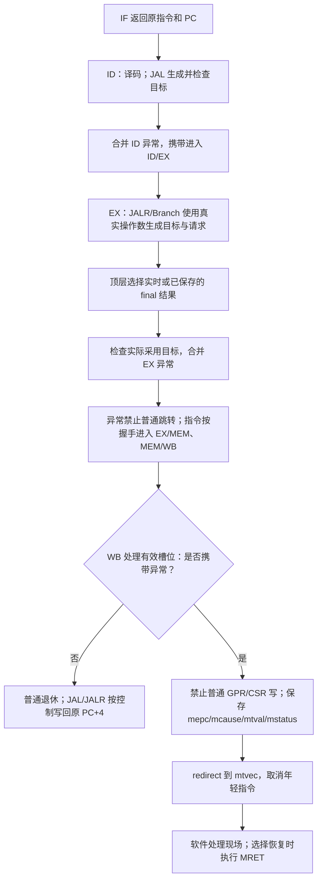

# NPC 五级流水线：跳转目标未对齐异常（cause=0）

整理日期：2026-11-03（Asia/Shanghai）。

本文依据 [原始学习笔记](execption-00.txt)，参考 [CSR 异常处理笔记](exception-02-csr.md) 的“总览—源码拆解—整体总结”结构，整理 JAL、JALR 和 Branch 的指令地址未对齐异常。

**适用范围：当前五级顺序单发射、RV32IM/Zicsr 支持子集、仅 M 模式、无 C 扩展、无 MMU，固定 IALIGN=32。** 本文描述当前源码关系与实现选择，已有测试结果见 [原始笔记](execption-00.txt) 第 4 部分及 [当次验收汇总](../../build/cause0-branch-20261103-pnwhkftw/final-summary.json)。本次整理仅修改文档，没有重新运行仿真。

---

## 一、总览：本次异常处理解决什么问题

### 1.1 cause=0 的含义

`mcause=0` 表示指令地址未对齐异常，英文为 **Instruction address misaligned**。在当前配置中，实际采用的指令跳转目标必须按四字节对齐。

这类异常的特点是：**指令编码本身可以合法，但它要求跳转的目标不满足对齐要求。** 检查目标之后，为原来的跳转指令记录异常；让它按顺序到 WB 处理，而不是立即越过更老指令进入 trap。

例如，一条 JALR 自己位于 `0x80000100`，实际目标为 `0x80000202`：

```text
原指令 PC = 0x80000100
错误目标  = 0x80000202

异常载荷：exc_valid=1，cause=0，tval=0x80000202。
到 WB 后：mepc=0x80000100，mcause=0，mtval=0x80000202。
```

这里故障归属于跳转指令。不能先跳到错误地址，再等待目标取指失败来代替本项异常。[RV32I 对齐与控制转移规定](https://docs.riscv.org/reference/isa/v20260120/unpriv/rv32.html)

### 1.2 三类控制流指令的检查条件

| 指令 | 是否采用跳转目标 | 当前检查位置 | 检查对象 |
| --- | --- | --- | --- |
| JAL | 无条件采用 | ID 的 `id_stage` | 本指令 PC + J 型偏移 |
| JALR | 无条件采用 | 顶层 EX 路径 | 寄存器值 + I 型偏移，清 bit0 后的最终目标 |
| 六类条件 Branch，taken | 采用 | 顶层 EX 路径 | 本指令 PC + B 型偏移 |
| 条件 Branch，not-taken | 不采用 | 通过跳转请求门控排除 | 继续顺序执行，不因未采用目标报本项异常 |

当前顺序 PC 更新为 PC+4，对齐的起始 PC 加 4 后继续对齐。复位向量、Direct mtvec 和当前 mepc 的对齐约束是另外的入口条件，不能把本项检测泛化成对所有 PC 来源的完整正确性证明。

### 1.3 四字节对齐如何判断

当前没有 C 扩展，指令地址对齐要求为 IALIGN=32，即四字节边界：

```verilog
target[1:0] == 2'b00   // 满足当前对齐要求
target[1:0] != 2'b00   // 不满足当前对齐要求
```

例如 `0x80000100`、`0x80000104` 满足要求，`0x80000102` 不满足。以后支持 C 或其他改变 IALIGN 的能力时，需要重新定义检查条件，不能直接沿用固定低两位检测。

必须把三种问题区分开：

| 问题 | 当前处理方向 |
| --- | --- |
| 指令编码不被支持 | cause=2，例如非法 funct3/funct7 组合 |
| 实际跳转目标未对齐 | 本项 cause=0 |
| 目标处取指发生访问错误 | cause=1，属于后续访问异常工作包 |

### 1.4 总体处理链



图中的箭头表示数据与控制的因果关系，不代表每个方框增加一个流水级。检测是组合逻辑；是否捕获到下一级由已有 fire、enable、flush 控制。

---

## 二、拆解：正常跳转目标怎样从指令中形成

### 2.1 模块分工

| 文件 | 当前职责 |
| --- | --- |
| [control.v](../../src/vsrc/src/control.v) | 识别 JAL/JALR/Branch，生成 PC 控制和写回意图 |
| [imm_gen.v](../../src/vsrc/src/imm_gen.v) | 还原并扩展 I、B、J 型偏移 |
| [id_stage.v](../../src/vsrc/src/id_stage.v) | 生成 JAL 目标和本级未对齐标志 |
| [ex_stage.v](../../src/vsrc/src/ex_stage.v) | forwarding 后生成 JALR/Branch 目标和原始跳转请求 |
| [br_cond.v](../../src/vsrc/src/br_cond.v) | 根据真实源操作数判断 Branch 是否 taken |
| [core_top.v](../../src/vsrc/src/core_top.v) | EX 结果保持、最终目标检测、异常合并、跳转仲裁及推进许可 |
| [wb_stage.v](../../src/vsrc/src/wb_stage.v) | JAL/JALR 的 GPR 写回数据选择原 PC+4 |
| [csr.v](../../src/vsrc/src/csr.v) | 公共 trap 现场保存和 MRET 状态恢复 |

### 2.2 JAL：原 PC 产生两个独立结果

设 JAL 自己的地址为 P：

```text
正常执行：
    x[rd] ← P+4
    PC    ← P+符号扩展后的 J 型偏移
```

两个结果都使用原 PC。当前微架构在 ID 发起正常 JAL 跳转，链接寄存器到 WB 才真正写入。

J 型立即数在编码中分散存放。当前还原逻辑：

```verilog
assign imm_j = {
    {11{inst[31]}}, inst[31], inst[19:12],
    inst[20], inst[30:21], 1'b0
};
```

| 偏移位 | 来源 |
| --- | --- |
| offset[20] | inst[31]，也是符号位 |
| offset[19:12] | inst[19:12] |
| offset[11] | inst[20] |
| offset[10:1] | inst[30:21] |
| offset[0] | 补零 |

`imm_out` 已经是符号扩展后的字节偏移，相加前不再左移。补一个低位零只保证二字节倍数，不保证四字节对齐。

ID 生成目标并检查：

```verilog
assign jal_redirect_pc = if_id_pc + imm_out;

assign jal_target_misaligned =
    pc_ctrl[`IS_JAL] && (jal_redirect_pc[1:0] != 2'b00);
```

必须限定当前是 JAL。加法器对其他指令也会组合求值，数值存在不等于它是有效跳转目标。顶层再用 `if_id_valid` 门控这条指令的异常。

原 PC+4 从取指响应身份生成，经过 IF/ID、ID/EX、EX/MEM、MEM/WB 携带到写回端。JAL/JALR 的 `reg_wdata_src=2'b10` 选择这份值，不使用跳转后的 IF PC 重新计算。

### 2.3 JALR：源寄存器加立即数，然后清 bit0

```asm
jalr rd, offset(rs1)
```

其正常功能为：

```text
raw_target = x[rs1] + 符号扩展后的 12 位偏移
target     = raw_target 清除 bit0

x[rd] ← 本指令 PC+4
PC    ← target
```

当前 I 型立即数为：

```verilog
assign imm_i = {{20{inst[31]}}, inst[31:20]};
```

它没有 B/J 型的隐含低位零，不能再把 offset 乘二。JALR 的目标须先按指令语义清 bit0，再判断剩余对齐要求。

| 原始地址 | 清 bit0 后的目标 | 当前结果 |
| --- | --- | --- |
| `0x80000200` | `0x80000200` | 对齐 |
| `0x80000201` | `0x80000200` | 对齐 |
| `0x80000202` | `0x80000202` | 未对齐 |
| `0x80000203` | `0x80000202` | 未对齐，tval 使用 `0x80000202` |

清 bit0 是 JALR 的正常语义；把低两位都清零则会掩盖本应报告的错误，当前没有采用这种处理。

### 2.4 Branch：先有比较结果，才决定是否采用目标

Branch 的目标为本指令 PC 加 B 型偏移：

```verilog
assign imm_b = {
    {19{inst[31]}}, inst[31], inst[7],
    inst[30:25], inst[11:8], 1'b0
};
```

条件判断在 `br_cond` 中完成：

| 指令 | taken 条件 |
| --- | --- |
| BEQ | rs1 与 rs2 相等 |
| BNE | rs1 与 rs2 不等 |
| BLT | 按有符号解释，rs1 小于 rs2 |
| BGE | 按有符号解释，rs1 大于等于 rs2 |
| BLTU | 按无符号解释，rs1 小于 rs2 |
| BGEU | 按无符号解释，rs1 大于等于 rs2 |

例如分支 PC=`0x80000100`、偏移=2，候选目标为 `0x80000102`。taken 时需要报告未对齐；not-taken 时顺序执行，不报告这项异常。

### 2.5 EX 如何共用目标生成路径

当前 `ex_stage`：

```verilog
wire is_branch = (pc_sel == 2'b11);
wire [31:0] redirect_sum = (is_jalr ? rs1_real : pc) + imm_out;

assign redirect_target =
    is_jalr ? {redirect_sum[31:1], 1'b0} : redirect_sum;

assign redirect_req = is_jalr || (is_branch && branch_taken);
```

逐项对应：

- JALR 选择 `rs1_real+imm_out`，随后清 bit0。
- Branch 选择 `pc+imm_out`，只有 taken 才提出跳转请求。
- 非 JALR 路径不是固定的 PC+4；这里的 `imm_out` 是该指令的偏移。
- `pc` 来自 `id_ex_pc`，不是当前 IF 的 PC。
- `rs1_real/rs2_real` 来自 forwarding 选择，Branch 比较及 JALR 目标使用同一套真实操作数。

目标加法在这里用独立组合表达式完成，不能因为位于 EX 就认为一定由普通 `alu_result` 端口提供。

顶层实例连接：

```verilog
.redirect_req    (ex_redirect_req),
.redirect_target (ex_branch_redirect_target)
```

虽然顶层信号名带 `branch`，它实际承载 JALR/Branch 共用目标。当前 `ex_stage` 不再导出单独的 `jalr_branch_target_misaligned`；对齐检测放在顶层 final 结果之后。

### 2.6 为什么使用 final：停顿时保持同一份执行结果

当前较老 MEM 等待时，`mem_allowin=0`，EX 指令不能移交。ID/EX 的指令和操作数保持，但较老 WB 仍可能退出，从而改变组合 forwarding 来源。

因此，已有 `ex_saved` 机制会在第一次被阻塞时保存执行结果，包括：

```verilog
held_target   <= ex_branch_redirect_target;
held_redirect <= ex_redirect_req;
```

最终消费者使用：

```verilog
wire [31:0] ex_target_final =
    ex_saved ? held_target : ex_branch_redirect_target;

wire ex_redirect_final =
    ex_saved ? held_redirect : ex_redirect_req;
```

| ex_saved | 目标与请求的来源 |
| --- | --- |
| 0 | 当前 EX 组合结果 |
| 1 | 同一次计算保存的 held 结果 |

`final` 不是 WB，也不是额外流水级；它表示当前 EX 指令最终应采用的结果。复位、所属指令被 flush 或 EX 可接收下一条时，保存标记按现有逻辑清除。

对齐检查使用这对结果：

```verilog
wire ex_target_misaligned_final =
    ex_redirect_final && (ex_target_final[1:0] != 2'b00);
```

它同时要求“确实采用目标”和“该目标未对齐”。请求为 0 的 not-taken 分支不报错；请求和目标的保存选择也保持一致。

**当前方案没有另外保存一份未对齐标志。** 因为目标与请求已经保存，可以从它们重新得到稳定的判断。不能一边跳转使用 held 目标，一边异常却检查可能变化的实时目标。

---

## 三、拆解：异常怎样合并、保持并到达 WB

### 3.1 统一载荷：一个有效位、一份原因、一份附加信息

每条在途指令携带：

```text
原有 PC / inst              → 指令身份。
exc_valid / cause / tval     → 是否异常、异常原因、附加信息。
```

不用为每一种异常增加一套贯穿所有流水级的布尔通道。各级只为本条指令选择一组载荷，后级继续携带。

| valid / cause | 含义 |
| --- | --- |
| exc_valid=0，cause=0 | 没有有效异常，cause 的数值不参与处理 |
| exc_valid=1，cause=0 | 有效的指令地址未对齐异常 |
| exc_valid=1，cause=2 | 有效的非法指令异常 |

所以三目选择器末尾可以使用 `32'b0` 占位，但消费者必须检查 `exc_valid`，不能用 `cause!=0` 判断。

### 3.2 ID 合并：已有异常、非法指令和 JAL 目标

当前顶层的核心关系为：

```verilog
wire id_exc_valid = if_id_valid &&
    (if_id_exc_valid || illegal_inst || jal_target_misaligned);

wire [31:0] id_exc_cause =
    !id_exc_valid         ? 32'b0 :
    if_id_exc_valid       ? if_id_exc_cause :
    illegal_inst          ? `EXC_ILLEGAL_INST :
    jal_target_misaligned ? `EXC_INST_ADDR_MISALIGNED : 32'b0;

wire [31:0] id_exc_tval =
    !id_exc_valid         ? 32'b0 :
    if_id_exc_valid       ? if_id_exc_tval :
    illegal_inst          ? if_id_inst :
    jal_target_misaligned ? id_jal_redirect_target : 32'b0;
```

当前选择先保留已有异常，再考虑本级新异常。cause 和 tval 按相同优先级成对选择：非法指令的 tval 是编码，JAL 未对齐的 tval 是错误目标。

当前 IF/ID 的异常输入仍固定为零；这里的保留结构并不表示真实 IF 访问错误已接入。本次也没有把 JAL 未对齐并入 `illegal_inst`，因为两者原因不同。

### 3.3 EX 合并：沿用 ID/EX 原异常，否则附加本级原因

JALR/Branch 属于 EX 中的指令，其合并对象是 `id_ex_exc_*`：

```verilog
wire ex_exc_valid = id_ex_valid &&
    (id_ex_exc_valid || ex_target_misaligned_final);

wire [31:0] ex_exc_cause =
    !ex_exc_valid              ? 32'b0 :
    id_ex_exc_valid            ? id_ex_exc_cause :
    ex_target_misaligned_final ? `EXC_INST_ADDR_MISALIGNED : 32'b0;

wire [31:0] ex_exc_tval =
    !ex_exc_valid              ? 32'b0 :
    id_ex_exc_valid            ? id_ex_exc_tval :
    ex_target_misaligned_final ? ex_target_final : 32'b0;
```

不能把 EX 的检测结果直接 OR 进 ID 的 `id_exc_valid`，那会把异常贴到另一条年轻指令身上。

上一级的 `id_ex_exc_*` 已随 ID/EX 保持；本级新异常根据 final 请求和目标生成。两种来源共同遵守这条 EX 指令的 valid 与取消关系。

### 3.4 检测与移交不同：异常不会另外要求 EX 停住

当前：

```verilog
wire ex_fire = !rst && !faulted && !halt &&
               id_ex_valid && mem_allowin && !ex_mem_flush;
```

| 情况 | 行为 |
| --- | --- |
| 下一级可接收，指令携带异常 | 通过 ex_fire 将原指令和异常移交 |
| 下一级不可接收 | 继续等待，使用保持后的目标与异常依据 |
| 更老 redirect 取消本指令 | 指令和异常一起失效 |

不能给 `ex_fire` 增加 `!ex_exc_valid`，否则故障指令无法到 WB。要禁止的是它的普通跳转和普通架构副作用。

异常入口接到 EX/MEM：

```verilog
.ex_mem_pc_in        (id_ex_pc),
.ex_mem_exc_valid_in (ex_exc_valid),
.ex_mem_exc_cause_in (ex_exc_cause),
.ex_mem_exc_tval_in  (ex_exc_tval)
```

该寄存器使用 `mem_allowin` 作为 enable，并以 `ex_fire` 对应的值更新指令 valid。载荷即使在空槽被采样，也不能脱离 valid 使用。

JAL/JALR/Branch 经过 MEM 阶段不代表它们要访问数据内存；这些控制流指令自身没有 Load/Store 请求，继续运送身份和异常即可。

### 3.5 禁止错误目标的正常 redirect

当前 ID 的 JAL 跳转许可包含：

```verilog
wire id_jal_redirect_fire =
    if_id_valid && !id_exc_valid && !id_stall_req && ex_allowin &&
    !sys_or_irq_redirect_fire && !ex_branch_redirect_fire &&
    pc_ctrl[`IS_JAL];
```

当前 EX 的共用跳转许可为：

```verilog
wire ex_branch_redirect_fire =
    ex_fire && !ex_exc_valid && ex_redirect_final;
```

两者都是先获得有效指令和执行许可，再排除本条异常及更老控制转移。检测使用原始请求或 final 请求；异常抑制施加在最终正常 redirect fire 上，避免把检测自身又依赖到已被它禁止的 fire。

正常 JAL 的目标在 ID 生效，正常 JALR/Branch 的目标在 EX 生效；异常进入处理程序的 redirect 则在 WB 发生，二者含义不同。

### 3.6 流水线维护身份与年龄

```text
JAL 的新异常：
ID 合并 → ID/EX → EX 保留 → EX/MEM → MEM/WB。

JALR/Branch 的新异常：
EX 合并 → EX/MEM → MEM/WB。
```

PC 始终使用所属指令已有的流水线 PC，没有额外增加独立的 exc_pc。cause=0 在后续 MEM 阶段也不会变成该阶段年轻指令的 PC。

同一指令多个异常来源按本级规则选择；不同指令之间维护年龄。例如，较老 EX taken 分支取消 ID JAL 时，年轻 JAL 的未对齐标签随它失效。不能因为 cause=0 数值小，就覆盖另一条更老指令的 cause=2。

这些年龄关系有相应源码门控；已有定向测试没有穷举所有 WB trap/IRQ 碰撞，具体动态覆盖边界见第 5.2 节。

### 3.7 WB：普通退休与同步 trap 分流

当前公共入口：

```verilog
wire wb_fire = mem_wb_valid && !rst && !faulted && !halt;
wire wb_retire_fire = wb_fire && !mem_wb_exc_valid;
wire wb_trap_fire   = wb_fire &&  mem_wb_exc_valid;

wire reg_write_eff = wb_retire_fire && reg_write_raw;
```

故障指令到达 WB 后：

```text
mem_wb_valid=1，mem_wb_exc_valid=1
    → wb_trap_fire=1，wb_retire_fire=0
    → 禁止普通 GPR/CSR 写入。
```

对 JAL/JALR，这会禁止链接寄存器写入；即使此前已经组合算出了 PC+4，也不允许故障指令完成该写回。rd=x0 只影响 GPR 写入，不会免除对齐异常。

CSR 的普通提交端口连接 `wb_retire_fire`，同步异常端口连接 `wb_trap_fire`，两者承担不同更新来源。

### 3.8 CSR 复用公共现场，不为每个 cause 重写一套

当前 CSR 入口选择完整原因和附加信息：

```verilog
wire [31:0] trap_code =
    wb_exc_valid    ? wb_exc_cause :
    interrupt_valid ? interrupt_cause : commit_trap_code_raw;

wire [31:0] trap_tval = wb_exc_valid ? wb_exc_tval : 32'b0;
```

进入 trap 时：

```verilog
csr_mepc   <= trap_pc;
csr_mcause <= trap_code;
csr_mtval  <= trap_tval;
```

本项使用同步异常路径，顶层 `trap_pc` 选择故障指令的 `mem_wb_pc`。同时按当前 M-only 规则更新 MPIE、MIE、MPP，并以 mtvec 作为处理入口。

case 中仅为某些 IRQ 增加 pending 清理，并不意味着只有那些编号才能进入 trap。cause=0 会经过共同现场更新，不需要额外增加一个重复的 CSR 保存分支。

### 3.9 公共 redirect、年轻指令与副作用

当前顶层将 `wb_trap_fire` 纳入公共系统 redirect，优先于年轻 EX/ID 正常跳转。PC 转向 mtvec，并通过相应 flush/fire 门控取消年轻槽位或阻止推进。

对已经发出的旧 IF 请求，当前机制允许响应回来后排空，但不能作为新路径有效指令捕获。取消请求结果和执行有效指令是两种不同动作。

年轻 Store/MMIO 的副作用不能仅靠 WB 禁止 GPR 写回解决。当前核有更老 WB 和数据请求许可的保守控制；本轮程序用年轻 Store canary 检查了指定故障后的取消实例，不等于所有设备、总线及错误返回组合都已验收。

---

## 四、拆解：REF 和软件如何形成闭环

### 4.1 NEMU 的 pc、snpc 和 dnpc

当前 [inst.c](../../../nemu/src/isa/riscv32/inst.c) 与 [Decode 定义](../../../nemu/include/cpu/decode.h) 中：

| 变量 | 含义 |
| --- | --- |
| `s->pc` | 原指令地址 |
| `s->snpc` | 当前固定四字节取指后的顺序下一地址 |
| `s->dnpc` | 本条指令最终选择的下一 PC |

`decode_exec()` 默认设置 `s->dnpc=s->snpc`，解释执行结束后由 `cpu.pc=s->dnpc` 推进。REF 没有 DUT 五级时序，不需要复制 forwarding 或 ex_saved；它独立执行同一条架构指令。

### 4.2 JAL/JALR：先判断，再执行链接写入

当前 JAL 核心执行体：

```c
word_t target = s->pc + imm;
if ((target & 3u) != 0) {
  s->dnpc = isa_raise_intr(0, s->pc);
  cpu.csr[CSR_IDX_mtval] = target;
} else {
  R(rd) = s->snpc;
  s->dnpc = target;
  // 原有 FTRACE 位于该正常分支内。
}
```

JALR 使用相同分流，但目标先按指令语义清 bit0：

```c
word_t target = (src1 + imm) & ~1u;
```

`src1` 已在操作数译码时取得，因此即使 rd=rs1，也先按旧源值得到目标。发生异常时不写 rd；正常调用/返回的 FTRACE 也只在正常分支执行，避免把进入 mtvec 误记成普通函数调用。

### 4.3 六条 Branch：taken 内部才检查目标

以当前 BEQ 为例：

```c
INSTPAT("??????? ????? ????? 000 ????? 11000 11", beq, B,
  if (src1 == src2) {
    word_t target = s->pc + imm;
    if ((target & 3u) != 0) {
      s->dnpc = isa_raise_intr(0, s->pc);
      cpu.csr[CSR_IDX_mtval] = target;
    } else {
      s->dnpc = target;
    }
  }
);
```

未 taken 时不修改 dnpc 或异常 CSR。其余五条保留各自比较条件：BLT/BGE 转成 `int32_t` 比较，BLTU/BGEU 使用当前无符号 word_t。六条匹配编码和立即数译码不因增加异常而改变。

修改前的缺口正是 taken 后直接写 dnpc，没有产生 cause=0；本轮通过真实 REF 检查先观察到失败，再修改六个执行体，避免让 REF 和 DUT 一起跳向错误地址而误判正常。

### 4.4 REF 公共异常入口

[isa_raise_intr()](../../../nemu/src/isa/riscv32/system/intr.c) 已经完成公共现场更新，并返回 mtvec。调用：

```c
s->dnpc = isa_raise_intr(0, s->pc);
cpu.csr[CSR_IDX_mtval] = target;
```

表示保存当前跳转指令现场，并使下一 PC 指向异常入口。第二行必须在调用后执行，因为公共入口先清零 mtval，再由具体故障提供附加信息。

这里也不需要在只处理 IRQ pending 清位的 switch 中再复制 cause=0 的完整保存代码。

### 4.5 Difftest 比较的是独立执行结果

当前 [Difftest 驱动](../../src/csrc/src/difftest/dut.cpp) 在对应 WB 事件让 REF 执行一条指令。对本项同步异常，REF 从同一指令及寄存器输入自己得到 trap，不通过复制 DUT 的 mepc/mcause/mtval 生成期望，也不额外调用异步 IRQ 注入接口。

比较对象包括故障指令身份和架构状态；软件自检还检查期望的现场、故障 rd 保持、恢复路径及内存 canary。

当前 WB 事件 valid 来自 `wb_fire`，包含异常槽位，不等于严格的 ISA 正常退休计数。计数器周期对齐、所有真实后继 PC 检查及控制碰撞覆盖仍有各自边界，不能由普通 Difftest PASS 一并推断。

除了源码语义，还必须确保加载的 REF 库来自当前源码。已有验收曾发现旧状态复制对象的 ABI 长度不一致，完整重编译后重新检查；相关构建日志和修改前后检查结果保存在当次产物目录中。

### 4.6 软件怎样处理和恢复

硬件保存现场后进入 mtvec。通用 AM 软件链为：

```text
mtvec → trap.S 保存软件上下文
      → __am_irq_handle(Context *)
      → user_handler(Event, Context *)
      → 若选择恢复：恢复上下文并执行 MRET。
```

当前 [cte.c](../../../abstract-machine/am/src/riscv/npc/cte.c) 将未单独分类的 cause=0 落到 `EVENT_ERROR`；它没有为目标未对齐自动修复返回地址。ECALL 分支中的 mepc+=4 不能机械套用到本项。

如果软件不修复源寄存器或返回 PC，直接 MRET 回原故障指令，可能再次发生相同异常。修复后重试、跳过或停止属于软件策略。

本轮定向程序使用自定义 trap handler 检查现场，再把 mepc 改为指定恢复点并 MRET；这不等于已经改写 AM 通用 handler，让所有应用都能自动恢复 cause=0。mtval 当前也不在 AM Context 的保存布局中，不能假定其已随所有上下文切换保存。

---

## 五、回到整体：当前实现、阅读方法与扩展边界

### 5.1 整套设计应掌握的关系

1. **指令功能与异常分开**：合法编码也可能产生错误目标。
2. **候选目标与采用目标分开**：Branch 未 taken 不检查未采用目标。
3. **实时值与保存值保持一致**：异常检查使用当前 EX 最终采用的请求和目标。
4. **检测与推进分开**：组合产生标签；fire 决定何时移交；故障指令仍需前进到 WB。
5. **正常跳转与 trap redirect 分开**：前者在 ID/EX，后者按年龄在 WB 处理。
6. **异常与原指令绑定**：mepc 记录原指令 PC，mtval 记录错误目标。
7. **公共处理与具体来源分开**：每类检测提供载荷，WB/CSR 复用公共现场保存。
8. **DUT 与 REF 独立执行**：相同输入得到各自结果，测试再进行比较。

当前固定采用的路线为：

```text
JAL：ID 生成并检查目标 → 合并 ID 异常。
JALR/Branch：EX 生成目标与请求 → 顶层选择 final → 检查并合并 EX 异常。

无论哪种来源：
禁止故障指令正常 redirect → 异常随指令推进 → WB 禁止普通写回
    → 保存现场、redirect 到 mtvec、取消年轻指令 → 软件处理。
```

### 5.2 当前完成范围和未完成项

| 项目 | 当前范围 |
| --- | --- |
| JAL、JALR、六类 taken Branch 的 cause=0 检测 | 已接入，指定指令级与生产 RTL 程序场景已验收 |
| not-taken 不误报、JALR bit0 清零、链接写入抑制 | 有指定正反例 |
| mepc/cause/tval、MIE/MPIE、MRET 恢复 | 有自定义 handler 检查 |
| 延迟配置下运行 | 已有默认和固定/随机等待配置的程序级结果 |
| 全部 EX 停顿状态、较老 WB trap/实际 IRQ 碰撞 | 未进行完整专项动态覆盖 |
| 波形双轨证据 | 本轮未采集 VCD，不能宣称本轮 VCD 通过 |
| 目标访问错误及数据访存异常 | 不属于本项实现范围 |

具体测试数量与通过状态参考 [原始笔记](execption-00.txt) 第 4 部分；源码和输入哈希、结果汇总见 [当次验收汇总](../../build/cause0-branch-20261103-pnwhkftw/final-summary.json)，命令及日志保存在同一产物目录。当前工作区未找到原笔记提及的 `exception-00-acceptance.md`，因此本文不把它作为可读取的证据来源。结果限定于记录中的源码版本和输入，不能当作完整 ISA、微架构或安全正确性的证明。

### 5.3 建议按这个顺序阅读源码

```text
control / imm_gen
    → id_stage 的 JAL 目标与检测
    → ex_stage / br_cond 的 JALR、Branch 目标与请求
    → core_top 的 ex_saved、final 选择、异常合并与 fire
    → ID/EX、EX/MEM、MEM/WB 的 PC 和异常载荷
    → wb_retire_fire / wb_trap_fire
    → csr 的 trap_code、trap_pc、trap_tval 与现场更新
    → NEMU 指令执行体 / isa_raise_intr
    → 软件 handler 与 MRET。
```

每次固定追一个信号的生产者、保存/选择、消费者和许可条件。例如：

```text
rs1_real + imm_out → JALR 清 bit0 → ex_branch_redirect_target
    → ex_saved 选择 → ex_target_final
    → ex_target_misaligned_final → ex_exc_* → mem_wb_exc_*
    → wb_trap_fire → CSR 现场 + 公共 redirect。
```

### 5.4 后续异常复用什么、还需单独补什么

共同骨架仍可复用：有效指令身份、异常载荷、保持/取消、WB 分流和公共 trap。每个新来源仍须确定检测点、原因/附加信息、优先级，以及需要禁止的普通动作。

Load/Store 未对齐需要在错误请求发出前检查宽度和有效地址；访存错误需要绑定原事务并让故障指令完成异常运输，不能继续等待成功响应；已取消 IF 响应需要排空。它们不能只照搬本项的正常 redirect 门控。

后续工作与范围见 [M 模式精确异常进度](../design-process/m-mode-precise-exceptions-progress.md)。

### 5.5 参考与记录分工

- [原始学习笔记](execption-00.txt)：保留讨论和逐步理解过程。
- [CSR 异常处理笔记](exception-02-csr.md)：共用异常运输与 CSR 现场机制的相关学习记录。
- [当次验收汇总](../../build/cause0-branch-20261103-pnwhkftw/final-summary.json)：保留源码与输入哈希及结果；同目录保存实际检查脚本、命令和日志。它是特定运行的产物，后续清理构建目录前应先归档必要证据。
- [异常编号定义](../../src/vsrc/include/exception.vh)：常量定义不等于全部异常已实现。
- [RV32I 官方规范](https://docs.riscv.org/reference/isa/v20260120/unpriv/rv32.html)：控制流指令功能、IALIGN、taken 条件及故障归属。
- [Machine-Level 官方规范](https://docs.riscv.org/reference/isa/priv/machine.html)：异常现场与 mtval 的规定；本项目选择为 cause=0 提供错误目标。

这项设计的核心是：**在实际采用目标的位置发现错误，保持与原指令一致的异常信息，让故障按年龄到 WB 处理，并阻止不应发生的普通动作。** 后续接入总线和 cache 时，仍需围绕指令身份、事务身份及副作用边界扩展和验收。
