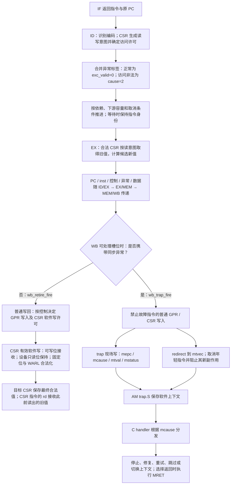
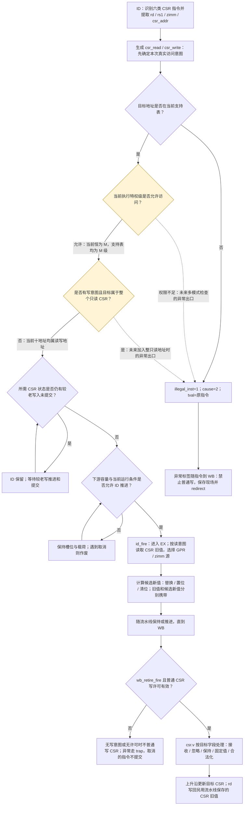

# NPC 五级流水线：精确异常与 CSR 访问处理设计总结

整理日期：2026-11-01；处理链补全：2026-11-02（Asia/Shanghai）。

本文参考 [execption.txt](execption.txt)，并对照当前 `npc/src/vsrc/`、`npc/src/csrc/`、NEMU 和 Abstract Machine 源码整理。采用“先总览、再拆解、最后回到整体”的结构，说明我们已经实现的机制、各个信号之间的关系，以及后续异常怎样接入。

**适用范围：当前单发射五级顺序流水线，RV32IM/Zicsr 支持子集，仅 M 模式，无 C、无 MMU、无 F/V/S/U/H。** 本文描述当前实现及其边界，不代表完整 RISC-V 特权架构合规，也不把源码审阅称为形式证明。

本文只整理设计，没有修改生产源码或重新运行仿真。此前验证结果见验收记录；相关临时测试代码和产物已按要求删除，详见 [清理记录](../cpu-fuzzing/test-cleanup.md)。

---

## 一、总览：我们解决的是什么问题

### 1.1 精确异常的目标

五级流水线中，多条指令同时处于 IF、ID、EX、MEM、WB。如果 ID 检测出一条非法指令，不能立刻不顾其他指令跳走：流水线中可能还有比它更老、尚未完成的指令。

当前设计采用的基本方案是：

> 检测异常时先记录在该指令身上；让这条有效但携带异常的指令继续按顺序推进；到 WB 再决定进入 trap，同时阻止它的普通架构写入并取消年轻指令。

精确异常需要维护三条关系：

1. **更老指令**：保留其合法完成的架构结果。
2. **故障指令**：记录自己的 PC、原因和附加信息，禁止其普通 GPR/CSR 写入。
3. **更年轻指令**：不得提交错误路径的架构结果；Store/MMIO 等不可撤销请求必须在发出前控制许可。

第三条不能仅靠清除 WB 写使能实现：设备已经消费的数据无法靠 flush 恢复。当前核有保守的访存许可，完整副作用合同仍需要随后续访问异常继续验收。

### 1.2 总体处理链

总体处理链必须同时覆盖**异常路径和合法 CSR 路径**。不能只画“地址是否支持 → 正常/异常”，因为地址支持只回答了其中一个问题。完整关系包括：指令编码、真实读写意图、访问许可、数据依赖与反压、EX 计算、WB 许可，以及最终的字段处理。

下面的箭头表示因果关系和载荷流向，不表示每个方框增加一个流水级，也不表示所有检查必须串成多拍状态机。ID 的多项判断当前由组合逻辑完成；字段约束在 WB 软件写入口生效。

#### 1.2.1 从流水线看正常写入与异常处理的分流



这里的 CSR 普通写仅针对**有写意图且获得提交许可**的指令；读指令或写意图被抑制时不会执行字段写入。GPR 写回和 CSR 写入也各自受控制，不是每条指令都同时执行两者。

图中的同步异常主线当前重点实现于 cause=2。ECALL 仍使用现有系统 trap 路径，已接受 IRQ 使用 `irq_take` 进入公共现场保存；IF/D 错误尚未并入精确 WB trap。不能因为存在共用 CSR 入口就认为所有来源都已统一。

#### 1.2.2 放大 CSR：从读写意图到字段约束的完整链路



黄色节点用于标出**完整访问合同需要回答、当前由固定配置限制住的问题**。当前 `control.v` 没有动态 `current_priv` 比较，也没有独立的 `csr_addr[11:10]` 整只读检测器；图中的两条虚线异常出口是后续扩展关系，不能读成已有 RTL 分支。

完整链路可压缩为：

```text
编码合法
  → 生成真实读写意图
  → 地址已实现
  → 当前执行特权级允许
  → 本次读写符合整个 CSR 的访问属性
  → 所需旧状态就绪且流水线允许推进
  → EX 读取旧值并计算候选新值
  → WB 确认正常提交和写许可
  → 按当前实现的字段规则处理候选值
  → 更新 CSR；按 rd 控制写回原 CSR 旧值。

访问非法 → cause=2，随指令到 WB 进入 trap。
依赖或反压未解除 → 等待，不产生新的异常。
访问合法但字段受限 → 采用该字段规定的保持、忽略或合法化规则。
```

#### 1.2.3 每一步在当前源码中的落点

| 环节 | 当前生产者 → 消费者 | 当前实现与边界 |
| --- | --- | --- |
| 编码识别、读写意图 | `control.v` → `csr_ctrl` | 六类 CSR 指令结合 rd/rs1/zimm 生成意图；意图不等于已经读写架构状态 |
| 地址支持检查 | `csr_addr_supported` → `illegal_inst` → `id_exc_*` | 未支持地址进入 cause=2 |
| 执行特权级许可 | 固定 M-only 配置 + 十地址支持表 | 当前支持地址的最低特权级均为 M；没有可切换的当前特权级寄存器或动态比较 |
| 整个 CSR 是否只读 | 当前支持表限制 | 十地址均为读写地址；不等于内部所有字段都可写，也不等于已实现通用整只读检测 |
| CSR 状态依赖等待 | `id_csr_read` + 较老同地址写 → `csr_state_raw_hazard` → `id_stall_req` | 年轻读在 ID 等待；较老写继续推进；写意图被抑制的老指令不构成该 CSR 写依赖 |
| 下游反压 | `mem_complete` → `mem_allowin` → `ex_allowin` → `id_fire` | 许可不足保持槽位；它和访问权限不是同一种“允许” |
| 旧值与候选新值 | `csr_rdata` / `rs1_real` / zimm → `ex_stage` → 流水线 | 旧值用于 rd；候选新值用于以后更新 CSR；停顿时已有 EX 保存机制 |
| WB 普通写许可 | `wb_retire_fire` → `csr_commit_valid`，再结合 `csr_write_raw`、trap/MRET 条件 | 当前故障指令不普通写 CSR；无写意图时也不写 |
| 字段处理 | `csr_write_addr` + `mem_wb_csr_wdata` → `csr.v` 时序分支或计数器 next 逻辑 | 按十地址的 M-only 合同更新；字段限制通常不会变成 cause=2 |
| 异常处理 | `mem_wb_exc_*` → `wb_trap_fire` → CSR trap 写 + redirect/flush | 与普通字段写是不同更新来源，优先级高于普通写 |

必须分开看四个问题：**能否访问这个 CSR、这条指令是否有读写意图、何时可以推进、允许写时最终哪些位改变。** 例如，`mstatus.MIE=0` 控制中断接受，不会因此禁止软件读写当前支持的 CSR；`mstatus.MPP` 也不是“当前执行特权级”的替代信号。

### 1.3 四个容易混淆的概念

| 概念 | 含义 | 当前例子 |
| --- | --- | --- |
| 同步异常 exception | 与某条指令的执行直接关联 | 非法指令、非法 CSR 地址、ECALL |
| 异步中断 interrupt | 来自指令执行之外，在合法边界被接受 | 定时器中断、外部中断 |
| trap | 异常或中断引发的控制转移 | 保存现场并转向处理程序 |
| CSR 软件写入 | 程序执行 CSR 指令修改寄存器 | `csrw mepc, t0` |

同步/异步依据的是与指令的关系，而不是代码写在 RTL 还是 C++。当前 C++ 模拟的定时器仍然是 CPU 所看到的异步中断源。

CSR 指令还要分清两种结果：

```text
访问不被允许：例如本项目不支持的 CSR 地址
    → 作为非法指令进入 cause=2。

访问被允许，但某些字段只读或值受限制
    → 按字段规则忽略、保持或合法化，不因此一律进入 cause=2。
```

### 1.4 当前模块分工

| 层次 | 主要文件 | 职责 |
| --- | --- | --- |
| 译码 | [control.v](../../src/vsrc/src/control.v)、[id_stage.v](../../src/vsrc/src/id_stage.v) | 指令识别、CSR 地址检查、读写意图、输出 `illegal_inst` |
| 顶层协调 | [core_top.v](../../src/vsrc/src/core_top.v) | 异常合并、逐级连接、WB 分流、IRQ 接受、PC 选择、flush 与请求许可 |
| 指令运输 | [id_ex_reg.v](../../src/vsrc/src/id_ex_reg.v)、[ex_mem_reg.v](../../src/vsrc/src/ex_mem_reg.v)、[mem_wb_reg.v](../../src/vsrc/src/mem_wb_reg.v) | 绑定 PC/inst/控制/异常，随指令一起保持、推进或取消 |
| EX | [ex_stage.v](../../src/vsrc/src/ex_stage.v) | 使用 CSR 旧值计算候选新值，处理源 GPR forwarding |
| 写回数据 | [wb_stage.v](../../src/vsrc/src/wb_stage.v) | 从 ALU、Load、PC+4、CSR 旧值中选择 GPR 写回数据 |
| CSR 状态 | [csr.v](../../src/vsrc/src/csr.v) | 组合读、软件写字段约束、trap 现场更新、MRET 状态恢复 |
| REF | [NEMU csr.c](../../../nemu/src/isa/riscv32/csr.c)、[inst.c](../../../nemu/src/isa/riscv32/inst.c)、[intr.c](../../../nemu/src/isa/riscv32/system/intr.c) | 独立解释执行指令、字段约束与 trap 行为 |
| 客户软件 | [trap.S](../../../abstract-machine/am/src/riscv/npc/trap.S)、[cte.c](../../../abstract-machine/am/src/riscv/npc/cte.c) | 软件上下文保存、事件分发、选择返回现场 |

---

## 二、拆解：从指令进入流水线到异常处理返回

### 2.1 ID：先识别指令，再检查访问

`id_stage` 拆出指令字段并调用 `control`。当前基础译码以 opcode 分类，但合法性不能只看 opcode 和 funct3：移位和部分 R 型指令还检查 funct7，ECALL/MRET 等系统指令检查完整编码。

CSR 指令主要字段为：

```verilog
wire [4:0]  rs1_addr = inst[19:15];
wire [4:0]  rd_addr  = inst[11:7];
wire [11:0] csr_addr = inst[31:20];
wire [31:0] csr_zimm = {27'b0, inst[19:15]};
```

`csr_addr` 是 CSR 编号，不是 Load/Store 的内存地址；CSR 和普通内存属于不同的访问空间。

当前 `csr_addr_supported` 明确列举十个地址。生成 CSR 读写意图后，再做：

```verilog
if ((csr_read || csr_write) && !csr_addr_supported) begin
    illegal_inst = 1'b1;
end
```

例如指令编码属于合法 CSRRW，但目标是当前未支持的 `0x7c0`，仍然会设置 `illegal_inst`。

不能通过 `rd=x0` 绕过地址检查：CSRRW 的 `rd=x0` 只抑制读取旧值，仍然有写意图。CSRRS/CSRRC 即使源寄存器是 x0，仍然有读意图。

### 2.2 六条 CSR 指令的真实读写意图

| 指令 | 读取 CSR 旧值 | 写入意图 | 候选新值 |
| --- | --- | --- | --- |
| CSRRW | `rd != x0` 时读取 | 始终写 | `rs1` 的值 |
| CSRRWI | `rd != x0` 时读取 | 始终写 | 零扩展 zimm |
| CSRRS | 始终读取 | `rs1` 编号不是 x0 时写 | `old OR rs1_value` |
| CSRRC | 始终读取 | `rs1` 编号不是 x0 时写 | `old AND NOT rs1_value` |
| CSRRSI | 始终读取 | `zimm != 0` 时写 | `old OR zimm` |
| CSRRCI | 始终读取 | `zimm != 0` 时写 | `old AND NOT zimm` |

`rd=x0` 的结果不会写进 GPR，但除 CSRRW/CSRRWI 的特定读抑制外，不等于整条指令没有 CSR 访问。

对 CSRRS/CSRRC，判断的是**编码中的源寄存器是否为 x0**。如果编码为 x1，即使 x1 当前保存 0，仍然属于有写意图的操作。这一点在以后支持整个只读 CSR 时尤其重要。[Zicsr 2.0](https://docs.riscv.org/reference/isa/v20260120/unpriv/zicsr.html)

当前十个支持地址均属于 M 级可读写 CSR 地址范围，没有另行增加一个独立的、整个只读的 CSR。因此不能把“已检查字段只读”写成“所有独立只读 CSR 与多特权级访问检查已经实现”。

#### 2.2.1 地址支持后，还需要回答访问许可问题

读写意图应当先参与访问判断。例如 CSRRS 的 rs1=x0 表示没有写意图，因此将来读取整个只读 CSR 时，不应被当作一次写访问；CSRRW 即使 rd=x0 仍有写意图，不能用“不需要返回旧值”绕过写权限。

对普通 M/S/U、无虚拟化的 CSR 访问，可以先按下面两项理解基本访问属性；Debug 专用地址及未来扩展的额外访问控制还需单独处理：

| 判断 | 含义 | 当前核的具体情况 |
| --- | --- | --- |
| 执行特权级与 `csr_addr[9:8]` | 地址编码最低访问特权级；当前执行级别需满足访问要求 | 当前始终 M；支持表中的十地址该字段均为 `11`，所以支持项均满足 |
| 写意图与 `csr_addr[11:10]` | 该字段为 `11` 表示整个 CSR 是只读地址；有写意图时访问非法 | 当前支持的 0x3xx 为 `00`，0xBxx 为 `10`，均不是整个只读地址 |

地址检查和这两类访问属性是不同问题。当前支持表把不在这十项中的地址都排除，固定 M-only 配置又限制了执行模式，所以**当前配置没有需要实际触发的越权或整只读地址写入分支**；源码没有另外实现动态检查器。将来扩大地址表或加入 S/U 时，必须重新建立对应检测及 cause=2 路径，不能仅扩展 case 项。[CSR 地址与访问属性](https://docs.riscv.org/reference/isa/priv/priv-csrs.html)

还要区分“整个 CSR 的只读地址”和“读写 CSR 内的只读字段”：mip 是读写地址，即使当前实现的 MTIP/MEIP 对 CSR 软件写只读，也不能据此把所有写 mip 指令都报非法。该合法访问会在 WB 按字段规则保留设备状态。

执行特权级回答的是“谁有权访问”，字段规则回答的是“允许的访问能修改什么”。当前 M-only 字段掩码由已实现能力决定，不是在软件写入时根据 MPP 临时模拟 M/S/U 切换。

### 2.3 ID 合并异常：有效指令和异常标签同时存在

`core_top` 中的合并逻辑为：

```verilog
wire id_exc_valid = if_id_valid && (if_id_exc_valid || illegal_inst);

wire [31:0] id_exc_cause = !id_exc_valid ? 32'b0 :
                          if_id_exc_valid ? if_id_exc_cause : `EXC_ILLEGAL_INST;

wire [31:0] id_exc_tval = !id_exc_valid ? 32'b0 :
                         if_id_exc_valid ? if_id_exc_tval : if_id_inst;
```

对应含义：

1. IF/ID 没有有效指令时，不把槽位中残留的位当成新异常。
2. 指令已经携带异常时，当前 ID 合并保留已有原因和附加信息。
3. 否则 ID 新检测的非法指令使用 cause=2，tval 取该指令编码。

当前 IF/ID 异常输入仍固定为零，所以“保留 IF 异常”的运输结构已预留，真实取指错误尚未接入。

需要同时理解两种有效位：

```text
stage_valid = 1，exc_valid = 0：有效的普通指令。
stage_valid = 1，exc_valid = 1：有效的故障指令，仍需按年龄处理。
stage_valid = 0：无有效指令，不根据残留 cause/tval 执行异常处理。
```

`exc` 是 exception 的缩写。cause=0 本身是合法异常编号，所以不能用 `cause != 0` 代替异常有效位。

### 2.4 异常载荷为什么必须随指令走

当前指令身份和异常信息分别为：

```text
PC / inst                → 这是谁、原指令是什么。
exc_valid / cause / tval  → 是否异常、原因、附加信息。
```

没有额外实现一套独立 `exc_pc` 寄存器；当前使用该指令已有的流水线 PC。

| 当前阶段 | 指令 PC | 异常标签 |
| --- | --- | --- |
| ID 输入 | `if_id_pc` | `if_id_exc_*` |
| EX 输入 | `id_ex_pc` | `id_ex_exc_*` |
| MEM 输入 | `ex_mem_pc` | `ex_mem_exc_*` |
| WB 输入 | `mem_wb_pc` | `mem_wb_exc_*` |

级间寄存器采用以下顺序：

```verilog
if (rst) begin
    stage_valid <= 1'b0;
    exc_valid   <= 1'b0;
    // 初始化其他载荷
end else if (flush) begin
    stage_valid <= 1'b0;
    exc_valid   <= 1'b0;
end else if (enable) begin
    // 捕获同一条指令的 valid、PC、inst、控制和异常信息
end
// 没有 enable 时保持原槽位及载荷
```

这保证停顿时故障身份不被覆盖；flush 优先于 enable，旧路径故障随所属指令失效。cause/tval 不一定在每次 flush 都清零，消费者必须受对应 valid 约束。

“本级新异常覆盖旧异常”的策略不能机械推广到所有异常：当前 ID 是已有 IF 异常优先。未来同一指令多异常的优先级需要按规范单独确定，跨指令则维护年龄关系。

### 2.5 正常 CSR 指令：EX 读旧值，WB 提交新值

顶层 CSR 实例连接：

```verilog
.csr_read_ctrl    (id_ex_csr_ctrl),
.csr_write_ctrl   (mem_wb_csr_ctrl),
.csr_wdata        (mem_wb_csr_wdata),
.csr_commit_valid (wb_retire_fire)
```

因此当前 CSR 组合读属于 **EX 指令对应的地址**，不能继续按早期单周期笔记理解为 ID 直接完成一次架构读取并提交。

`ex_stage` 使用读出的旧值和经 forwarding 选择的源 GPR/立即数，得到候选新值：

```verilog
wire [31:0] csr_src = csr_imm ? rs1_real : csr_zimm;

case (csr_op)
    2'b00: csr_wdata = csr_src;
    2'b01: csr_wdata = csr_rdata | csr_src;
    2'b10: csr_wdata = csr_rdata & ~csr_src;
    default: csr_wdata = 32'b0;
endcase
```

当前 `csr_imm=1` 选择 GPR，`csr_imm=0` 选择 zimm，要按实际源码理解该控制位。

```text
CSR 旧值 ──→ EX/MEM、MEM/WB ──→ WB 数据选择 ──→ rd

CSR 候选新值 ──→ EX/MEM、MEM/WB ──→ 字段约束 ──→ 目标 CSR
```

`wb_stage` 的 CSR GPR 写回来源是旧值，不是经过字段约束后的新值：

```verilog
assign rd_wdata = (rd_wdata_src == 2'b00) ? alu_result :
                  (rd_wdata_src == 2'b01) ? mem_rdata :
                  (rd_wdata_src == 2'b10) ? pc_plus4 : csr_rdata;
```

字段约束在允许 WB 软件写入时生效。EX 计算出候选值，不代表目标 CSR 已经发生架构更新。

### 2.6 CSR 的两种 RAW 关系不能混在一起

**第一种：CSR 读取旧值后写 GPR，下一条指令需要这个 GPR。**

这属于普通寄存器数据依赖，使用 EX/MEM、MEM/WB forwarding 及 WB→ID bypass。EX/MEM 转发中 `WB` 数据源为 `2'b11` 时选择流水线携带的 CSR 旧值。

**第二种：一条 CSR 指令要更新 CSR 状态，年轻 CSR 指令需要读取这个 CSR 的新状态。**

当前方案不是转发 CSR 候选新状态，而是在 ID 检查同地址的较老 CSR 写：

```verilog
wire csr_state_raw_hazard = if_id_valid && id_csr_read &&
    ((id_ex_csr_write  && (id_csr_addr == id_ex_csr_addr)) ||
     (ex_mem_csr_write && (id_csr_addr == ex_mem_csr_addr)));
```

命中时停住年轻 ID 指令，较老指令继续推进。当前只比较 EX/MEM 对应的两个较老阶段，是因为年轻指令若在较老指令 WB 写入的同一边沿进入 EX，边沿后组合读已经能观察更新值。该解释依赖当前 EX 读、WB 写的时序，不能照搬到其他存储实现。

这里必须使用真实的 `csr_read/csr_write`：CSRRW rd=x0 没有旧值读意图，不为该读触发同地址等待；CSRRS rs1=x0 仍读旧值，必须等待较老写；较老 CSRRS 的 rs1=x0 则没有写意图，不构成 CSR 状态写依赖。

“CSR 不再有同地址依赖”也不等于立即进入 EX，顶层还要求流水线容量与运行条件满足：

```verilog
wire id_stall_req = load_use_hazard || csr_state_raw_hazard;
wire ex_allowin   = !id_ex_valid || mem_allowin;
wire id_fire     = !rst && !faulted && !halt && if_id_valid &&
                   !id_stall_req && ex_allowin && !id_ex_flush;
```

因此有三个不同出口：访问非法时给指令贴异常标签；依赖或下游阻塞时保持该指令；获得 `id_fire` 才真正移交 EX。等待不是新的访问异常，redirect/flush 则可能取消这条等待中的指令。

当较老 MEM 等待时，当前 `ex_saved/held_csr_read/held_csr_write` 会保存 EX 已计算的数据，避免转发来源离开流水线后，等待中的指令结果随组合输入变化。

### 2.7 WB：区分处理槽位、正常退休和同步 trap

顶层有三个层次：

```verilog
wire wb_fire = mem_wb_valid && !rst && !faulted && !halt;
wire wb_retire_fire = wb_fire && !mem_wb_exc_valid;
wire wb_trap_fire   = wb_fire &&  mem_wb_exc_valid;
```

| 信号 | 当前含义 |
| --- | --- |
| `mem_wb_valid` | WB 槽位中存在一条有效指令 |
| `wb_fire` | 在当前运行条件下处理这个槽位 |
| `wb_retire_fire` | 当前代码允许走普通退休路径 |
| `wb_trap_fire` | 当前有效槽位携带同步异常，需要进入 trap |

不是所有 `wb_fire` 都是正常退休。当前普通写许可为：

```verilog
wire reg_write_eff = wb_retire_fire && reg_write_raw;
```

CSR 的 `.csr_commit_valid` 也连接 `wb_retire_fire`。因此故障指令不能靠译码残留的 `reg_write` 或 `csr_write` 改写普通状态。

**当前特殊边界：ECALL 仍由 `SYS_CTRL_TRAP_ENTER` 经 `wb_retire_fire` 路径进入系统 trap；它尚未统一为 `mem_wb_exc_valid` 的非普通退休事件。** 所以此处的信号名称描述当前实现，不能宣称 ECALL 的 ISA 退休事件语义已经统一完成。

### 2.8 同步异常和 IRQ 怎样共享 CSR 入口

顶层连接关系：

```verilog
.wb_exc_valid    (wb_trap_fire),
.interrupt_valid (irq_take),
.sys_commit_ctrl (mem_wb_sys_ctrl)
```

注意：顶层外部输入 `interrupt_valid` 表示有待处理请求；送到 CSR 模块的同名端口实际上连接的是 `irq_take`，表示本拍真正接受。两者不能互换。

CSR 模块先选择完整原因值：

```verilog
wire [31:0] trap_code = wb_exc_valid    ? wb_exc_cause :
                        interrupt_valid ? interrupt_cause :
                                          commit_trap_code_raw;

wire trap_enter = wb_exc_valid || interrupt_valid ||
                  (csr_commit_valid && commit_trap_raw);
```

当前来源：

| 事件 | 完整原因值来源 | 示例 |
| --- | --- | --- |
| 非法指令/非法 CSR 地址 | 指令携带的 `wb_exc_cause` | `0x00000002` |
| M 模式 ECALL | 系统控制包的 trap code | `0x0000000b` |
| 机器定时器中断 | 仿真环境产生的 `interrupt_cause` | `0x80000007` |
| 机器外部中断 | 对应中断请求原因 | `0x8000000b` |

`trap_code` 选择器不会重新设置最高位；各生产者提供的值已经包含中断标志。`exception.vh` 的常量定义不表示每个异常源都已经实现。

### 2.9 `mepc`：保存哪条指令，和返回执行哪条指令

顶层先决定要保存的 PC：

```verilog
wire [31:0] irq_resume_pc = ex_mem_valid ? ex_mem_pc :
                            id_ex_valid  ? id_ex_pc :
                            if_id_valid  ? if_id_pc : if_pc;

assign trap_pc = irq_take ? irq_resume_pc : mem_wb_pc;
```

**同步异常和 ECALL**：使用当前 WB 指令自己的 PC。非法指令的 `mepc` 指向故障指令，ECALL 的 `mepc` 指向 ECALL 本身。

**接受异步中断**：选择被取消、尚需恢复执行的最老指令 PC；WB 如果存在可正常退休的更老指令，可以先完成，恢复地址不再选择它。

示例假设本拍 IRQ 的所有接受条件满足：

| 阶段 | PC | 本拍行为 |
| --- | --- | --- |
| WB | `0x100` | 普通老指令正常退休 |
| MEM | `0x104` | 最老被取消指令，成为恢复点 |
| EX | `0x108` | 被取消 |
| ID | `0x10c` | 被取消 |

此时保存 `mepc=0x104`。该例不代表任何访存状态都可立即接受 IRQ：当前会等待 `mem_issued` 和相关 WB memory 边界结束。

CSR 模块统一执行：

```verilog
if (trap_enter) begin
    csr_mepc <= trap_pc;
end
```

这里是**硬件保存现场**。软件随后执行 `csrw mepc,t0` 则属于另一条普通 CSR 写路径：

```verilog
mepc: csr_mepc <= {csr_wdata[31:2], 2'b00};
```

两条路径共用一个寄存器，来源和时机不同；trap 分支的优先级高于普通软件写。软件写入的低位约束不会自动证明硬件 `trap_pc` 总是正确：未来目标未对齐等异常仍需检查 PC 归属与保存规则。

### 2.10 trap 现场更新、返回目标与时钟边沿

CSR 的主要更新顺序是：

```text
复位
  > 进入 trap
  > MRET
  > 允许提交的普通 CSR 软件写
```

进入 trap 时：

```verilog
csr_mepc   <= trap_pc;
csr_mcause <= trap_code;
csr_mtval  <= trap_tval;
```

并按当前 M-only 状态栈更新：

```text
MPP  ← M
MPIE ← 原来的 MIE
MIE  ← 0
```

MRET 时：

```text
MIE  ← 原来的 MPIE
MPIE ← 1
MPP  ← M（当前最低且唯一支持的特权级）
PC   ← mepc
```

`MPP` 是保存的返回特权级字段，不是独立的“当前模式寄存器”。当前核没有实现可切换的 S/U 模式状态，不能通过写 MPP 假装完成模式切换。

当前目标计算为：

```verilog
assign trap_target = (wb_exc_valid || wb_trap || interrupt_valid) ? csr_mtvec :
                      wb_mret ? csr_mepc : 32'b0;
```

上升沿前，WB 事件、`trap_code/trap_pc` 和跳转目标已经由组合逻辑形成；上升沿更新 CSR 状态，同时 PC 根据 redirect 更新。不是先额外过一拍保存 CSR，再额外过一拍发出跳转。新的取指和响应仍需经过当前访存握手，不能认为下一拍一定已有处理程序指令进入 EX。

### 2.11 redirect、flush、请求取消的关系

顶层优先选择 WB trap/系统返回/已接受 IRQ，再选择 EX、ID 的年轻跳转：

```verilog
wire sys_or_irq_redirect_fire = wb_trap_fire || wb_sys_redirect_fire || irq_take;
wire redirect_fire = sys_or_irq_redirect_fire ||
                     ex_branch_redirect_fire || id_jal_redirect_fire;
```

WB 同步异常有效时，`irq_take` 受 `!wb_trap_fire` 抑制。因此同拍不再接受新的 IRQ，但这不等于任意外部单拍请求都有了保存机制。

当前 WB 类 redirect 会使 IF/ID、ID/EX、EX/MEM、MEM/WB 的 flush 生效。`mem_stage_valid`、`ex_fire`、`id_fire` 等也受对应取消条件约束。`pc_enable=redirect_fire || if_capture_fire`，所以等待取指时 PC 保持，redirect 仍可更新目标。

对已经发出的旧 IF 请求，redirect 将 `if_live` 清零，响应回来后可以完成握手排空，但 `if_capture_fire` 不允许旧响应进入 ID。这区分了“结束一次物理访问”和“把结果作为有效指令执行”。

数据侧当前请求许可还要求没有更老 WB 有效槽位，并在 `mem_issued` 期间避免重复发送。当前 `mem_stage_valid` 在 WB redirect 时失效，阻止年轻的新请求。该保守策略为已有同步异常提供支持，但不能取代未来 Store/MMIO 错误返回、已接受副作用等完整验收。

### 2.12 一个非法 CSR 访问的逐阶段例子

假设故障指令位于 `0x80000100`：

```asm
csrrw x5, 0x7c0, x6
```

当前项目没有支持 `0x7c0`。不考虑额外停顿时，可以按阶段观察：

| 阶段 | 关键观察 | 允许的动作 |
| --- | --- | --- |
| IF | 取回指令并保留原 PC | 将取指响应交给 IF/ID |
| ID | 编码属于 CSRRW，但地址不在支持表 | 产生 `illegal_inst`，组合得到 valid/cause=2/tval=编码 |
| EX | `id_ex_valid=1`、异常标签仍有效 | 运送身份；组合候选值不等于普通架构写入 |
| MEM | 同一条故障指令处于 EX/MEM | 继续按顺序运送至 WB |
| WB | `wb_fire=1`，`mem_wb_exc_valid=1` | `wb_retire_fire=0`、`wb_trap_fire=1` |
| WB 边沿 | CSR 入口收到故障现场 | x5 不普通写入；保存 mepc/cause/tval，redirect 并取消年轻槽位 |
| 处理程序 | 从统一入口读取原因 | 软件选择停止、修复或改变返回 PC |

这里的时序不固定等于五个连续周期：反压可能让某条指令停留多拍。需要按 fire 与指令身份推理，而不是仅按周期编号猜测。

---

## 三、拆解：十个 CSR 的完整软件写入约定

### 3.1 先区分访问异常和字段约束

| 判断层次 | 问题 | 处理位置 | 失败/限制的结果 |
| --- | --- | --- | --- |
| 编码 | 是当前支持的 CSR 操作吗？ | `control.v` | 不支持编码进入非法路径 |
| 真实读写意图 | 本条指令实际读、写哪些动作？ | `control.v` | rd/rs1/zimm 决定动作抑制；意图用于权限检查与数据依赖判断 |
| 地址 | 这个 CSR 地址实现了吗？ | `control.v` | 项目选择 cause=2 |
| 执行特权级 | 当前执行模式是否有权访问目标？ | 当前由固定 M-only 配置和支持表约束；尚无动态比较器 | 将来越权需要 cause=2；当前支持项均满足 |
| 整个 CSR 属性 | 本次是否试图写整个只读地址？ | 当前十地址均为读写地址；尚无通用整只读检测器 | 将来加入整只读项后，有写意图才触发对应访问异常 |
| 数据依赖与容量 | 旧状态是否已就绪、下游能否接收？ | `core_top.v` 的 hazard、allowin、fire | 等待或取消；等待本身不新增 cause=2 |
| 架构提交许可 | 当前有效指令能否正常退休并执行本次写？ | `wb_retire_fire` → `csr_commit_valid` → `csr_write` | 无写意图、异常、取消或其他禁止条件下不普通写 CSR |
| 字段 | 允许访问后，哪些位能改、支持什么值？ | `csr.v`，WB 普通软件写 | 保持、只读零或按合法值约束 |

对字段只读的写入不能直接等同于整 CSR 地址只读。WARL、WLRL 和 WPRI 的规则也不能合并成“遇到不喜欢的值就 cause=2”。[CSR 字段规则](https://docs.riscv.org/reference/isa/priv/priv-csrs.html)

这几层通过后，仍要把 EX 的**候选新值**转换成最终存储值。并不是“权限通过 → 将 csr_wdata 原样写入所有位”；是否保持旧位、固定为零或固定合法值，取决于该字段的具体定义。

#### 3.1.1 用一次 mtvec 写后读贯通这几层

假设当前 mtvec=`0x80000100`，x6=`0x80000203`，程序连续执行：

```asm
csrrw x5, mtvec, x6
csrrs x7, mtvec, x0
```

| 环节 | 第一条：CSRRW | 第二条：CSRRS |
| --- | --- | --- |
| 意图 | rd 非零，需要读旧值；始终有写意图 | 始终读；rs1=x0，没有写意图 |
| 访问许可 | 0x305 在支持表，当前 M 能访问，目标是读写地址 | 同样允许；没有写动作 |
| 依赖 | 若有更早写入或反压，仍需等待 | 第一条处于 ID/EX 或 EX/MEM 时，同地址 CSR RAW 命中，停在 ID |
| EX | 读到旧值 `0x80000100`，替换操作的候选新值为 `0x80000203` | 第一条提交后进入 EX，读取已更新状态 |
| WB 字段处理 | 获得写许可后，MODE 固定 Direct，最终写入 `0x80000200` | 没有写意图，不执行 mtvec 字段写入 |
| GPR 结果 | x5 接收第一条保存的旧值 `0x80000100` | x7 接收更新后的合法值 `0x80000200` |

第一条对 MODE 的写值不受支持，当前采用 WARL 合法化，不产生 cause=2；第二条需要等待并读取**最终合法化后的状态**，不能把第一条尚未约束的候选值 `0x80000203` 直接作为这个 CSR 的新状态转发。这是原图“地址合法 → 普通执行”省略后最容易丢失的关系。

上例是依照当前 RTL 的时序关系进行的源码推演，本次文档补全没有重新运行该指令序列的仿真。

### 3.2 当前地址和写入规则总表

| 地址 | 名称 | 当前软件写入规则 |
| --- | --- | --- |
| `0x300` | mstatus | 只接收 MIE[3]、MPIE[7]；MPP[12:11] 固定 `11`；其他字段为零 |
| `0x304` | mie | 只接收 MEIE[11]、MTIE[7]；其他位零 |
| `0x305` | mtvec | 保存 [31:2]，MODE[1:0] 固定 `00` |
| `0x340` | mscratch | 全部 32 位可写 |
| `0x341` | mepc | 保存 [31:2]，低两位固定零 |
| `0x342` | mcause | 全部 32 位存储，保留完整原因编码 |
| `0x343` | mtval | 全部 32 位存储，不按指令地址清低位 |
| `0x344` | mip | CSR 软件写保持 MTIP/MEIP，其他未实现位零 |
| `0xB00` | mcycle，本地名 mcyclel | 写 64 位计数器低 32 位 |
| `0xB80` | mcycleh | 写 64 位计数器高 32 位 |

这些是当前具体实现选择与已支持能力，不是要求所有 RISC-V 核使用相同掩码。

### 3.3 mstatus：不能用宽范围直通绕过未实现字段

当前代码：

```verilog
localparam [31:0] MSTATUS_SW_WRITE_MASK = 32'h0000_0088;
localparam [31:0] MSTATUS_M_ONLY        = 32'h0000_1800;

mstatus: csr_mstatus <= (csr_wdata & MSTATUS_SW_WRITE_MASK) |
                        MSTATUS_M_ONLY;
```

逐字段解释：

| 字段 | 位 | 当前处理及原因 |
| --- | --- | --- |
| MIE | 3 | 软件可写，M 模式全局中断使能 |
| MPIE | 7 | 软件可写，异常软件可准备返回状态 |
| MPP | 12:11 | 当前只有 M，固定为 `11` |
| SIE / SPIE / SPP | 1 / 5 / 8 | 当前没有 S 模式，不能通过写值伪造状态 |
| UBE | 6 | 当前没有 U 模式，零 |
| VS / FS / XS / SD | 10:9 / 14:13 / 16:15 / 31 | 当前没有相关状态扩展，零 |
| MPRV | 17 | 当前没有 U 模式，有效特权切换功能未实现，零 |
| SUM / MXR / TVM / TSR | 18 / 19 / 20 / 22 | 当前无 S 模式及对应虚拟内存功能，零 |
| TW | 21 | 本配置选择固定零；没有下层特权级等待指令拦截功能 |
| 其他未实现/保留字段 | 其余位 | 本配置固定零 |

这样避免原来 `csr_wdata[30:19]`、`csr_wdata[8:6]` 等宽范围直通，让 UBE、SPP 或未实现扩展状态被写成 1。

例如软件写全 1，当前合法保存值为 `0x1888`；软件写全 0，保存 `0x1800`。掩码和逐位拼接可以实现相同功能，关键是规则和各消费路径一致。

### 3.4 mtvec 与 mepc：两个低两位零，含义不同

```verilog
mtvec: csr_mtvec <= {csr_wdata[31:2], 2'b00};
mepc : csr_mepc  <= {csr_wdata[31:2], 2'b00};
```

- mtvec 的低两位是 MODE。本核只实现 Direct，写其他 MODE 会映射到当前支持的 `00`。
- mepc 的低两位是地址位。当前固定 IALIGN=32，按四字节指令对齐处理。

Direct 模式同时处理同步异常和异步中断，软件在统一入口按 mcause 分发；它不会关闭异步中断。Vectored 模式会对中断计算 BASE+4×编号，当前没有实现。以后加入 C 或可变 IALIGN 时，mepc 的 bit1 规则必须重新设计。

只在 `csr_rdata` 屏蔽 mepc 低位，而让 MRET 继续直接使用未约束的内部值，会使软件读值与实际返回目标不一致。当前选择写入时约束存储，避免这类分裂。

### 3.5 mcause：硬件记录原因和软件主动写入是两条路径

RV32 当前完整值采用：

```text
bit 31    ：1 为中断，0 为同步异常。
bit 30:0  ：对应原因编号。
```

硬件 trap 保存：

```verilog
csr_mcause <= trap_code;
```

软件 CSR 写入：

```verilog
mcause: csr_mcause <= csr_wdata;
```

两者更新同一个寄存器，前者是进入 trap 的副作用，后者是允许提交的 CSR 指令行为。软件写 `0x80000007` 本身不会触发定时器中断。

原因字段是 WLRL。当前使用完整 32 位存储，不额外为软件写原因值添加白名单；这不表示硬件会生成所有编号，也不把编号宽度误缩成一个固定小字段。[Machine-Level ISA](https://docs.riscv.org/reference/isa/priv/machine.html)

### 3.6 mip 与 mie：设备状态和软件开关分离

```verilog
localparam [31:0] MACHINE_IRQ_MASK = 32'h0000_0880;

mip: csr_mip <= csr_mip   & MACHINE_IRQ_MASK;
mie: csr_mie <= csr_wdata & MACHINE_IRQ_MASK;
```

| 位置 | mip | mie |
| --- | --- | --- |
| bit7 | MTIP，定时器请求等待状态 | MTIE，定时器中断允许 |
| bit11 | MEIP，外部请求等待状态 | MEIE，外部中断允许 |

软件写 mip 不用 wdata 覆盖这两个设备状态；软件写 mie 则应该接收这两个开关位。其他当前未实现的 S 模式、本地、自定义或机器软件中断位都不由 CSR 写入制造出来。

“软件只读”不等于状态永远为零。MTIP 已经为 1 时，`csrw mip,x0` 后仍应保留它；未实现的 S 模式位则不保留任意软件数据。

当前仿真源路径可以概括为：

```text
宿主 timer → alarm_fired → interrupt_check()
    → npc_csr backdoor 置 mip.MTIP
    → 查询 mip、mie、mstatus
    → 提出 interrupt_valid / cause
    → RTL 仲裁得到 irq_take
```

设备置位与 CSR 指令软件写入不是同一个入口。当前 C++ 直接访问 Verilator 内部状态；真实 SoC 将需要 RTL 中断输入、定时器或中断控制器。

当前 trap 路径还会主动清 MTIP/MEIP，这是已有仿真模型的行为。标准设备 pending 的撤销应与真正中断源相匹配，不能把这里视为完整 mtime/mtimecmp、PLIC 实现。当前查询代码还先检查 timer、再检查 external；两源同时挂起时的规范优先级需在中断/SoC 工作包单独复核。

### 3.7 mtval 与 mscratch：软件可完整写，硬件职责不同

```verilog
mtval   : csr_mtval    <= csr_wdata;
mscratch: csr_mscratch <= csr_wdata;
```

mscratch 是软件暂存。mtval 保存异常附加信息，trap 时硬件还会覆盖它：

```verilog
wire [31:0] trap_tval = wb_exc_valid ? wb_exc_tval : 32'b0;
```

当前非法指令使用指令编码，ECALL/IRQ 路径写零。不能像 mepc 一样清 mtval 低位：非法指令编码、错误数据地址的低位本身有意义。

当前 AM `Context`/trap.S 保存了 mcause、mstatus、mepc，没有自动把 mtval 放进 Context。处理程序若需要它，需要在可能被嵌套 trap 改写前显式读取/保存。

### 3.8 mcycle/mcycleh：字段之外，还存在时间行为

这两个地址对应一个 `mcycle_64`，不是两个完全独立的计数器。

当前 next 值逻辑：

```verilog
always @(*) begin
    mcycle_next = mcycle_64 + 64'd1;
    if (csr_write && (csr_write_addr == mcyclel))
        mcycle_next = {mcycle_64[63:32], csr_wdata};
    else if (csr_write && (csr_write_addr == mcycleh))
        mcycle_next = {csr_wdata, mcycle_64[31:0]};
end
```

时序部分只对整个计数器进行一次赋值：

```verilog
mcycle_64 <= mcycle_next;
```

本实现的约定是：有效计数器软件写优先于本拍整个计数器自增，另一半保持写前值；没有实际提交的写不影响正常递增。这样避免原来“整个 64 位加一”和“对其中 32 位再写入”的重叠非阻塞赋值，在溢出边界意外改变另一半。

这是本项目明确的同拍优先级约定。REF 按指令解释执行，没有 DUT 周期概念；不能把一条 REF 指令的执行次数直接当作 mcycle。当前生产 Difftest 对真实计数器读值的周期对齐尚未完成。

---

## 四、拆解：软件和 REF 如何形成闭环

### 4.1 硬件保存的是最低限度现场

trap 硬件入口主要写 mepc、mcause、mtval、mstatus，不会自动把 32 个 GPR 压到栈上。

AM 的基本链为：

```text
cte_init(handler)
    → 软件将 __am_asm_trap 写入 mtvec
    → 注册 user_handler

CPU 进入 trap
    → __am_asm_trap
    → 保存 GPR 和 mcause/mstatus/mepc 到栈上
    → 将 Context* 传给 __am_irq_handle()
    → user_handler(ev, c)
    → 返回选定的 Context*
    → trap.S 恢复 CSR/GPR
    → MRET
```

`user_handler` 是软件回调函数指针，不是 RTL 模块。返回的 Context 可以是原来的上下文，也可以是调度器选中的另一个线程上下文，因此 trap 返回可以承担线程切换。

### 4.2 `__am_irq_handle()` 当前怎样分类

| mcause | 当前 AM 事件 |
| --- | --- |
| `0x0000000b` | 按 a7 分类为 yield 或 syscall，并对 Context.mepc 加 4 |
| `0x80000007` | `EVENT_IRQ_TIMER` |
| `0x8000000b` | `EVENT_IRQ_IODEV` |
| 其他，包括 cause=2 | `EVENT_ERROR` |

非法指令不是外部中断。当前没有给它单独添加一个专有 AM 事件，而是通过 EVENT_ERROR 进入已注册的用户 handler。

对于已知四字节 ECALL，当前软件选择跳过它，因此 mepc+=4。对非法指令，若不修复指令、也不改变恢复 PC，返回后可能再次触发同一个异常；不能为所有异常统一加 4。

当前 trap.S 仍有尝试设置 MPRV 的旧代码和“to pass difftest”注释。新的 M-only 写规则会在 DUT 和 REF 两端忽略该位，该注释不再是当前行为依据；本次总结未修改这段软件。

### 4.3 NEMU 如何独立实现同样的规则

CSR 指令执行路径为：

```text
解码指令和 CSR 地址
    → csr_idx_addr() 查询支持表
    → 地址不支持：isa_raise_intr(2, s->pc)，mtval=指令编码
    → 地址支持：按指令语义读取 old、计算候选值
    → 有写意图：csr_write(csr_num, value)
    → 需要写 rd：返回 old
```

新增 `csr_write()` 根据目标地址处理 mstatus、mip、mie、mtvec、mepc；其余支持项按合同保存全宽数据。六类指令都通过它，避免只修正 CSRRW 而让 CSRRS/CSRRC 绕过规则。

同步异常由 REF 执行相应指令时自己产生：

```c
s->dnpc = isa_raise_intr(2, s->pc);
cpu.csr[CSR_IDX_mtval] = s->isa.inst;
```

`isa_raise_intr()` 负责公共现场与入口；指令级逻辑再提供该异常的附加信息。MRET 则在 REF 内独立恢复状态和目标 PC。没有把 DUT 的最终 mepc/mcause 或 CSR 写结果复制过来充当期望。

### 4.4 同步异常、IRQ 和 MMIO 的 Difftest 方式不同

当前 [dut.cpp](../../src/csrc/src/difftest/dut.cpp) 中，普通 WB 事件使 REF 执行一条指令。对于该指令的同步异常，REF 在这一步自行进入 trap。

```text
同步非法指令/CSR 地址异常：
    REF 执行同一条指令 → REF 独立判断并 trap → 比较。

异步 IRQ：
    如有更老 WB，先处理它 → 在 DUT 实际 irq_take 边界注入 REF IRQ → 比较。

MMIO：
    处理已提交的设备访问结果，同步必要的设备 Load 目标 GPR/下一 PC；
    同拍若有 IRQ，再按边界注入。
```

不能把“MMIO 输入同步”推广成“所有异常都直接复制 DUT 结果”。也不能让 REF 自行根据宿主时间随意触发 IRQ，否则 DUT 和 REF 接受边界无法对齐。

当前生产 DPI 的 WB valid 来自 `wb_fire`，包含需要处理的异常槽位，不等于严格 ISA 正常退休计数；显式同步 trap 事件和 ECALL 非退休语义仍在后续工作中。普通事件的 PC 比较也沿用执行 PC 对齐方式，不能当作所有真实后继 PC 都被完整检查。

---

## 五、回到整体：当前完成范围、阅读方法和下一步

### 5.1 从零到一，这次建立了哪些关系

我们不是单独增加一个异常寄存器，而是依次建立了：

1. **异常与指令身份绑定**：异常标签必须对应某条有效 PC/inst。
2. **检测与处理分时**：ID 可以发现异常，WB 才按年龄处理其架构后果。
3. **普通写与 trap 写分流**：故障指令不普通写回，但 trap 自身仍须更新 CSR。
4. **PC 保存与入口选择分开**：mepc 保存恢复/故障地址，mtvec 配置处理入口。
5. **软件 CSR 写与硬件现场保存分开**：同一寄存器可以有不同来源，由明确优先级仲裁。
6. **读写意图与实际动作分开**：译码意图决定访问检查、依赖判断和后续动作，实际架构写入仍须等待 WB 许可。
7. **地址、执行权限、整个 CSR 属性与字段规则分开**：访问非法进入 cause=2；合法访问的受限字段按各自规则处理；当前配置约束与未来通用检测器明确区分。
8. **访问许可与推进许可分开**：有权访问不保证本拍可以前进，数据依赖和下游反压仍然可能要求等待。
9. **DUT 与 REF 独立实现**：对相同指令和外部输入分别得到架构结果，再比较。

本阶段可以用下面两条主线记忆：

```text
非法 CSR 访问：
ID 判非法 → 标签随指令走 → WB 禁止普通写 → 保存现场并 redirect → 软件处理。

合法 CSR 访问：
ID 识别编码并产生真实意图
  → 确定地址支持、当前执行级别及整个 CSR 访问属性允许
  → 等待所需 CSR/GPR 状态与下游容量就绪
  → EX 按意图读取旧值并计算候选新值
  → 旧值、新值、控制与身份一起随流水线携带
  → WB 获得普通提交和写许可
  → 目标 CSR 按字段合同接收、忽略、保持或合法化；rd 接收旧值。
```

### 5.2 当前进度和边界

| 项目 | 当前状态 |
| --- | --- |
| 非法编码及固定支持表之外的 CSR 地址 | cause=2 检测和共用运输/处理路径已有 |
| 现有十个 CSR 的 M-only 软件写规则 | 已实现，DUT/REF 有此前指定场景验收记录 |
| 当前执行特权级、整个只读 CSR 的通用访问检测 | 当前固定 M 和十个读写地址满足访问条件；没有独立动态检测器，扩展支持表或模式时需补齐 |
| CSR/GPR 数据依赖 | 已有 forwarding 与同地址 CSR 状态 interlock |
| ECALL | 能通过现有系统 trap 进入软件；统一非普通退休事件仍待完成 |
| MRET | 当前 M-only 状态恢复与 mepc 返回已有 |
| EBREAK | 当前是仿真 HALT 入口，真实 cause=3 尚待迁移 |
| 实际跳转目标未对齐 cause=0 | 待实现 |
| Load/Store 未对齐 cause=4/6 | 待按项目策略实现 |
| IF 访问错误 cause=1，D 错误 cause=5/7 | 当前仍走 faulted 停机，尚未纳入精确 WB trap |
| 真正的 S/U 越权访问、委托、MMU | 后续架构扩展 |
| 计数器读的周期 Difftest 对齐 | 未完成 |
| 真实 SoC 中断源与 pending 协议 | 后续实现，不能由当前仿真清位代替 |

因此可以收尾的是**当前十地址 M-only CSR 的访问与软件写字段工作项**，不是“所有精确异常和所有特权级 CSR 已全部完成”。

### 5.3 怎样按源码重新读懂这套设计

推荐沿这条顺序阅读，每次只追一个问题：

1. `control.v`：这条指令为何合法/非法，真实读写意图是什么？
2. `core_top.v`：异常如何组成 PC/inst/cause/tval 对应关系，在哪个 fire 推进？
3. `id_ex_reg → ex_mem_reg → mem_wb_reg`：停顿和 flush 时身份如何保持/取消？
4. `wb_fire → wb_retire_fire / wb_trap_fire`：正常写与 trap 在哪里分流？
5. `csr.v`：现场从哪里来，软件写和硬件写谁优先，最终保存哪些位？
6. `trap.S → cte.c → user_handler → MRET`：软件怎样消费现场并决定恢复点？
7. `NEMU inst.c → csr_write / isa_raise_intr`：REF 是否从相同输入独立得到相同语义？

读某个信号时固定追踪：**生产者 → 中间选择/寄存器 → 消费者 → 允许生效的条件**。例如：

```text
illegal_inst → id_exc_valid → id_ex/ex_mem/mem_wb_exc_valid
    → wb_trap_fire → csr.wb_exc_valid → trap_enter
    → CSR 时序更新 + 顶层 redirect/flush。
```

### 5.4 后续异常沿相同骨架扩展

下一项是 cause=0：在当前 JAL/Branch/JALR 实际决定控制转移的地方，检查真实采用目标；JALR 先按指令语义清 bit0，再检查 bit1。故障身份应属于跳转指令本身，mepc 保存该指令 PC，tval 保存错误目标。未 taken 的分支不因未采用目标而报错。[RV32I 2.1](https://docs.riscv.org/reference/isa/v20260120/unpriv/rv32.html)

后续的共用步骤仍是：确定检测点和优先级，绑定动态指令，禁止错误普通副作用，让异常随指令按年龄到 WB，保存现场并取消年轻指令，再让 REF 根据同一输入独立实现。

在更复杂的访问错误、总线和 cache 场景中，还需要补充事务身份与不可撤销边界：错误响应到达时必须知道属于哪条指令；已被作废的 IF 响应只结束事务，已被接受的设备请求不能依靠 flush 回滚。

### 5.5 学习总结与验收记录的分工

本文保留长期设计原理和源码关系。具体测试版本、通过数量及曾经发现的错误放在独立记录中，不用一次 PASS 推断完整 ISA 或微架构正确性：

- [M-only CSR 字段合同](../design-process/m-only-csr-fields.md)：十个地址的实现约定。
- [M-only CSR 验收记录](../cpu-fuzzing/m-only-csr-acceptance.md)：本轮 RTL/REF、字段自检、CPU 和 RT 的历史验证结果。
- [较早 CSR 字段失败记录](../cpu-fuzzing/csr-field-access-acceptance.md)：说明为什么需要补齐未实现字段。
- [非法指令 REF/Difftest 验收](../cpu-fuzzing/nemu-illegal-difftest-acceptance.md)：同步异常闭环的先前记录。
- [M 模式精确异常进度](../design-process/m-mode-precise-exceptions-progress.md)：后续 cause=0/1/3/4/5/6/7/11 的工作包。
- [测试清理记录](../cpu-fuzzing/test-cleanup.md)：已有临时代码和原始产物已删除，不能按旧命令直接复现。

最终应掌握的整体关系是：**异常处理控制一条指令能否正常改变架构状态；CSR 保存处理异常所需的状态，也接受受规则约束的软件访问；流水线负责维护年龄、身份和取消关系；软件和 REF 分别负责处理现场与独立验证。** 这套关系是后续精确访存异常、AXI/SoC、cache 及 M/S/U 扩展的共同基础。
